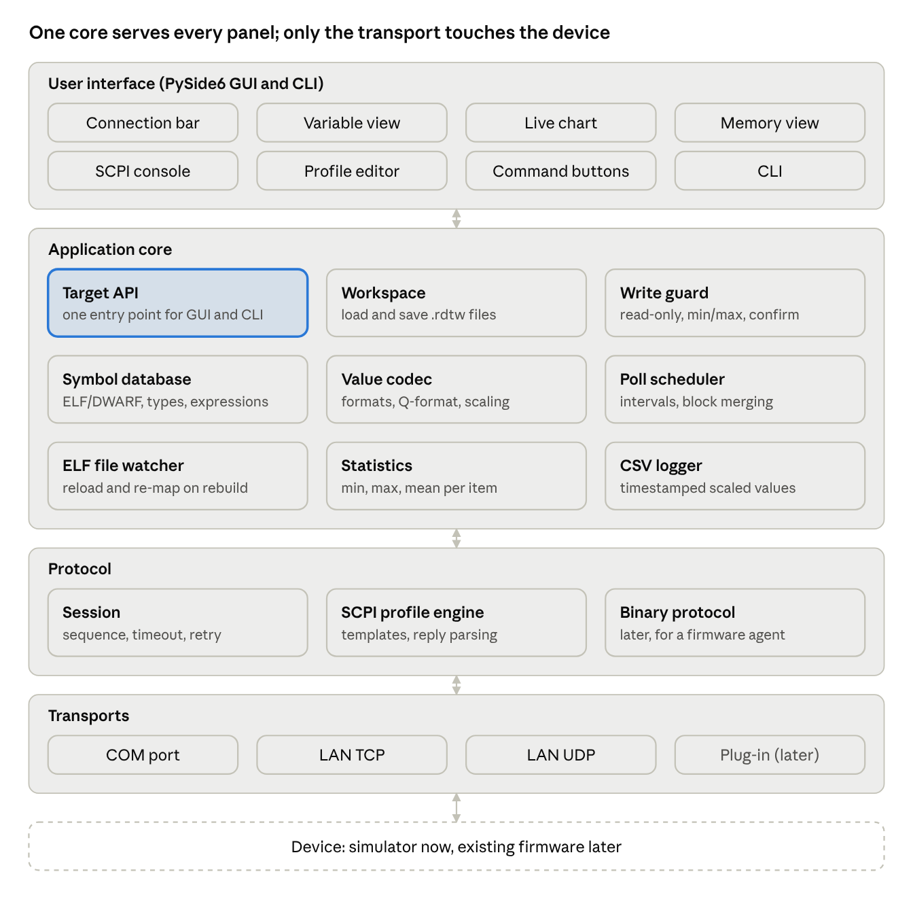
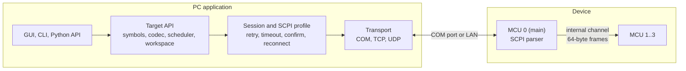

# RDT Design Document

RDT reads and writes a running device's firmware variables and raw memory over the link the product already has (a COM port or LAN), using the firmware's ELF file to turn names into addresses and types. No JTAG or SWD probe is needed.

This file is the single design document for RDT. Section 2 lists every requirement with an ID and its status, and section 4 has one design section per requirement, describing how it is built and where the code is. Requirements and decisions were set by rani; the date each was set is given where it is known.

**Contents**

1. [Overview](#1-overview)
2. [Requirements](#2-requirements)
3. [Architecture](#3-architecture)
4. [Design by requirement](#4-design-by-requirement)
5. [Firmware specification](#5-firmware-specification)
6. [Testing](#6-testing)
7. [Milestones](#7-milestones)
8. [Decision log](#8-decision-log)
9. [Appendix: binary protocol (planned)](#9-appendix-binary-protocol-planned)

## 1. Overview

The host application loads one ELF file per MCU and reads its DWARF debug information. It resolves an expression the user types, such as `main:motor.speed` or `motorctl:cfg.gains[2]`, into an address, a size and a type. It then reads or writes those bytes through SCPI commands that the user defines, and shows the result as a typed value.

- **Users:** firmware and test engineers on a bench or a trusted lab network.
- **Scope now:** the PC application only. The firmware side is a specification (section 5); a Python simulated device implements it, so the application is built and tested end to end before the firmware has its memory commands.
- **Not in v1:** breakpoints, stepping, local (stack) variables, flashing, authentication, map files.

**Status (2026-10-12):** milestones M0 to M4 are done. The simulator, host core, CLI, symbols, workspace, GUI, watch tabs, live chart, statistics, CSV log and console features are all built and tested. The firmware memory commands are not written yet.

## 2. Requirements

Status values:

- **Done:** implemented in the PC application and covered by tests.
- **Firmware:** a requirement on the firmware. The simulator implements it today; the real firmware will implement it later.
- **In review:** built in an open pull request, not merged yet.
- **Planned:** agreed but not built yet.
- **Removed:** was built or agreed, then dropped by rani.

Each requirement links to its design section.

### 2.1 Platform and scope

| ID | Requirement | Status | Design |
| --- | --- | --- | --- |
| PLT-1 | The PC application runs on Windows; the code stays portable so Linux can be added later (2026-10-05) | Done | [D-PLT-1](#d-plt-1-windows-application-portable-code) |
| PLT-2 | The host is written in Python with a Qt GUI (PySide6) (2026-10-05) | Done | [D-PLT-2](#d-plt-2-python-and-pyside6) |
| PLT-3 | The firmware is written in C; no C++ support is needed (2026-10-05) | Done | [D-PLT-3](#d-plt-3-c-firmware-only) |
| PLT-4 | The design is MCU-independent; byte order and pointer size come from each ELF (2026-10-05) | Done | [D-PLT-4](#d-plt-4-mcu-independent) |
| PLT-5 | No authentication; RDT is used on trusted benches and networks (2026-10-05) | Done | [D-PLT-5](#d-plt-5-no-authentication) |
| PLT-6 | The GUI, the CLI and a Python API sit on one core, so anything the GUI does can be scripted (2026-10-05) | Done | [D-PLT-6](#d-plt-6-one-core-three-front-ends) |

### 2.2 Device link

| ID | Requirement | Status | Design |
| --- | --- | --- | --- |
| LNK-1 | Connect over a COM port, with the port and baud rate chosen by the user | Done | [D-LNK-1](#d-lnk-1-com-port) |
| LNK-2 | Connect over LAN with a plain TCP socket, IP address and port entered by the user; no VISA (2026-10-05) | Done | [D-LNK-2](#d-lnk-2-tcp) |
| LNK-3 | Connect over LAN with UDP, one command per datagram | Done | [D-LNK-3](#d-lnk-3-udp) |
| LNK-4 | More channels can be added later as plug-in transports, with nothing above the transport changing | Done | [D-LNK-4](#d-lnk-4-plug-in-transports) |
| LNK-5 | On link loss RDT reconnects on its own; values grey out and writes are refused while the link is down (2026-10-05) | Done | [D-LNK-5](#d-lnk-5-auto-reconnect) |
| LNK-6 | Other tools may use the firmware's SCPI port over LAN at the same time as RDT (2026-10-05) | Done | [D-LNK-6](#d-lnk-6-sharing-the-link-with-other-tools) |
| LNK-7 | On connect and every reconnect, check that the device answers | Done | [D-LNK-7](#d-lnk-7-probe-on-connect) |

### 2.3 SCPI commands

| ID | Requirement | Status | Design |
| --- | --- | --- | --- |
| SCPI-1 | No SCPI command is hard-coded; the user defines the read and write commands and the reply format in an SCPI profile (2026-10-05) | Done | [D-SCPI-1](#d-scpi-1-scpi-profile) |
| SCPI-2 | Memory is read with one command, `read mcu,startAddress,size`; one reply carries up to a configurable maximum response size (2026-10-05) | Done | [D-SCPI-2](#d-scpi-2-block-read) |
| SCPI-3 | Memory is written one value per command, `write mcu,address,value,size`, with the value as a raw hex integer (2026-10-05) | Done | [D-SCPI-3](#d-scpi-3-single-value-write) |
| SCPI-4 | Read replies can be hex text, comma-separated bytes, decimal bytes, an IEEE 488.2 block, or matched by a regular expression | Done | [D-SCPI-4](#d-scpi-4-reply-formats) |
| SCPI-5 | A failed command sends no reply and its error goes only to the error queue; RDT copes with that (2026-10-11) | Done | [D-SCPI-5](#d-scpi-5-failed-commands-send-no-reply) |
| SCPI-6 | Every write is confirmed by reading the value back | Done | [D-SCPI-6](#d-scpi-6-write-confirmation) |
| SCPI-7 | If the firmware offers a size query, RDT uses it to set the maximum response size on connect | Done | [D-SCPI-7](#d-scpi-7-size-query) |
| SCPI-8 | A manual SCPI console sends any command and shows the raw reply (2026-10-05) | Done | [D-SCPI-8](#d-scpi-8-scpi-console) |
| SCPI-9 | The profile can be edited in the GUI, with a preview of the commands and a test read | Done | [D-SCPI-9](#d-scpi-9-profile-editor) |

### 2.4 Multiple MCUs

| ID | Requirement | Status | Design |
| --- | --- | --- | --- |
| MCU-1 | The device has several MCUs. The main MCU (MCU 0) owns the external link and forwards requests to the others over an internal channel (2026-10-11) | Done | [D-MCU-1](#d-mcu-1-main-and-secondary-mcus) |
| MCU-2 | Each MCU has its own ELF file (2026-10-11) | Done | [D-MCU-2](#d-mcu-2-one-elf-per-mcu) |
| MCU-3 | Every SCPI memory command names the MCU as an extra parameter (2026-10-11) | Done | [D-MCU-3](#d-mcu-3-mcu-in-every-command) |
| MCU-4 | Secondary MCUs use fixed 64-byte commands and responses; the main MCU's firmware splits larger reads (2026-10-11) | Done | [D-MCU-4](#d-mcu-4-64-byte-internal-frames) |
| MCU-5 | One global maximum response size; the timeout can be set per MCU (2026-10-11) | Done | [D-MCU-5](#d-mcu-5-per-mcu-timeout) |
| MCU-6 | A secondary MCU that stops answering is greyed out alone, and the others keep working (2026-10-11) | Done | [D-MCU-6](#d-mcu-6-silent-mcu) |
| MCU-7 | Every expression starts with the MCU's name, always, MCU 0 included; there is no default MCU (2026-10-11) | Done | [D-MCU-7](#d-mcu-7-mcu-name-prefix) |
| MCU-8 | Values from all MCUs can be mixed in one watch list, chart and CSV log (2026-10-11) | Done | [D-MCU-8](#d-mcu-8-mixed-mcus) |

### 2.5 Symbols

| ID | Requirement | Status | Design |
| --- | --- | --- | --- |
| SYM-1 | Symbols come from the ELF's DWARF information only; map files are not supported (2026-10-05) | Done | [D-SYM-1](#d-sym-1-elf-and-dwarf-only) |
| SYM-2 | List every global and file-static variable with its address, size and type, and search them | Done | [D-SYM-2](#d-sym-2-symbol-list) |
| SYM-3 | Resolve expressions: members, array cells, pointers, file-statics | Done | [D-SYM-3](#d-sym-3-expressions) |
| SYM-4 | Read or write a raw address, as a basic type or as any type from the ELF | Done | [D-SYM-4](#d-sym-4-raw-addresses) |
| SYM-5 | An expression through a pointer follows the pointer when the firmware moves it | Done | [D-SYM-5](#d-sym-5-pointers) |
| SYM-6 | Loading a large ELF is fast after the first time | Done | [D-SYM-6](#d-sym-6-symbol-cache) |
| SYM-7 | When an ELF is rebuilt, RDT reloads it and finds every watched item again by name (2026-10-05) | Done | [D-SYM-7](#d-sym-7-elf-rebuild-detection) |
| SYM-8 | Check on connect that each ELF matches the firmware running on its MCU (2026-10-12) | Done | [D-SYM-8](#d-sym-8-build-identity-check) |

### 2.6 Memory access

| ID | Requirement | Status | Design |
| --- | --- | --- | --- |
| MEM-1 | Read and write any address, with or without a symbol | Done | [D-MEM-1](#d-mem-1-raw-memory-access) |
| MEM-2 | Refuse any access outside the ELF's memory and the ranges the user listed (2026-10-05) | Done | [D-MEM-2](#d-mem-2-known-memory-only) |
| MEM-3 | Refuse writes to read-only ELF sections | Done | [D-MEM-3](#d-mem-3-read-only-sections) |
| MEM-4 | Never merge a peripheral range into a larger read; read each item there alone at its exact size (2026-10-05) | Done | [D-MEM-4](#d-mem-4-peripheral-ranges) |
| MEM-5 | List RAM and flash banks as memory ranges, matching the firmware's own table of readable regions (ITCM, Flash, DTCM, AXI SRAM, SRAM1-4, Backup SRAM); reads in them merge like reads in ELF sections (2026-10-12) | Done | [D-MEM-5](#d-mem-5-memory-ranges) |

### 2.7 Values and display

| ID | Requirement | Status | Design |
| --- | --- | --- | --- |
| VAL-1 | Decode bytes into typed values and encode values into bytes: integers, floats, bools, enums, bit fields, `char` strings, pointers | Done | [D-VAL-1](#d-val-1-typed-values) |
| VAL-2 | Show structs and arrays fully expanded, nested to any depth, like a debugger (2026-10-05) | Done | [D-VAL-2](#d-val-2-structs-and-arrays) |
| VAL-3 | Display formats per item: decimal, hex, binary, char (2026-10-05) | Done | [D-VAL-3](#d-val-3-display-formats) |
| VAL-4 | Fixed-point (Qm.n) and linear scaling with a unit; writes apply the inverse (2026-10-05) | Done | [D-VAL-4](#d-val-4-scaling) |
| VAL-5 | Enum names and bit fields from DWARF (2026-10-05) | Done | [D-VAL-5](#d-val-5-enums-and-bit-fields) |
| VAL-6 | A value wider than the firmware's write size is written in pieces | Done | [D-VAL-6](#d-val-6-wide-writes) |

### 2.8 Write safety

| ID | Requirement | Status | Design |
| --- | --- | --- | --- |
| WS-1 | A per-item read-only flag (2026-10-05) | Done | [D-WS-1](#d-ws-1-read-only-items) |
| WS-2 | Per-item minimum and maximum, checked before every write (2026-10-05) | Done | [D-WS-2](#d-ws-2-limits) |
| WS-3 | An optional confirm before writing (2026-10-05) | Done | [D-WS-3](#d-ws-3-confirm-before-writing) |
| WS-4 | A global setting that makes every item read-only by default (2026-10-12) | Done | [D-WS-4](#d-ws-4-global-read-only-default) |

### 2.9 Polling

| ID | Requirement | Status | Design |
| --- | --- | --- | --- |
| POLL-1 | A global polling interval, 500 ms by default, which can be turned off (2026-10-05) | Done | [D-POLL-1](#d-poll-1-global-interval) |
| POLL-2 | Each watched item can use the global interval, its own interval, or be read only by hand (2026-10-05) | Done | [D-POLL-2](#d-poll-2-per-item-interval) |
| POLL-3 | Nearby items are read together in one command, so they cost one round trip and come from the same moment | Done | [D-POLL-3](#d-poll-3-block-merging) |
| POLL-4 | A slow link makes items fall behind instead of queueing, and each item shows the rate it actually gets | Done | [D-POLL-4](#d-poll-4-falling-behind) |

### 2.10 Watch tabs

| ID | Requirement | Status | Design |
| --- | --- | --- | --- |
| TAB-1 | A workspace holds several named watch tabs, each with its own list of items (2026-10-11) | Done | [D-TAB-1](#d-tab-1-several-watch-tabs) |
| TAB-2 | One expression in several tabs is one item with one set of settings | Done | [D-TAB-2](#d-tab-2-shared-items) |
| TAB-3 | Every tab keeps polling, not only the one in front | Done | [D-TAB-3](#d-tab-3-every-tab-polls) |
| TAB-4 | Tabs can be added, renamed, removed and reordered in the GUI and the CLI | Done | [D-TAB-4](#d-tab-4-managing-tabs) |

### 2.11 GUI

| ID | Requirement | Status | Design |
| --- | --- | --- | --- |
| GUI-1 | The GUI is the primary interface (2026-10-05) | Done | [D-GUI-1](#d-gui-1-main-window) |
| GUI-2 | A connection bar to choose the transport and its settings, connect and see the link state | Done | [D-GUI-2](#d-gui-2-connection-bar) |
| GUI-3 | A variable browser to search an MCU's variables and add them to a watch tab | Done | [D-GUI-3](#d-gui-3-variable-browser) |
| GUI-4 | A watch tree showing value, type, address and achieved rate, with values edited in place | Done | [D-GUI-4](#d-gui-4-watch-tree) |
| GUI-5 | A memory view: hex and ASCII dump of any range, editable | Done | [D-GUI-5](#d-gui-5-memory-view) |
| GUI-6 | The GUI never blocks on the device | Done | [D-GUI-6](#d-gui-6-device-worker-thread) |

### 2.12 Live chart

| ID | Requirement | Status | Design |
| --- | --- | --- | --- |
| CHT-1 | Plot any numeric watched value over time, from any MCU (2026-10-05) | Done | [D-CHT-1](#d-cht-1-chart) |
| CHT-2 | Pause, zoom, pan and two cursors with values and time difference | Done | [D-CHT-2](#d-cht-2-pause-zoom-and-cursors) |
| CHT-3 | Up to four Y axes, with signals of the same unit sharing one | Done | [D-CHT-3](#d-cht-3-y-axes) |
| CHT-4 | 10 minutes of history in memory | Done | [D-CHT-4](#d-cht-4-history) |

### 2.13 Statistics and logging

| ID | Requirement | Status | Design |
| --- | --- | --- | --- |
| STA-1 | Minimum, maximum, mean and sample count per watched value, with a reset (2026-10-05) | Done | [D-STA-1](#d-sta-1-statistics) |
| CSV-1 | Log watched values to a CSV file with timestamps (2026-10-05) | Done | [D-CSV-1](#d-csv-1-csv-log) |

### 2.14 Workspace

| ID | Requirement | Status | Design |
| --- | --- | --- | --- |
| WSP-1 | One workspace file holds the connection, the SCPI profile, the MCUs and their ELFs, the watch tabs with every item's settings, and the chart layout (2026-10-05) | Done | [D-WSP-1](#d-wsp-1-workspace-file) |
| WSP-2 | Workspaces from older versions still open | Done | [D-WSP-2](#d-wsp-2-older-workspaces) |
| WSP-3 | The last workspace reopens when the GUI starts (2026-10-12) | Done | [D-WSP-3](#d-wsp-3-reopen-last-workspace) |

### 2.15 Command line and API

| ID | Requirement | Status | Design |
| --- | --- | --- | --- |
| CLI-1 | A command line, `rdt`, for every device operation and for editing the workspace | Done | [D-CLI-1](#d-cli-1-rdt-command-line) |
| CLI-2 | A Python API for scripts | Done | [D-CLI-2](#d-cli-2-python-api) |
| CLI-3 | Every failure is reported with a clear, specific error | Done | [D-CLI-3](#d-cli-3-errors) |

### 2.16 Simulator

| ID | Requirement | Status | Design |
| --- | --- | --- | --- |
| SIM-1 | A simulated device stands in for the firmware until it has its memory commands (2026-10-05) | Done | [D-SIM-1](#d-sim-1-simulated-device) |

### 2.17 Console

Console features taken from ComPort-Zone (an open serial terminal); rani approved each on 2026-10-12. Ideas only: ComPort-Zone has no licence, so none of its code is used.

| ID | Requirement | Status | Design |
| --- | --- | --- | --- |
| CON-1 | The console keeps its command history across launches, per user and shared by the GUI and CLI; it can be listed, re-sent and deleted (2026-10-12) | Done | [D-CON-1](#d-con-1-saved-history) |
| CON-2 | Tab completion in the console from the history and the imported known commands; with several matches Tab lists them all (2026-10-12; sources narrowed and Tab added 2026-10-12) | Done | [D-CON-2](#d-con-2-autocomplete) |
| CON-3 | The console transcript shows each line's time to the millisecond (optional) and colours commands, replies, errors and notes differently (2026-10-12) | Done | [D-CON-3](#d-con-3-timestamps-and-colours) |
| CON-4 | Search the console transcript (Ctrl+F) with highlighted matches and a counter; Ctrl+K clears it (2026-10-12) | Done | [D-CON-4](#d-con-4-transcript-search) |
| CON-5 | Log the console session to a text file, every line with date, time and direction (2026-10-12) | Done | [D-CON-5](#d-con-5-session-log) |
| CON-6 | Convert a transcript selection between hex and text (2026-10-12) | Done | [D-CON-6](#d-con-6-hex-and-text) |
| CON-7 | A list of the device's known commands, kept in the workspace, imported from and exported to a file, and picked from in the console (2026-10-12) | Done | [D-CON-7](#d-con-7-known-commands) |
| CON-8 | `rdt send --expect REGEX` checks a reply, with its own exit code (2026-10-12) | Done | [D-CON-8](#d-con-8-checking-a-reply) |
| CON-9 | `rdt console` can reconnect and show the device info without leaving (2026-10-12) | Done | [D-CON-9](#d-con-9-reconnect-and-info-in-the-console) |
| CON-10 | Send a serial break on a COM port link (2026-10-12) | Done | [D-CON-10](#d-con-10-serial-break) |
| CON-11 | The console text size can be changed and long lines wrapped or not, remembered per user (2026-10-12) | Done | [D-CON-11](#d-con-11-text-size-and-wrap) |
| CON-12 | The GUI lists every keyboard shortcut in one window (2026-10-12) | Done | [D-CON-12](#d-con-12-keyboard-shortcuts) |
| CON-13 | The GUI console looks like a terminal: dark, each line with its time and a TX, RX, ERR or SYS tag, and the prompt as its last line, with no separate line or button for sending (2026-10-12) | Done | [D-CON-13](#d-con-13-terminal-look) |
| CON-14 | Commands are typed on the console's next free line, inside the transcript, and the best suggestion from the history or the known commands shows while typing, without pressing Tab (2026-10-12) | Done | [D-CON-14](#d-con-14-typing-in-the-transcript) |

### 2.18 Removed and not in v1

| ID | Item | Status | Design |
| --- | --- | --- | --- |
| RM-1 | User-defined SCPI command buttons. Built in M3, removed by rani on 2026-10-11; the SCPI console sends any command | Removed | [D-RM-1](#d-rm-1-command-buttons) |
| RM-2 | Map file input (2026-10-05, ELF only) | Removed | [D-SYM-1](#d-sym-1-elf-and-dwarf-only) |
| RM-3 | Not in v1 (2026-10-05): multi-address read command, on-target recorder, alarms, stimulus, computed values, log replay, dashboards | Removed | none |
| RM-4 | Binary protocol, a faster alternative to SCPI | Planned | [Appendix](#9-appendix-binary-protocol-planned) |
| RM-5 | Not taken from ComPort-Zone (2026-10-12): command files (scripts), running a file of commands, sending several pasted lines and several console tabs, all declined by rani; its control panel (covered by watch tabs) was not proposed | Removed | none |

Requirements on the firmware itself (FW-1 to FW-9) are in [section 5](#5-firmware-specification).

## 3. Architecture



The PC application has four layers, and each talks only to the layer below it:

1. **Front ends:** the GUI, the CLI and the Python API. All of them call the Target API and never the layers below it.
2. **Core:** the Target API, the workspace, the write guard, the symbol database, the value codec, the poll scheduler, the ELF watcher, statistics and the CSV log.
3. **Session and protocol:** sequencing, timeouts, retries, write confirmation, silent MCUs and reconnect; the SCPI profile engine.
4. **Transport:** COM port, TCP and UDP byte movers.

Everything that knows about names and types lives on the PC. The firmware only ever sees an MCU number, an address and a byte count. That keeps the firmware side small and lets the symbol handling grow without touching it. Swapping the simulator for the real firmware, or SCPI for another protocol, changes nothing above the protocol layer.



### Package layout

```
rdt/
  transport/   base.py, tcp.py, udp.py, serial.py   byte movers
  protocol/    scpi.py                              profile commands, reply framing
  profile.py                                        SCPI profile: templates, reply formats
  session.py                                        timeouts, retries, write confirm, silent MCUs, reconnect
  memmap.py                                         ELF sections and listed ranges; access checks
  symbols/     elf.py, types.py, expr.py, values.py DWARF symbol table, type model, expressions, typed values
  codec.py                                          raw scalar types
  target.py                                         Target API and target file
  scheduler.py                                      poll scheduler: block merging, one poll for many items
  stats.py, csvlog.py                               statistics, CSV log
  workspace.py, scaling.py, tomlw.py                workspace file, display formats and scaling, write safety
  console.py                                        console history, autocomplete, session log, hex/text, known commands
  cli.py                                            command line
  gui/         app.py       main window, connection bar, menus, polling tick, ELF check
               device.py    device worker thread
               variables.py watch tabs, watch tree, item settings, symbol browser
               panels.py    memory view, SCPI console, profile editor, MCU dialog
               chart.py     live chart (pyqtgraph)
sim/                                                simulated device
tests/                                              pytest suite, ELF corpus
```

User guides: [CLI.md](CLI.md), [GUI.md](GUI.md), [SIMULATOR.md](SIMULATOR.md).

## 4. Design by requirement

### 4.1 Platform and scope

#### D-PLT-1 Windows application, portable code

RDT is a Python package installed with `python -m pip install -e .[dev]`. It uses no Windows-only API: serial ports go through pyserial, sockets through the standard library, and paths through `pathlib`. Windows-specific defaults are limited to the symbol cache folder (`%LOCALAPPDATA%\rdt\cache`) and COM port names. CI runs the whole test suite on both Windows and Linux, with Python 3.11 and 3.13, which keeps the code portable.

#### D-PLT-2 Python and PySide6

The GUI uses PySide6, chosen because it packages into a single Windows installer and has a fast plotting library to pair with (pyqtgraph). The other dependencies are pyelftools for DWARF and pyserial for COM ports. They are listed in `pyproject.toml`, which also installs the commands `rdt`, `rdt-gui` and `rdt-sim`.

#### D-PLT-3 C firmware only

The DWARF reader in `rdt/symbols/elf.py` handles the C type model: base types, pointers, arrays, structs, unions, enums, bit fields and typedefs. C++ features (classes, namespaces, templates, references) are not read.

#### D-PLT-4 MCU-independent

Nothing in RDT assumes an MCU. Byte order and pointer size come from each MCU's ELF header (`rdt/symbols/elf.py`), and the profile's `byte_order` is used only for an MCU without an ELF. The test ELF corpus covers little-endian Cortex-M4, big-endian ARM and x86-64 with 64-bit pointers.

#### D-PLT-5 No authentication

RDT sends no credentials, and the firmware specification has none. Anyone who can reach the device's SCPI port can read and write its memory, so RDT is meant for trusted networks. The firmware specification keeps two cheap controls for that reason (FW-9).

#### D-PLT-6 One core, three front ends

`rdt.Target` (`rdt/target.py`) is the one API for device access, and `rdt.Workspace` (`rdt/workspace.py`) adds the watch tabs, scaling and write safety on top. The CLI (`rdt/cli.py`) and the GUI (`rdt/gui/`) only call these two, and scripts can use them directly (D-CLI-2).

### 4.2 Device link

#### D-LNK-1 COM port

`rdt/transport/serial.py` opens the port with pyserial. In the target file:

```toml
[connection]
transport = "serial"
port      = "COM5"
baud      = 115200
```

On the CLI: `--serial COM5 --baud 115200`. In the GUI the connection bar lists the COM ports and offers common baud rates. A COM port can be opened by one program only, so it is never shared (D-LNK-6).

#### D-LNK-2 TCP

`rdt/transport/tcp.py` opens a plain socket to `address = "192.168.1.20:5025"` (CLI `--tcp HOST:PORT`). Replies are framed by the profile's line terminator, or by the IEEE 488.2 block header for `ieee_block` replies.

#### D-LNK-3 UDP

`rdt/transport/udp.py` sends one command per datagram and takes one reply per datagram (CLI `--udp HOST:PORT`). A datagram can be lost silently, so a read that times out is simply sent again. A write that times out is never repeated blindly: RDT reads the value back first and writes again only if the read-back shows the value missing (D-SCPI-6).

#### D-LNK-4 Plug-in transports

Every transport subclasses `Transport` in `rdt/transport/base.py`: `open()`, `close()`, `write(bytes)`, and the reads `read_until(sep, deadline)` and `read_exact(n, deadline)`. Adding a channel (CAN, USB bulk, BLE) means one new subclass and a new `transport` value in the target file. The session, the protocol and everything above stay the same.

#### D-LNK-5 Auto-reconnect

The session (`rdt/session.py`) has three link states: up, down and closed. The link goes down when the connection breaks, or when a command times out and the error query gets no reply either.

- **While the link is down:** every access fails at once with `LinkDown`, so writes are refused. The GUI shows `link down` in grey with the last values kept, and the CSV log and the chart mark the gap.
- **Reconnecting:** a background thread reconnects with growing delays of 0.25, 0.5, 1, 2, 4 and then 5 s, and sends the probe each time (D-LNK-7).
- **After reconnecting:** polling resumes at the next due time, and the CSV log records `link up`.

`watch`, `console` and the GUI reconnect on their own. The other CLI commands are one-shot and fail at once.

#### D-LNK-6 Sharing the link with other tools

Other tools may use the firmware's SCPI port over LAN while RDT is connected.

- **Own connection:** each tool has its own TCP connection, and the firmware answers on the connection that asked (FW-6). Over UDP it replies to the sender's address and port.
- **Stray replies:** before each command the session drops anything still waiting in the input, so a late reply to an earlier command is never taken for the current one. Every read reply is checked against the requested size; one that doesn't fit is discarded and the read is sent again.
- **Busy device:** a read that times out is sent again with a growing delay, starting at 50 ms and doubling, up to `retries` extra attempts (2 by default).
- **Shared error queue:** another tool's errors can appear in RDT's error query, and another tool can read RDT's error first. RDT therefore never depends on the error queue: errors are only a hint (D-SCPI-5), and writes are confirmed by read-back (D-SCPI-6).

A simulator test runs a second SCPI client against the device while RDT polls.

#### D-LNK-7 Probe on connect

The profile's `probe` (default `*IDN?`) is sent on connect and on every reconnect. A device that doesn't answer it fails the connect, or keeps the link down while reconnecting. An empty `probe` skips the check. `rdt info` shows the reply.

### 4.3 SCPI commands

#### D-SCPI-1 SCPI profile

The profile (`rdt/profile.py`) is a `[scpi]` TOML table. It can be a file of its own (`profile = "fw_profile.toml"`) or sit inline in the target file or workspace. The simulator reads the same table, so a command set can be tried on the simulator before the firmware has it.

```toml
[scpi]
name         = "Motor controller v3"
read         = "MEMory:READ? {mcu},{addr},{len}"
write        = "MEMory:WRITE {mcu},{addr},{value},{size}"
value_format = "0x{value:X}"   # raw integer; floats as their bit pattern
addr_format  = "0x{addr:08X}"
max_write    = 4               # largest value one write accepts: 1, 2, 4 or 8 bytes
size_query   = "MEMory:MAX?"   # optional; its reply sets max_response on connect
data_format  = "hex"           # hex | bytes_csv | decimal | ieee_block
reply_regex  = ""              # optional; group "data" (or group 1) holds the data
byte_order   = "little"        # only for an MCU without an ELF
max_response = 1024            # bytes of data one read reply can carry
error_query  = "SYSTem:ERRor?"
probe        = "*IDN?"         # sent on connect and reconnect
terminator   = "\n"
timeout_ms   = 500
retries      = 2               # extra attempts after a read times out
```

Placeholders: `{mcu}`, `{addr}`, `{len}`, `{value}` and `{size}`. `{addr}` is written with `addr_format` and `{value}` with `value_format`. The profile checks itself when loaded: an unknown placeholder, an unknown data format, a bad `max_write` or a non-positive timeout is a `ConfigError`. The GUI's profile editor also refuses a template that can't work, such as a read without `{len}`. A profile may also list `[[ranges]]` for every MCU, or for one MCU with `mcu = "name"` (D-MEM-2).

#### D-SCPI-2 Block read

`Session.read` (`rdt/session.py`) splits any read into pieces of at most `max_response` bytes and sends one read command per piece. The poll scheduler packs nearby items into those reads (D-POLL-3), which is what makes polling fast over SCPI. A multi-address read command is not planned; it would only be considered if scattered variables turn out to poll too slowly.

#### D-SCPI-3 Single-value write

A write sends one value per command. The value is the raw integer of the variable's bytes, in the variable's byte order, written with `value_format`. A float is sent as its bit pattern (1.5 becomes `0x3FC00000`), so the firmware never parses a float. `{size}` is the access width, so the firmware does a single store of the right width. Values wider than `max_write` are split (D-VAL-6). A later firmware may add a buffer write; the profile would then get a second write template.

#### D-SCPI-4 Reply formats

`Profile.parse_read` decodes a read reply with `data_format`:

| Format | 4 bytes `00 00 C0 3F` |
| --- | --- |
| `hex` | `0000C03F` |
| `bytes_csv` | `00,00,C0,3F` |
| `decimal` | `0,0,192,63` |
| `ieee_block` | `#14` followed by the 4 raw bytes |

For any other reply shape, `reply_regex` picks the data out of the reply (group `data`, or group 1) and `data_format` decodes it. `reply_regex` cannot be combined with `ieee_block`.

#### D-SCPI-5 Failed commands send no reply

The firmware sends nothing back when a command fails; the error goes only to the error queue. So in RDT a failure looks like a timeout:

1. After a read times out, the session sends the profile's `error_query` once.
2. If the queue has an error, it is attached to the timeout as a hint (`CommandTimeout.hint`) and shown to the user. The queue is shared with other tools (D-LNK-6), so the hint is never trusted for anything else.
3. If the error query gets no reply either, the device is not answering: the link is marked down and RDT reconnects (D-LNK-5).
4. Otherwise the read is sent again with a growing delay, up to `retries` times.

A `-240` error in the queue marks a secondary MCU silent (D-MCU-6). In the console, a query with no reply shows `(no reply; error queue: ...)`.

#### D-SCPI-6 Write confirmation

A write gets no reply whether it succeeds or fails, so `Session.write` reads the written bytes back after every write and compares them. A mismatch raises `WriteNotConfirmed` with both values. Over UDP, a write whose read-back shows it missing is sent again, and only then. Bit-field writes are confirmed the same way (D-VAL-5).

#### D-SCPI-7 Size query

If the profile has a `size_query` (default `MEMory:MAX?`), the session sends it on connect, and its reply replaces `max_response` for that connection. Without it, or if it gets no reply, the profile's `max_response` is used. `rdt info` shows the value in use.

#### D-SCPI-8 SCPI console

- **GUI:** a console panel (`rdt/gui/panels.py`) sends any typed command and shows the raw reply, with Up and Down for history. A command whose header ends in `?` waits for a reply. There is no error-queue button (removed 2026-10-12 at rani's request); typing `SYST:ERR?` reads one entry.
- **CLI:** `rdt console` offers the same, plus `.read EXPR`, `.write EXPR VALUE`, `.err` and `.quit`. `rdt send COMMAND` sends one command, and `rdt errors` empties the error queue.
- **Logging:** `-vv` on the CLI logs every command and reply, so the commands the scheduler actually sends can be checked.
- **More:** saved history, autocomplete, timestamps and colours, search, a session log and hex/text conversion are in [4.17 Console](#417-console).

#### D-SCPI-9 Profile editor

**Target > SCPI profile** in the GUI edits every field of the profile.

- **Preview:** the read and write commands are shown as they will be sent, and a template that can't work is refused, such as a read without `{len}`.
- **Test read:** while connected, it sends one read with the edited profile and shows the reply and the decoded bytes, before anything is applied.
- **Apply:** OK stores the profile inside the workspace and reconnects. **Target > Load profile file** points the workspace at a profile file instead.

### 4.4 Multiple MCUs

#### D-MCU-1 Main and secondary MCUs

MCU 0 is the main MCU; it owns the link and is required. The others have IDs 1, 2, 3 and so on. Each `[[mcu]]` in the target file has an `id`, a display `name`, an `elf`, an optional `timeout_ms` and optional `[[mcu.ranges]]`:

```toml
[[mcu]]
id   = 0
name = "main"
elf  = "build/main.elf"

  [[mcu.ranges]]          # a peripheral block (kind = "peripheral" is the default)
  name     = "GPIOA"
  start    = 0x48000000
  size     = 0x400
  writable = true

  [[mcu.ranges]]          # a whole RAM bank (D-MEM-5)
  name  = "DTCM"
  kind  = "memory"
  start = 0x20000000
  end   = 0x2001FFFF      # the last address in it; or give size

[[mcu]]
id         = 1
name       = "motorctl"
elf        = "build/motorctl.elf"
timeout_ms = 1000
```

The GUI edits them in **Target > MCUs and ELF files**, and the CLI can replace them with `--mcu NAME=ID[:ELF]`.

#### D-MCU-2 One ELF per MCU

Each MCU (`Mcu` in `rdt/target.py`) loads its own ELF into its own symbol table and memory map. Symbols, memory ranges, ELF rebuild detection and the planned build-ID check all work per MCU.

#### D-MCU-3 MCU in every command

The profile's read and write templates take `{mcu}`, filled with the MCU's ID: `MEMory:READ? 1,0x20000000,64`. Commands typed in the console are sent as typed.

#### D-MCU-4 64-byte internal frames

The PC sends the same read, up to `max_response`, to any MCU. For MCUs 1 and up, the main MCU's firmware splits it into 64-byte frames on the internal channel and joins the replies (FW-4), so `max_response` stays one global setting. A struct or array larger than 64 bytes on a secondary MCU is therefore read in pieces, and its fields may not come from the same moment; the CLI guide says so.

#### D-MCU-5 Per-MCU timeout

The profile's `timeout_ms` applies to every MCU, and an MCU's own `timeout_ms` overrides it (`Session.timeout_s`). Secondary MCUs usually need longer, because their reads are split behind MCU 0.

#### D-MCU-6 Silent MCU

When a secondary MCU stops answering, the main MCU sends no reply and puts `-240,"MCU not responding"` in the error queue (FW-5).

- **Marking it silent:** the session marks an MCU silent when the error query after a timeout returns `-240`. Because another LAN client may read that error first, it also marks it silent after three timeouts in a row while MCU 0 still answers the error query.
- **While silent:** its reads fail at once with `McuSilent` and its writes are refused, so the GUI greys out only that MCU's values. The other MCUs keep working.
- **Recovery:** the silent MCU is tried again every 2 s, and the first answer clears the state.

#### D-MCU-7 MCU name prefix

The expression parser (`rdt/symbols/expr.py`) requires the MCU's name before every expression: `main:motor.speed`, `motorctl:cfg.gains[2]`, `@motorctl:0x20000418:u32`. There is no default MCU. The name is the display name from the target file, and the watch tree, the chart legend and the CSV columns show it too.

#### D-MCU-8 Mixed MCUs

A watch tab, the chart and the CSV log can hold items from any MCUs, and every name shows its MCU (D-MCU-7). The scheduler plans reads per MCU (D-POLL-3), and every sample carries the PC time its reply arrived, so values from different MCUs share one time axis.

### 4.5 Symbols

#### D-SYM-1 ELF and DWARF only

`rdt/symbols/elf.py` reads the ELF with pyelftools and walks `.debug_info`. Every file-scope `DW_TAG_variable` with a fixed address becomes a symbol, and its type DIE is resolved into the type model in `rdt/symbols/types.py`: base types, pointers, arrays, structs, unions, enums, bit fields and typedefs. The firmware must be built with `-g`.

Map files are not read, because they have addresses but no types:

| | ELF with DWARF | Map file |
| --- | --- | --- |
| Address and size | Yes | Yes, size usually |
| Type, signedness, width | Yes | No |
| Struct members, array element type and count | Yes | No |
| Enum names | Yes | No |
| Standard across GCC, Clang, IAR, Keil | Yes (DWARF) | No, vendor-specific text |

A raw address with an explicit type still works with no symbols at all (D-SYM-4).

Not included: local variables, function-static variables, and variables the compiler kept only as constants.

#### D-SYM-2 Symbol list

- **CLI:** `rdt symbols MCU [PATTERN]` lists an MCU's variables with address, size and type. The pattern is a glob such as `motor*`, or any part of the name. `rdt ptype EXPR` shows where a variable is and its type's layout: member offsets, bit positions and enum values. It also takes a type name. Neither needs a device.
- **GUI:** the variable browser does the same (D-GUI-3).

#### D-SYM-3 Expressions

`rdt/symbols/expr.py` parses and resolves expressions into a `Location`: MCU, address, size and type.

| Expression | Meaning |
| --- | --- |
| `main:tick_count` | A global variable |
| `main:motor.speed` | A struct or union member, to any depth |
| `main:gains[2]`, `main:matrix[1][2]` | An array cell, bounds-checked |
| `main:*head`, `main:head->next->value`, `main:(*head).value`, `main:head[2]` | Following a pointer |
| `main:motor.c:state` | A file-static variable named with its source file, needed only when two files have a variable of that name |

Arithmetic, function calls and casts other than the raw-address form are not supported. A name, member or index that doesn't resolve raises `SymbolError`.

#### D-SYM-4 Raw addresses

`@MCU:ADDRESS:TYPE` reads memory with no symbol: `@main:0x20000010:u32`, with the types `u8 i8 u16 i16 u32 i32 u64 i64 f32 f64`. The type can also be any type in that MCU's ELF (a typedef, or a struct, union or enum tag), followed by members and cells: `@main:0x48000000:GPIO_TypeDef.ODR`.

#### D-SYM-5 Pointers

Following a pointer reads it from the device. A `Location` that goes through a pointer is marked dynamic, and it is resolved again before every read, so `main:head->value` follows `head` when the firmware moves it. In the GUI, **Watch what it points to** on a pointer row adds its target as an item.

#### D-SYM-6 Symbol cache

Reading DWARF takes a while for a large firmware, so the symbol table is cached on disk, keyed by the ELF's content hash. The cache is in `%LOCALAPPDATA%\rdt\cache` on Windows, `~/.cache/rdt` elsewhere, or the folder in `RDT_CACHE_DIR`. A rebuilt ELF gets a new entry, old entries can be deleted at any time, and a cache version number ignores entries written by an older reader.

#### D-SYM-7 ELF rebuild detection

`Target.refresh_elfs()` checks each ELF's size and modification time.

- **Waiting for the linker:** a changed file is reloaded only after it has been unchanged for 0.5 s, so a file the linker is still writing is left alone. A rebuilt file that can't be read keeps the old symbols.
- **Re-mapping:** after a reload, `Target.remap()` finds each watched item again by its expression, not by its old address.
- **In the GUI:** the check runs every second while connected. An item that moved or changed type turns orange, with a note in its tooltip and the status bar. An item that no longer exists stays in the tree in grey and shows `gone`. The variable browser reloads too.
- **In the CLI:** `rdt watch` prints a `#` line for each such item.
- **In the CSV log:** an `ELF rebuilt for MCU` event is recorded.

#### D-SYM-8 Build identity check

RDT compares a few bytes that differ between firmware builds, read from the device and from the ELF file. `Target.check_identity()` in `rdt/target.py` does it; helpers `elf_bytes` and `build_id_note` are in `rdt/memmap.py`.

- **What is compared:** each MCU's `identity` setting names a constant variable, such as a version string or a build-ID array (`identity = "firmware_name"` in `[[mcu]]`). Its bytes are taken from the ELF file's section data at the variable's address and read from the device. Without the setting, RDT uses the GNU build ID (`.note.gnu.build-id`) when the linker placed it in the firmware's memory (an allocated section). Without either, the MCU is not checked. This replaces the earlier plan of a CRC over an address range: a constant variable needs no new firmware command (FW-10).
- **When:** on connect, on `.reconnect` (the firmware may have been flashed), after an ELF is rebuilt and reloaded (D-SYM-7), and from Target > Check ELF identity.
- **Results:** `match`, `mismatch`, `unchecked` (nothing to compare, an unknown variable, or a variable with no value in the file, such as one in `.bss`) and `unread` (the MCU did not answer). Only `mismatch` has an effect.
- **On a mismatch:** every write to that MCU, typed or raw, is refused with `WriteRefused` naming both values (`device 'rdt-main', ELF 'rdt-mXin'`). Reads still work. The user can allow writes anyway: Target > Allow writes despite ELF mismatch in the GUI, `--allow-mismatch` on the CLI, `Target.allow_mismatch(mcu)` from Python. The permission lasts until the next check.
- **Shown:** in the GUI, each result is a console line and a mismatch also goes to the status bar in red. On the CLI, a mismatch is a warning on stderr, `rdt info` prints each MCU's result, and `rdt watch` prints a `#` line when a rebuilt ELF does not match.
- **Editing:** the GUI's MCU dialog has an Identity variable column. The example workspace and target file check `firmware_name` on MCU `main`.

### 4.6 Memory access

#### D-MEM-1 Raw memory access

- **CLI:** `rdt dump EXPR [LEN]` or `rdt dump MCU ADDR LEN` prints a hex and ASCII dump. `rdt poke MCU ADDR HEX` writes raw bytes, lowest address first, and confirms them by read-back.
- **GUI:** the memory view does the same (D-GUI-5).
- **Scripts:** `Target.read(mcu, addr, size)` and `Target.write(mcu, addr, data)`.

#### D-MEM-2 Known memory only

`rdt/memmap.py` builds a memory map per MCU from its ELF's allocated sections plus the listed ranges (`[[mcu.ranges]]`, or `[[ranges]]` in the profile with `mcu = "name"`). `Target._check` refuses an access outside them with `AccessRefused` before anything is sent. A read that starts inside a known region and runs past its end is refused too, unless the next section or memory range continues it. An access that touches a peripheral range must stay entirely inside it. The firmware's own region table is a second check (FW-7).

#### D-MEM-3 Read-only sections

Sections without the ELF write flag (`.text`, `.rodata`) are readable but not writable, so writes to them are refused with `AccessRefused`. A listed range is writable unless it has `writable = false`. A read-only ELF section stays read-only even where a writable memory range covers it (D-MEM-5).

#### D-MEM-4 Peripheral ranges

A range's `kind` is `"peripheral"` unless it says otherwise. Peripheral ranges hold registers, where reading one can clear a flag or pop a FIFO. The scheduler never merges an item in a peripheral range with anything else, and reads it alone at its exact size (D-POLL-3). A peripheral range may not overlap an ELF section or another range; that is a `ConfigError` when the file loads.

#### D-MEM-5 Memory ranges

Firmware often keeps a table of the regions it lets a debugger read, such as ITCM, Flash, DTCM, AXI SRAM, SRAM1 to SRAM4 and Backup SRAM. Each region becomes a range with `kind = "memory"`, in `[[mcu.ranges]]` or in the profile's `[[ranges]]`:

```toml
[[mcu.ranges]]
name     = "AXI SRAM"
kind     = "memory"
start    = 0x24000000
end      = 0x2407FFFF     # inclusive, as firmware tables write it; or size = 0x80000
writable = true
```

| | `kind = "peripheral"` (default) | `kind = "memory"` |
| --- | --- | --- |
| For | Register blocks | RAM and flash banks |
| Overlapping ELF sections or other ranges | Refused when the file loads | Allowed |
| Reads | Each item alone, at its exact size, never merged | Merged with nearby items, like reads in ELF sections |
| An access that runs past its end | Refused | Refused, unless another section or memory range continues it |
| `writable = false` | Writes refused | Writes refused; a read-only ELF section inside a writable memory range stays read-only |

- **Extent:** a range gives either `size` or `end`, the inclusive last address. Giving both, or neither, is a `ConfigError`, and so is an unknown `kind`.
- **Access checks:** `MemoryMap` in `rdt/memmap.py` keeps memory ranges alongside the ELF's sections. A read may span adjacent sections and memory ranges, so a variable at the edge of `.data` can be read with the bank around it. A write is checked against every area it touches, overlapping ones included, so a writable bank never makes `.rodata` writable.
- **Merging:** only peripheral ranges are kept out of block merging (D-POLL-3); memory ranges are treated like ELF sections.
- **Code:** `Range` and `RANGE_KINDS` in `rdt/profile.py`, `Area.kind` and `MemoryMap` in `rdt/memmap.py`. Tests are in `tests/test_host_memmap.py`, `tests/test_workspace.py` and `tests/test_host_cli.py`.

### 4.7 Values and display

#### D-VAL-1 Typed values

`rdt/symbols/values.py` decodes bytes into typed values and encodes them back, and `rdt/codec.py` handles the raw scalar types.

| Kind | Shown as | Written as |
| --- | --- | --- |
| Integer | decimal (and hex in the CLI), or the item's format | `42`, `-7`, `0x1F`, `0b101`; refused if it doesn't fit the type |
| Float, double | decimal | `1.5`, `2.5e3`; a hex integer is taken as the bit pattern |
| Bool | `true` / `false` | `true`, `false`, `1`, `0` |
| Enum | `NAME (n)` | an enumerator's name or its number |
| Bit field | its own value, extracted from the word that holds it | a number that fits the field's width (D-VAL-5) |
| `char` | the number and its character | a number or `'A'` |
| `char` array | a string, such as `"rdt-main"` | a string, padded with zeros |
| Pointer | the address and what it points to, such as `0x20000048 (&nodes[1])` or `0x00000000 (NULL)` | an address |
| Struct, union, array | every field and cell (D-VAL-2) | one field or cell at a time |

`uint8_t` and `int8_t` arrays stay numbers; only `char` arrays show as strings. Through the Python API, `Target.read_value` returns a number or bool, an `EnumValue` (an `int` with a `.name`), `bytes` for a `char` array, a dict for a struct and a list for an array.

#### D-VAL-2 Structs and arrays

A struct opens to all its fields and an array to all its cells, nested to any depth. `Target.read_rows` produces the display rows that both the CLI and the GUI use.

- **One block:** a struct or array is read in one block, so all of its fields come from the same moment (except on secondary MCUs, D-MCU-4).
- **Large arrays:** arrays show 100 cells at a time. The CLI takes `--max-cells N`; the GUI has **Show 100 more cells**.
- **GUI tree:** each struct and array has a header row with its type and address. A collapsed node is not read at all (D-POLL-4).
- **Editing:** a struct or array is edited one field or cell at a time. That is not atomic, since the firmware can run between two writes.

#### D-VAL-3 Display formats

Each integer item has `format = "dec" | "hex" | "bin" | "char"` in the workspace, set in the GUI's **Format** menu or with `rdt add --format`. The format applies to the item's integer fields and cells too. The CSV log always writes decimal (D-CSV-1).

#### D-VAL-4 Scaling

`rdt/scaling.py` applies, to a single value:

```
shown = raw / 2^q × scale + offset
```

- **Settings:** `q` is the fixed-point format (`Q15`, `Q31`, `Q3.12`, or a number of fraction bits). `scale` and `offset` default to 1 and 0, and `unit` is a label.
- **Writing:** a write takes the value in shown units, applies the inverse and writes the nearest raw value. A value whose raw form doesn't fit the type is refused, and a float variable keeps its fraction.
- **Where it applies:** scaling applies to single values, not to a struct or array. The watch tree, the chart, the statistics and the CSV log all use the shown value.

#### D-VAL-5 Enums and bit fields

Enum values come from DWARF and are shown as `NAME (n)`; a write takes the name or the number. A bit field is shown as its own value. A bit-field write reads the word that holds the field, changes the field, writes the word back and confirms it by read-back. If the firmware changes a neighbouring field in that moment, that change is lost; the CLI guide says so.

#### D-VAL-6 Wide writes

`split_write` in `rdt/session.py` cuts a value wider than `max_write` (a `double` or `int64` when the limit is 4) into aligned pieces, low address first, and sends one write each. The pieces are not atomic, and the whole value is confirmed by one read-back afterwards.

### 4.8 Write safety

The write guard lives in `Workspace.write` (`rdt/workspace.py`). It is used by the GUI, by `rdt write` with a workspace, and by scripts. The settings are per item, and they are shared by every tab the item is in (D-TAB-2).

#### D-WS-1 Read-only items

`read_only = true` refuses every write to the item with `WriteRefused`. On a struct or array it covers all its fields and cells. In the GUI, read-only values are grey and can't be edited.

#### D-WS-2 Limits

`min` and `max`, in shown units, are checked before the write is sent. A value outside them is refused with a message: in the GUI's status bar, or as an error on the CLI.

#### D-WS-3 Confirm before writing

`confirm = true` asks before writing, naming the item and the new value. In the GUI that is a dialog; on the CLI it is a terminal prompt, and `write -y` answers yes. A write that needs a confirm with no one to answer it (no terminal and no `-y`) is refused. On a struct or array it covers all its fields and cells.

#### D-WS-4 Global read-only default

`read_only = true` at the top of the workspace makes every item read-only unless the item itself says `read_only = false`. `Workspace.read_only_reason()` in `rdt/workspace.py` decides, in this order: the item's own `read_only = true`, then a watched struct or array it is inside that is read-only (D-WS-1), then an item or parent with `read_only = false` (writable), then the workspace default. An item without the key follows the default, so `read_only` on an item has three states: true, false, or not set.

- **Raw writes:** with the default on, writes with no item behind them are refused too: an expression that is not watched, the GUI's memory view, and `rdt poke`. SCPI commands typed in the console are not checked, since RDT cannot know what they do.
- **GUI:** Watch > All items read-only turns it on and off, and greys the values on the next read. The item settings dialog offers Workspace default, Read-only or Writable.
- **CLI:** `rdt read-only on|off` sets it and `rdt read-only` shows it; `rdt add EXPR --no-read-only` lets one item be written; `rdt list` mentions the default when it is on.

### 4.9 Polling

#### D-POLL-1 Global interval

The workspace's `poll_ms` (default 500) is the global interval, shown as **Poll** in the GUI's connection bar. `0` (Off) stops polling for every item that follows the global interval; items with their own interval keep polling. In `rdt watch`, `-i MS` replaces it.

#### D-POLL-2 Per-item interval

Each top-level item has `poll = "global" | "manual" | <ms>`. `global` follows the global interval, including later changes to it. A number keeps its own interval. `manual` reads the item only on demand: **Watch > Read all now** (F6) in the GUI, or once at the start of `rdt watch`. Every item is also read once on connect. Fields and cells are read with their parent, so they share its interval; to poll one field at another rate, add it as its own item (**Watch this on its own** in the GUI).

#### D-POLL-3 Block merging

`rdt/scheduler.py` plans each poll:

1. Collect every due item, from every tab, once each (D-TAB-3).
2. Group the items by MCU and sort them by address.
3. Merge items at most 32 bytes apart (`MERGE_GAP`) into one block of up to `max_response` bytes. The gaps between them are read too.
4. Never merge an item in a peripheral range; read it alone at its exact size (D-MEM-4). Items in memory ranges merge like items in ELF sections (D-MEM-5).
5. Send one read per block and decode every item from its block. Each `Sample` carries the PC time the reply arrived.
6. If a merged read fails, read its items again one by one, so one bad item fails alone.

`Workspace.read_many` runs one poll for the CLI and the GUI.

#### D-POLL-4 Falling behind

Only one poll runs at a time. In the GUI, a 50 ms tick looks for due items and starts a poll only when the last one has finished; `rdt watch` works the same way. A slow link (likely SCPI on a slow COM port) makes items fall behind instead of building a queue. The watch tree's **Rate** column shows the rate each item actually gets, so the limit is visible. Collapsed structs and arrays are not read, which keeps the link free; while the CSV log runs, or for a charted field, they are read anyway.

### 4.10 Watch tabs

#### D-TAB-1 Several watch tabs

A workspace has a list of `[[tab]]` tables, each with a `name` and its own ordered `[[tab.watch]]` items. Names are unique, ignoring case. A new workspace starts with one tab named `Watch`.

```toml
[[tab]]
name = "Motor"

  [[tab.watch]]
  expr = "main:motor.speed"
  unit = "rpm"

[[tab]]
name = "Overview"

  [[tab.watch]]
  expr = "main:motor.speed"   # the same item as in "Motor"
```

#### D-TAB-2 Shared items

An expression is one `Watch` object in the workspace, however many tabs show it. Its format, scaling, polling and write safety are the same in every tab; changing them in one tab changes them in all. The file writes the settings at the item's first place only. A later place may repeat them but must not differ, or the file fails to load with a `ConfigError`. Write safety is found by expression across all tabs.

#### D-TAB-3 Every tab polls

The poll collects what every tab has due, not only the tab in front. Each expression is read once per poll and its result goes to every tab that shows it. The chart and the CSV log therefore see items from all tabs.

#### D-TAB-4 Managing tabs

- **GUI:** the centre of the window is a tab bar of watch trees (`rdt/gui/variables.py`).
  - **Add:** **+**, a double-click on the empty tab bar, or **Watch > New tab** (Ctrl+Shift+T).
  - **Rename:** double-click a tab, or **Rename**.
  - **Remove:** **Remove** asks first if the tab has items. The last tab can't be removed.
  - **Move between tabs:** drag a tab to reorder it, and Ctrl+PgUp/PgDown switch tabs.
  - **Items:** an item's menu has **Also show in tab** and **Remove from this tab**. Variables added from the browser go to the tab in front.
- **CLI:**
  - `rdt tab add NAME`, `rdt tab rename NAME NEW` and `rdt tab remove NAME` manage tabs.
  - `rdt add EXPR --tab NAME` adds to a tab and creates it if it is new.
  - `rdt remove EXPR --tab NAME` removes from one tab, and from every tab without `--tab`.
  - `rdt list` prints the items per tab, and `read` and `watch` take `--tab NAME`.

### 4.11 GUI

#### D-GUI-1 Main window

`rdt-gui [workspace.rdtw]` (or `python -m rdt.gui`) opens one workspace. The window has the connection bar on top, the watch tabs in the centre, and docked panels for the variable browser, the chart, the memory view and the SCPI console. Every change is saved back to the workspace: the title shows `*` while there are unsaved changes, and closing asks whether to save. **File > New, Open, Save, Save as** work on `.rdtw` files. Opening a plain `.toml` target file starts an unsaved workspace, and Save asks for a `.rdtw` path.

#### D-GUI-2 Connection bar

- **Transport:** `tcp` or `udp` with an IP address and port, or `serial` with a COM port and baud rate.
- **Profile:** a button that opens the profile editor and shows the profile's name.
- **Connect / Disconnect** (F5), with a state light: green while the link is up, red while it is down and RDT is reconnecting, grey when not connected.
- **Poll:** the global interval (D-POLL-1).
- **Log CSV** (Ctrl+L): starts and stops the CSV log (D-CSV-1).

The connection fields can be edited only while disconnected. The console and the memory view are disabled unless the link is up.

#### D-GUI-3 Variable browser

The **Variables** panel lists the chosen MCU's globals from its ELF, filtered by the search box (`motor*`, `*count`). A double-click, or **Add to watch list**, adds the selected variables to the tab in front. **Watch > Add expression** (Ctrl+E) takes any expression the CLI takes.

#### D-GUI-4 Watch tree

Each tab's tree (`rdt/gui/variables.py`) shows each item's name (with its MCU), value, type, address and achieved rate, with optional statistics columns (D-STA-1).

- **Display:** structs and arrays open as described in D-VAL-2, and pointers show their target's name.
- **Value colours:**
  - Grey values are read-only.
  - A red value is an error, with the reason in its tooltip.
  - `link down` or `MCU silent` shows in grey, and the last values stay.
- **Editing:** double-click a value (or **Write...**), type it in the item's units, and press Enter. Write safety applies (section 4.8), and every write is confirmed by read-back.
- **Item settings:** **Format** and **Settings...** set the display format, fixed-point format, scale, offset, unit, polling and write safety.

#### D-GUI-5 Memory view

Choose the MCU, type an address or a variable name and a length, and press **Read**. The dump shows 16 bytes per row with their ASCII. Double-click a byte, type two hex digits and press Enter to write it; the write is confirmed by read-back. **Refresh** reads again at the global interval. The same access checks as everywhere else apply (D-MEM-2).

#### D-GUI-6 Device worker thread

All device I/O runs on one worker thread (`rdt/gui/device.py`), in the order it was asked for, so the window never waits on the link. Jobs carry a key (the poll, the memory view, the ELF check). A job is dropped while an earlier job with the same key is still pending, which is how a slow link falls behind instead of queueing (D-POLL-4). Results come back to the window as Qt signals.

### 4.12 Live chart

#### D-CHT-1 Chart

The **Chart** panel (`rdt/gui/chart.py`, pyqtgraph) plots numbers, bools and enums from the watch tree: variables, fields and cells, from any MCUs. Values are added with **Add to chart** on a row, or with Ctrl+G on a selection. The time axis is the PC time each reply arrived. A charted field of a collapsed struct is still read. When the link goes down or a value can't be read, its line breaks rather than joining across the gap.

The layout is saved in the workspace:

```toml
[chart]
window_s = 30                    # visible window, 1 s to 600 s

[[chart.series]]
expr   = "main:motor.speed"
axis   = 1                       # 1 to 4: 1 on the left, the rest on the right
color  = "#1f77b4"
unit   = "rpm"                   # optional
hidden = false                   # optional
```

#### D-CHT-2 Pause, zoom and cursors

- **Pause and run:** the chart follows the newest data over the window. **Pause** (or Space) freezes the view while data keeps arriving; dragging or zooming pauses too, and **Run** goes back to following.
- **Zoom and pan:** the mouse wheel zooms, dragging pans, and right-dragging zooms each axis on its own. The wheel over a Y axis zooms only that axis. **Fit Y** rescales every axis to the data in view.
- **Cursors:** **Cursors** shows two vertical cursors. The list shows each signal's value at both cursors and the difference, and the bar above shows both times, the time between them and its frequency.
- **Clear:** **Clear** drops the recorded data and keeps the signals.

#### D-CHT-3 Y axes

There are up to four Y axes: axis 1 on the left and the others on the right, each labelled with its units. A new signal goes to the axis that already has its unit, or to the next free one. A signal's menu moves it to another axis, changes its colour or removes it, and unticking it hides it.

#### D-CHT-4 History

Each signal keeps the last 10 minutes in memory, whatever window is shown, and the chart redraws every 50 ms.

### 4.13 Statistics and logging

#### D-STA-1 Statistics

`rdt/stats.py` keeps the minimum, maximum, mean and sample count for every numeric value, in shown units, including fields and cells. In the GUI they are the **Min**, **Max**, **Mean** and **Samples** columns of the watch tree, hidden by default and shown with **View > Statistics columns** (Ctrl+T). They count every value read since connecting or the last reset. **Watch > Reset statistics** resets every tab, and an item's menu resets that item alone. Changing an item's scaling resets its statistics.

#### D-CSV-1 CSV log

`rdt/csvlog.py` writes one row per poll. It is used by `rdt watch --csv FILE` and by the GUI's **Log CSV** (Ctrl+L), which by default names the file `rdt-<date>-<time>.csv` next to the workspace.

```
time,seconds,main:motor.speed [rpm],main:motor.mode,main:tick_count,event
2026-10-11T14:03:22.120+03:00,0.000,1500.5,1,6911,
2026-10-11T14:03:22.220+03:00,0.100,1502.25,,,
2026-10-11T14:03:23.950+03:00,1.830,,,,link down
```

- **Time:** `time` is the PC clock in ISO 8601 with its UTC offset, and `seconds` counts from the first row.
- **Columns:** one per value, fields and cells included, with the unit in the header. In the GUI, the columns are every value all the tabs show when the log starts; collapsed structs and arrays are read while logging.
- **Values:** shown values, always in decimal. An enum is written as its number, a bool as 0 or 1, and a `char` array as its string.
- **Empty cells:** a cell is empty when that value was not read in that poll, because it has a slower interval, is manual, or its read failed.
- **Events:** the `event` column records `link down`, `link up` and `ELF rebuilt for MCU`.
- **Encoding:** UTF-8 with a byte order mark, so Excel shows units such as `°C` correctly.

### 4.14 Workspace

#### D-WSP-1 Workspace file

A workspace (`.rdtw`, TOML, `rdt/workspace.py`) is a target file plus everything set up on top of it. A target file (`.toml`) has the same `profile`, `[connection]` and `[[mcu]]` content, and opens as a workspace with one empty tab.

```toml
profile = "fw_profile.toml"   # or an inline [scpi] table
poll_ms = 500                 # global polling interval; 0 = off
read_only = false             # true: every item read-only unless it says read_only = false (D-WS-4)

[connection]
transport = "tcp"             # tcp | udp | serial
address   = "192.168.1.20:5025"

[[mcu]]
id       = 0
name     = "main"
elf      = "build/main.elf"
identity = "firmware_version" # compared with the ELF on connect (D-SYM-8)

[[tab]]
name = "Motor"

  [[tab.watch]]
  expr      = "main:motor.speed"
  poll      = 100             # "global" (default), "manual", or ms
  format    = "dec"           # dec | hex | bin | char
  q         = "Q15"           # optional fixed point
  scale     = 0.5
  offset    = 0
  unit      = "rpm"
  read_only = false           # true, false, or left out to follow the workspace
  min       = 0               # write limits, in shown units
  max       = 3000
  confirm   = true

[chart]
window_s = 30

[[command]]                   # the device's known commands (D-CON-7)
command     = "MOTor:SPEed?"
group       = "Motor"
description = "Motor speed in rpm"
```

Every key in a `[[tab.watch]]` except `expr` is optional. Saving rewrites the whole file (`rdt/tomlw.py`), so comments are not kept. Paths are stored relative to the file. On the CLI, `-w` opens a workspace (`-t` is the same option), and `rdt init FILE` saves the current target as a new workspace. [`examples/sim_bench.rdtw`](../examples/sim_bench.rdtw) is a working example for the simulator.

#### D-WSP-2 Older workspaces

- **Old watch list:** a file with a top-level `[[watch]]` list (from before watch tabs) loads as one tab named `Watch` and is saved with tabs.
- **Old buttons:** a file with `[[button]]` tables (command buttons, RM-1) loads with a warning, in the GUI's status bar or on the CLI. The buttons are left out when the file is saved.

#### D-WSP-3 Reopen last workspace

The GUI remembers the last workspace file it opened or saved, in `gui.ini` next to the console history (`%LOCALAPPDATA%\rdt` on Windows), and opens it when `rdt-gui` starts with no file named. A file given on the command line wins. If the remembered file is gone, the GUI starts with a new workspace and says so in the status bar. A target file (`.toml`) opened as a new workspace is not remembered, since it is not a workspace. Code: `MainWindow.remember()` and `reopen_last()` in `rdt/gui/app.py`.

### 4.15 Command line and API

#### D-CLI-1 rdt command line

`rdt` (`rdt/cli.py`) takes a target file or workspace with `-t`/`-w`. These options override it or replace it: `--tcp`, `--udp`, `--serial`, `--baud`, `--profile`, `--timeout` and `--mcu NAME=ID[:ELF]`.

| Command | What it does |
| --- | --- |
| `info` | Device identity, max response size, each MCU's memory map |
| `symbols MCU [PATTERN]`, `ptype EXPR` | Variables and type layouts, no device needed |
| `read [EXPR...] [--tab NAME]` | Read values; with no names, the workspace's items |
| `write EXPR VALUE [-y]` | Write one value and confirm it, with the workspace's scaling and write safety |
| `dump`, `poke` | Raw memory dump and write |
| `send`, `errors`, `console` | SCPI by hand |
| `watch [EXPR...] [--tab NAME] [-i MS] [-n N] [--csv FILE]` | Poll and print one line per sample, optionally logging to CSV |
| `init`, `list`, `add`, `remove`, `tab` | Create and edit the workspace, no device needed |

`-v` logs link events and `-vv` every command and reply. The exit code is 0 on success and 1 on any failure. Full usage is in [CLI.md](CLI.md).

#### D-CLI-2 Python API

```python
from rdt import Target, Watch, Workspace

with Target.from_file("examples/sim_target.toml") as t:
    motor = t.read_value("main:motor")                 # dict of fields
    t.write_value("main:motor.mode", "MODE_FAULT")     # confirmed by read-back
    raw = t.read("motorctl", 0x20000000, 64)           # bytes
    print(t.command("*IDN?"))                          # any SCPI command

ws = Workspace.load("examples/sim_bench.rdtw")
ws.add(Watch("main:gains"), "System")
with Target(ws.config) as t:
    for r in ws.read_many(t, ws.watches):              # one poll for every item
        print(r.time, r.watch.expr, r.error or [s.text for s in r.shown])
    ws.write(t, "main:motor.target", "2500", confirm=lambda q: True)
    ws.save()
```

Also available: `rdt.scheduler.read_many` (one poll for many expressions), `rdt.stats.StatsBook` and `rdt.csvlog.CsvLog`.

#### D-CLI-3 Errors

Every failure is an `rdt.RdtError` subclass (`rdt/errors.py`) with a message that names what failed:

| Error | Raised when |
| --- | --- |
| `AccessRefused` | The address is outside known memory, or the write is to a read-only section |
| `WriteRefused` | The workspace's write safety refused the write |
| `SymbolError` | A name, member or index doesn't resolve |
| `CommandTimeout` | No reply; carries `.hint` from the error query |
| `WriteNotConfirmed` | The read-back after a write doesn't match |
| `McuSilent` | A secondary MCU is not responding |
| `LinkDown` | The link is down |
| `BadReply` | A reply doesn't parse with the profile |
| `ConfigError` | A target file, workspace or profile is invalid |

The CLI prints the message and exits with code 1. The GUI shows it in the status bar, or in red on the item it belongs to.

### 4.16 Simulator

#### D-SIM-1 Simulated device

`python -m sim` (`sim/`) is a separate program that answers SCPI as the firmware will, over TCP, UDP and a serial port (com0com on Windows, a pseudo-terminal on Linux).

- **MCUs:** it simulates MCU 0 `main` and MCU 1 `motorctl`, each with memory loaded from its own example ELF (`sim/examples/firmware`), so reads return the firmware's real start-up values.
- **Commands:** it answers whatever templates the profile defines, in any of the four reply formats.
- **Firmware behaviour:** it implements the firmware rules in section 5: no reply on failure, a shared error queue, region checks, 64-byte splitting behind MCU 0, and a silent MCU (`SIMulation:MCU:SILent`).
- **Testing retries:** `--udp-drop` drops a fraction of UDP requests to exercise retries.

Usage is in [SIMULATOR.md](SIMULATOR.md).

### 4.17 Console

The console code that is not Qt lives in `rdt/console.py`, so the GUI console (`Console` in `rdt/gui/panels.py`) and `rdt console` (`rdt/cli.py`) share it.

#### D-CON-1 Saved history

- **Store:** `CommandHistory` keeps the commands sent by hand, oldest first, at most 500. Sending a command again moves it to the end. The file is `%LOCALAPPDATA%\rdt\console_history.txt` on Windows (`$XDG_STATE_HOME/rdt` or `~/.local/state/rdt` elsewhere; `RDT_HISTORY_FILE` overrides it), one command per line, UTF-8. It is per user, not in the workspace, so sending a command never marks the workspace changed.
- **Two consoles at once:** every change re-reads the file, applies the change and writes it back through a temporary file and a rename. A GUI and a CLI console open together therefore both keep their commands. A file that can't be written is logged as a warning and the history stays in memory.
- **What is kept:** SCPI commands only. The CLI's `.` commands are not saved, since the GUI can't run them.
- **GUI:** Up and Down walk the history; past the newest entry, the text being typed before comes back. **History** shows `HistoryPanel` beside the transcript, like the Commands panel (D-CON-7), newest first, with Send (or double-click), Delete and Clear all; with both open they sit side by side in the same splitter, Commands then History.
- **CLI:** in a terminal, readline (pyreadline3 on Windows, a Windows-only dependency) is loaded with the history for Up and Down. `.history [N]` lists the last N numbered, `!N` sends entry N again, `.history clear` empties it. `rdt history [-n N] [--clear]` works without a workspace or device.

#### D-CON-2 Autocomplete

Suggestions come from the history and the workspace's known commands (D-CON-7) only, as rani asked on 2026-10-12: a suggestion is always a command really sent before or one imported for this device. `completions(text, history, profile, extra, common=False)` returns up to 20, without duplicates (case-insensitive): those starting with `text` first, then those containing it, each group ordered history (newest first) then known commands. (With a profile and `common=True` it can also offer the profile's command heads and the IEEE 488.2 common commands; neither console uses that any more.)

- **GUI:** while typing, the best suggestion shows in grey after the cursor (D-CON-14); Right takes it. Tab (Ctrl+Space too) completes, whether or not a suggestion shows: one match is filled in at once; with several, the part they all start with is filled in and a `QCompleter` popup lists them at the cursor; it refreshes as you type, and Tab or Enter takes the highlighted one.
- **CLI:** Tab, through readline, completing the whole line (the completer delimiters are cleared, since SCPI headers hold `:`, `?` and `*`). The console's own `.` commands are offered as well.

#### D-CON-3 Timestamps and colours

- **GUI:** the console keeps its last 5000 lines as entries of (time, kind, text), the kind being `tx` (sent), `rx` (reply), `error` (no reply, the link going down, any failure) or `note` (RDT's own: the other link state changes from `MainWindow._show_state`, a command sent with no reply expected, log start and stop). How they are drawn is D-CON-13. The **Timestamps** check box redraws the transcript from the entries with or without times.
- **CLI:** `rdt console --timestamps` wraps the output in a writer that starts every line with the time, and echoes each command as `> COMMAND` so the command has a time too. The CLI has no colours.

#### D-CON-4 Transcript search

Ctrl+F (a shortcut on the console panel) opens a find bar under the transcript, filled with the selection if one is selected. Every case-insensitive match (at most 1000) is highlighted with `QPlainTextEdit` extra selections, the current one in a stronger colour, and a label shows `3 of 12`. Typing jumps to the newest match; Enter and Shift+Enter step to the next and previous, wrapping; Esc closes the bar and removes the highlights. New lines while the bar is open are searched too. Ctrl+K clears the transcript and its entries, like **Clear**. The CLI relies on the terminal's own search.

#### D-CON-5 Session log

`SessionLog` appends to a text file (never overwrites), one line per transcript line: `2026-10-12 06:58:53.123 > *IDN?`. The mark is `>` sent, `<` reply, `!` error, `#` note; a reply of several lines gives one log line each. Every line is flushed at once, so the file is complete if RDT is killed. It starts with `# log started` and ends with `# log stopped`.

- **GUI:** **Log to file** asks for a file (default `console_YYYYMMDD_HHMMSS.txt`) and logs until clicked again or the window closes. It is separate from the CSV value log (D-CSV-1).
- **CLI:** `rdt console --log FILE`. A writer copies each finished output line to the log: a line starting with `error:` or `(no reply` as an error, the rest as replies; the typed line is logged as sent.

#### D-CON-6 Hex and text

`text_to_hex` gives a string's UTF-8 bytes as spaced hex (`Hi` is `48 69`). `hex_to_text` takes hex with or without spaces, commas, colons or `0x`, refuses anything else or an odd number of digits, and shows printable ASCII as is, tab and newline as themselves, and any other byte as `\xNN`. In the GUI, the transcript's right-click menu adds **Selection as hex** and **Hex selection as text**, shown in a small window with **Copy**; an invalid selection shows why.

#### D-CON-7 Known commands

A list of the device's commands, so nobody has to remember the exact SCPI spelling. Unlike the removed command buttons (RM-1), an entry is never sent by a click: it goes to the input line to be checked and completed first.

- **Model:** `SavedCommand(command, name, group, description)` in `rdt/console.py`; `Workspace.commands` holds the list, saved as `[[command]]` tables in the `.rdtw` (empty keys left out). It lives in the workspace because the list belongs to one firmware, like the profile (rani, 2026-10-12).
- **Import:** `read_commands` reads a `.csv` file whose header names the columns `command`, `name` (or `label`), `group` and `description` in any order; without a header the columns are taken in that order. A header with no `command` column is refused. Any other file is plain text, one command per line. Blank lines and lines starting with `#` are skipped, and a UTF-8 BOM (Excel) is accepted. The CSV separator is a comma, semicolon or tab, whichever the first line has most of, and a file that is not UTF-8 is read in the Windows code page (Excel's plain "CSV"). In the GUI the Import and Export buttons call their slots through lambdas, since `clicked` passes a checked flag that would otherwise arrive as the file path. `merge_commands` appends, skipping commands already in the list (ignoring case), or replaces the list, and reports how many were added and skipped.
- **Export:** `write_commands` writes CSV with a header, UTF-8 with a BOM so Excel opens it.
- **GUI:** the console's **Commands** button shows `CommandsPanel` beside the transcript: a filter box, a tree by group (descriptions as tooltips), Import, Export and Clear. Double-click puts the command in the input line. Changes mark the workspace changed. The panel, transcript, search and log stay usable while the link is down; only sending is disabled (`Console.set_link_up`).
- **CLI:** `rdt commands list|import|export|clear` (offline, needs `-w`), and `.commands [TEXT]` in `rdt console`.
- **Autocomplete:** the known commands come right after the history in CON-2's suggestions, in the GUI and in Tab completion.

#### D-CON-8 Checking a reply

`rdt send COMMAND --expect REGEX` waits for a reply (even without `?`), prints it, and exits 0 if `re.search` finds the pattern in it. If no reply comes or it doesn't match, it says so on stderr and exits 11 (`EXIT_EXPECT_FAILED`), so a batch file can tell a wrong reply from a broken link (1). `--expect` with `--no-reply` is refused.

#### D-CON-9 Reconnect and info in the console

`rdt console` takes `.reconnect`, which calls `Target.reconnect()` (close the session and connect again, with the probe and size query), and `.info`, which prints the same as `rdt info`. The GUI has Connect and Disconnect already.

#### D-CON-10 Serial break

`Transport.send_break(seconds)` refuses by default; `SerialTransport` calls pyserial's `send_break`. `Session.send_break(ms)` and `Target.send_break(ms=250)` run it under the session lock while the link is up. The GUI offers **Send break (250 ms)** in the transcript's right-click menu, enabled only on a COM port link while connected; `rdt console` has `.break`. A TCP or UDP link answers "a break can only be sent on a COM port".

#### D-CON-11 Text size and wrap

Ctrl+= (or Ctrl++), Ctrl+- and Ctrl+mouse wheel over the transcript change the console's font size (transcript and input line together) between 6 and 32 points; Ctrl+0 goes back to the system's fixed-width size. The **Wrap** check box switches the transcript between wrapping at the panel's width and no wrapping (the default, so long replies such as hex dumps scroll sideways). Both are kept per user in `console.ini` (a `QSettings` INI file) next to the console history (D-CON-1), not in the workspace.

#### D-CON-13 Terminal look

The console panel (`Console` in `rdt/gui/panels.py`) is a dark terminal whatever the window's theme, styled from the `TERMINAL`, `LINE_COLORS` and `LINE_TAGS` tables:

- **Lines:** `HH:MM:SS.mmm` in grey (when **Timestamps** is on), a four-character tag, then the text. `TX` (sent) is green with light green text, `RX` (reply) blue with the normal light text, `ERR` red with red text, `SYS` (RDT's notes) grey with grey italic text. The lines of a multi-line reply are indented to line up under the first line's text. A command is shown as typed, without the old `> `; the session log file (D-CON-5) keeps its own `>`, `<`, `!`, `#` marks.
- **Prompt:** the last line of the transcript is the link's address (`COM3`, `192.168.1.20:5025`), green while the link is up and grey when it is not, then `>`, then what you type (D-CON-14). Enter sends; there is no **Send** button or separate input row.
- **Buttons:** Commands, History, Clear and Log to file, with the Timestamps and Wrap check boxes, sit in one row above the terminal.

#### D-CON-14 Typing in the transcript

The transcript and the prompt are one editable `QPlainTextEdit`, `Terminal` in `rdt/gui/terminal.py`. Its last block is the prompt; everything before the input's start position is fixed.

- **Typing:** a key that edits the text, or a paste, goes to the end of the prompt line, wherever the cursor was (clicking in the transcript to select and copy still works). Backspace and Left stop at the input's start, and Home goes there. A paste becomes one line. While the link is down nothing can be typed.
- **New lines:** a reply or note is inserted above the prompt line, so what you are typing stays, and the view follows the prompt while the cursor is on it. Enter turns the typed line into a `TX` line above, and the prompt is free again on the next line.
- **Suggestion while typing:** after every edit the console takes the first suggestion (D-CON-2, history newest first, then known commands) that starts with the typed text, ignoring case, and the terminal paints the rest of it in grey after the cursor. Right (or End) at the end of the line takes it; Tab instead completes (D-CON-2), so with several matches it lists them all rather than taking the one shown; Esc hides it. On an empty prompt the grey text is a hint ("type a command — ↑ recalls history, → takes the suggestion, Tab lists matches", or "not connected").
- **Keys:** Up and Down walk the history (D-CON-1); Ctrl+C copies a selection; the console's Ctrl+F, Ctrl+K and zoom shortcuts work as before.

#### D-CON-12 Keyboard shortcuts

**Help > Keyboard shortcuts** (F1) shows one table of where, what and keys. The menu rows are read from the menus' own actions (`MainWindow.shortcut_rows`), so a new menu shortcut appears there by itself; the console's keys, which are not menu actions, come from `CONSOLE_KEYS` in `rdt/gui/panels.py`, kept next to their bindings.

### 4.18 Removed

#### D-RM-1 Command buttons

User-defined buttons that each sent one SCPI command, with an optional parameter, were built in M3 (`[[button]]` in the workspace, a Buttons panel, `rdt press`). rani removed them on 2026-10-11. Such commands are now sent from the SCPI console or with `rdt send`. Old workspaces are handled as described in D-WSP-2.

## 5. Firmware specification

The firmware side is not written yet; rani adds it to the existing firmware later. This section is the contract it must meet. The simulator meets it today.

| ID | Requirement |
| --- | --- |
| FW-1 | A memory read command with the MCU as a parameter, such as `MEMory:READ? <mcu>,<addr>,<len>`, replying with `len` bytes, lowest address first, in one of the reply formats (D-SCPI-4) |
| FW-2 | A memory write command, such as `MEMory:WRITE <mcu>,<addr>,<value>,<size>`, storing one value of 1, 2 or 4 bytes as a single aligned store. The value is a raw integer in hex |
| FW-3 | A failed command sends no reply and puts its error in the SCPI error queue, read with `SYSTem:ERRor?`. A read longer than the reply buffer is such a failure |
| FW-4 | The main MCU forwards commands for MCUs 1 and up over the internal channel in 64-byte frames, and splits and joins larger reads |
| FW-5 | When a secondary MCU doesn't answer, the main MCU sends no reply and queues `-240,"MCU not responding"` |
| FW-6 | Over TCP, each reply goes on the connection that asked; over UDP, to the sender's address and port |
| FW-7 | Every address and length is checked against a region table built from the linker script; peripherals are excluded unless added on purpose; read and write permissions are separate. A bad request must never fault the MCU |
| FW-8 | Optional: a size query (`MEMory:MAX?`) returning the largest read the firmware accepts |
| FW-9 | The memory commands compile in only when `RDT_ENABLE` is defined, and the LAN listener is off unless the integrator enables it |
| FW-10 | Recommended: a constant variable that changes with every build, such as a version string or a copy of the build ID, kept in flash, so RDT can check the ELF matches (D-SYM-8). Linking with `--build-id` and keeping `.note.gnu.build-id` in an allocated section also works |

Recommended shape, which the simulator and the default profile use:

```
MEMory:READ? <mcu>,<addr>,<len>          -> hex bytes, lowest address first: 0000A041
MEMory:WRITE <mcu>,<addr>,<value>,<size> ; no reply
MEMory:MAX?                              -> largest <len> the read accepts
SYSTem:ERRor?                            -> 0,"No error" or a code and text
```

Addresses are accepted as `0x` hex. The read reply is plain hex text rather than an IEEE 488.2 block, because it is trivial to produce and readable in the console. Names are up to the firmware, since the profile maps them.

Error codes the simulator uses, as a reference:

| Error | When |
| --- | --- |
| `-102,"Syntax error"` | Known header, wrong parameters |
| `-104,"Data type error"` | A parameter isn't a number |
| `-113,"Undefined header"` | Unknown command |
| `-222,"Data out of range"` | Address not mapped, write to read-only memory, or value too wide for its size |
| `-223,"Too much data"` | Read longer than the maximum response |
| `-224,"Illegal parameter value"` | Unknown MCU, bad length or write size |
| `-240,"MCU not responding"` | A secondary MCU is silent |
| `-350,"Queue overflow"` | Too many errors queued |

Budgets for the firmware part, to check once it exists:

| Item | Target |
| --- | --- |
| ISR work | Buffer one byte or one packet, nothing more |
| Memory | No dynamic allocation; buffers supplied by the integrator |
| Single read round trip | Under 5 ms on a COM port at 115200 baud or faster |
| Language | Plain C99, no compiler extensions |

## 6. Testing

`python -m pytest` runs the whole suite. CI runs it on every pull request and on main, on Windows and Linux with Python 3.11 and 3.13 (`.github/workflows/tests.yml`).

- **Simulator tests** (`tests/test_device.py`, `test_memory.py`, `test_profile.py`, `test_transports.py`): every command, reply format and error, the shared error queue, a silent MCU, and 64-byte splitting.
- **Host tests** (`tests/test_host_*.py`): run against the simulator over TCP, UDP with dropped datagrams, and a serial pseudo-terminal. They cover user-defined commands, split reads and writes, write confirmation, a silent MCU, a cut link and reconnect, and a second SCPI client sharing the device and its error queue.
- **Symbol tests** (`tests/test_symbols.py`): a corpus in `tests/elf` of one C program with structs, unions, anonymous members, bit fields, enums, 2-D arrays, pointer chains, function pointers and clashing file-statics. It is built by Clang for little-endian Cortex-M4 (DWARF 4), by Clang for big-endian ARM (DWARF 5), and by GCC for x86-64 (64-bit pointers), plus a "rebuilt" image for reload tests. `build.sh` rebuilds them; the ELFs are committed.
- **Scheduler and workspace tests** (`tests/test_scheduler.py`, `test_workspace.py`): block planning, peripheral ranges, fallback to item-by-item reads, tabs, shared items, older files, scaling and write safety.
- **Console tests** (`tests/test_console.py`, console tests in `test_host_cli.py` and `test_gui.py`): the saved history shared by two consoles, its limit and an unwritable file, Up and Down with the draft, completion order, the session log format, hex and text conversion, reading, merging and saving known commands, `rdt console --timestamps`, `--log`, `.history`, `!N`, `.commands`, `.info`, `.reconnect` and `.break`, `rdt commands`, `send --expect`, a break and reconnect over a serial pseudo-terminal, and in the GUI typing on the prompt line, the grey suggestion and taking it with Right, Tab listing several matches while one shows in grey, replies arriving while typing, no typing while disconnected, Tab completion (keys and a real Tab that keeps the focus), the terminal tags, colours and prompt, the history panel beside the commands panel, the commands panel, colours, timestamps, search, Ctrl+K, text size, wrap and the shortcuts list.
- **GUI tests** (`tests/test_gui.py`): pytest-qt drives the window against the simulator, offscreen. They cover connect, watch tabs, editing, the chart, statistics, the CSV log and the console.
- **M5 tests** (`tests/test_identity.py`, the read-only default tests in `test_workspace.py`, and in `test_gui.py`): a matching ELF, a copy of the ELF with another version string (writes refused, then allowed, then refused again after reconnect), an unknown or `.bss` identity variable, a silent MCU, `--allow-mismatch`; the read-only default's order of rules, saving it, `rdt read-only`, refused raw writes; reopening the last workspace, including a moved and a deleted file.

Later, with the firmware: region-boundary tests on the target, and measuring the round trip against FW budgets on real hardware.

## 7. Milestones

| Milestone | Content | Status |
| --- | --- | --- |
| M0 | Design and repository | Done 2026-10-05 |
| M1 | Simulated device (PR #5) | Done 2026-10-11 |
| M2 | Host core and `rdt` CLI over SCPI, several MCUs, reconnect (PR #7) | Done 2026-10-11 |
| M3 | Symbols by name (PR #9), workspace (PR #10), GUI (PR #12) | Done 2026-10-11 |
| M4 | Poll scheduler, live chart, statistics, CSV log (PR #14); watch tabs and removing command buttons (PR #16) | Done 2026-10-11 |
| Console | Console features from ComPort-Zone, CON-1 to CON-12; terminal look and typing in it CON-13, CON-14 | Done 2026-10-12 |
| M5 | ELF identity check (SYM-8), global read-only default (WS-4), reopen last workspace (WSP-3) | Done 2026-10-12 |
| M6 | Installer and packaged documentation | Planned |
| Later | Firmware memory commands on real hardware; binary protocol (RM-4) | Waiting on firmware |

The application is built against the simulator. As soon as the firmware has the read and write commands of section 5, it works on real hardware with only the target file changed. The first hardware board is still open.

## 8. Decision log

| Date | Decision |
| --- | --- |
| 2026-10-05 | ELF only, no map files |
| 2026-10-05 | COM port and LAN in v1; more channels later as plug-ins |
| 2026-10-05 | GUI from the start, with the CLI and API on the same core |
| 2026-10-05 | No authentication |
| 2026-10-05 | MCU-independent design |
| 2026-10-05 | PC application first, tested against a simulator; firmware later |
| 2026-10-05 | Python with PySide6 |
| 2026-10-05 | SCPI commands defined by the user in a profile, plus a manual console |
| 2026-10-05 | LAN is a plain TCP or UDP socket, no VISA |
| 2026-10-05 | Firmware read `read startAddress,size` with a configurable maximum response size; write `write address,value,size` with one raw hex value |
| 2026-10-05 | Nine features adopted from FreeMASTER and STM32CubeMonitor: live chart, display formats and scaling, enum and bit-field names, workspace file, ELF rebuild detection, CSV logging, write safety, command buttons, statistics |
| 2026-10-05 | Debugger-style variable tree with structs and arrays fully expanded; global polling interval with per-item override |
| 2026-10-05 | Windows only, code kept portable; firmware in C only |
| 2026-10-05 | Access outside ELF memory and listed ranges refused; peripheral ranges never merged |
| 2026-10-05 | Auto-reconnect, with writes refused while the link is down; the link is shared with other tools over LAN |
| 2026-10-11 | Several MCUs: MCU 0 forwards to the others over 64-byte frames; one ELF per MCU; the MCU is a parameter of every command; per-MCU timeout; a silent MCU is greyed out alone |
| 2026-10-11 | Every expression is prefixed by its MCU's name, with no default |
| 2026-10-11 | A failed SCPI command sends no reply; its error goes only to the error queue |
| 2026-10-11 | M2 is the host core and CLI only, with no GUI |
| 2026-10-11 | Several watch tabs; command buttons removed |
| 2026-10-12 | The full design document lives in the repository as this file, organised by requirement; DESIGN.md removed |
| 2026-10-12 | Console features from ComPort-Zone: saved history, autocomplete, timestamps and colours, search, session log, hex/text conversion (CON-1 to CON-6). Scripts and multi-line paste declined |
| 2026-10-12 | Second round from ComPort-Zone: a list of known commands kept in the workspace and imported from CSV or text, `send --expect`, `.reconnect` and `.info`, serial break, text size and wrap, a shortcuts list (CON-7 to CON-12). Running a file and several console tabs declined |
| 2026-10-12 | Console as a terminal (CON-13): dark, TX/RX/ERR/SYS tags, the prompt as the last line, no Send button. Tab completes from the history and the imported commands only (CON-2 narrowed) |
| 2026-10-12 | Typing on the transcript's next free line and a grey suggestion while typing (CON-14), at rani's request after CON-13 |
| 2026-10-12 | Tab lists every match when several commands match, even while a grey suggestion shows (CON-2), at rani's request; → alone takes the grey suggestion |
| 2026-10-12 | Ranges have a kind: `peripheral` (default, never merged) or `memory` (RAM and flash banks from the firmware's region table, may overlap ELF sections, merged like sections); a range may give `end` instead of `size` (MEM-5) |
| 2026-10-12 | The console history opens beside the transcript like the commands list, side by side with it when both are open (CON-1), at rani's request |
| 2026-10-12 | The GUI console's Error queue button removed, at rani's request (the CLI keeps `rdt errors` and `.err`) |
| 2026-10-12 | M5 built: ELF identity check by a constant variable or the GNU build ID, a mismatch refuses writes until allowed (SYM-8); the workspace's read-only default, which also refuses raw writes (WS-4); the GUI reopens the last workspace (WSP-3) |

## 9. Appendix: binary protocol (planned)

A compact binary protocol was designed as a faster alternative to SCPI for when the firmware part is written. It is not built, and the firmware does not have it. It would plug in as a second protocol under the session, with nothing above it changing.

- **Frame:** `SOF 0xA5`, `seq` (1 byte, echoed in the response), `cmd` (1), `len` (2), payload, and CRC-16/CCITT over `seq` through the payload. On byte streams the frame is COBS-encoded, so a zero byte delimits frames and a receiver resynchronises at the next delimiter.
- **Commands:** `PING`, `INFO` (protocol version, build ID, maximum payload, byte order, pointer size), `READ`, `WRITE`, `READ_MULTI`, `WRITE_ATOMIC` (inside a critical section), `WATCH_SET`, `WATCH_START` and `WATCH_STOP`, and unsolicited `SAMPLE` frames for target-side sampling.
- **Status codes:** OK, bad CRC, unknown command, address not allowed, too long, unaligned, write refused, too many watch slots, busy.
