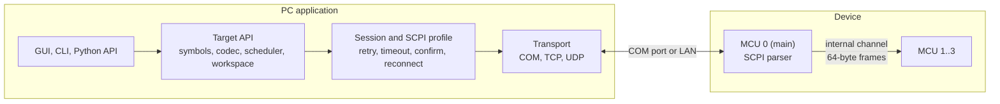

# RDT Design Document

RDT reads and writes a running device's firmware variables and raw memory over the link the product already has (a COM port or LAN), using the firmware's ELF file to turn names into addresses and types. No JTAG or SWD probe is needed.

This file is the single design document for RDT. Section 2 lists every requirement with an ID and its status, and section 4 has one design section per requirement, describing how it is built and where the code is. Requirements and decisions were set by rani; the date each was set is given where it is known.

**Contents**

1. [Overview](#1-overview)
2. [Requirements](#2-requirements)
3. [Architecture](#3-architecture)
4. [Design by requirement](#4-design-by-requirement)
5. [Firmware specification](#5-firmware-specification)
6. [Testing](#6-testing)
7. [Milestones](#7-milestones)
8. [Decision log](#8-decision-log)
9. [Appendix: binary protocol (planned)](#9-appendix-binary-protocol-planned)

## 1. Overview

The host application loads one ELF file per MCU and reads its DWARF debug information. It resolves an expression the user types, such as `main:motor.speed` or `motorctl:cfg.gains[2]`, into an address, a size and a type. It then reads or writes those bytes through SCPI commands that the user defines, and shows the result as a typed value.

- **Users:** firmware and test engineers on a bench or a trusted lab network.
- **Scope now:** the PC application only. The firmware side is a specification (section 5); a Python simulated device implements it, so the application is built and tested end to end before the firmware has its memory commands.
- **Not in v1:** breakpoints, stepping, local (stack) variables, flashing, authentication, map files.

**Status (2026-10-17):** milestones M0 to M6 are done, and so are the GUI redesign (MCU cards, panel buttons, themes and the look and feel, GUI-12 to GUI-18, LNF-1 to LNF-8) and the split workspace files (WSP-4 to WSP-8). The simulator, host core, CLI, symbols, workspace, GUI, watch tabs, live chart, statistics, CSV log and console features are all built and tested. rani's firmware answers the memory read command on the first real board (an STM32H7, over COM3, since 2026-10-13). The installer and releases (M6, INS-1 to INS-14) were built on 2026-10-17. Only the binary protocol (RM-4) is still planned.

**How to use RDT:** the [user manual](USER_MANUAL.md) explains how to operate it from the GUI and the CLI.

## 2. Requirements

Status values:

- **Done:** implemented in the PC application and covered by tests.
- **Firmware:** a requirement on the firmware. The simulator implements it today; the real firmware will implement it later.
- **In progress:** being built, no pull request open yet.
- **In review:** built in an open pull request, not merged yet.
- **Planned:** agreed but not built yet.
- **Removed:** was built or agreed, then dropped by rani.

Each requirement links to its design section.

### 2.1 Platform and scope

| ID | Requirement | Status | Design |
| --- | --- | --- | --- |
| PLT-1 | The PC application runs on Windows; the code stays portable so Linux can be added later (2026-10-05) | Done | [D-PLT-1](#d-plt-1-windows-application-portable-code) |
| PLT-2 | The host is written in Python with a Qt GUI (PySide6) (2026-10-05) | Done | [D-PLT-2](#d-plt-2-python-and-pyside6) |
| PLT-3 | The firmware is written in C; no C++ support is needed (2026-10-05) | Done | [D-PLT-3](#d-plt-3-c-firmware-only) |
| PLT-4 | The design is MCU-independent; byte order and pointer size come from each ELF (2026-10-05) | Done | [D-PLT-4](#d-plt-4-mcu-independent) |
| PLT-5 | No authentication; RDT is used on trusted benches and networks (2026-10-05) | Done | [D-PLT-5](#d-plt-5-no-authentication) |
| PLT-6 | The GUI, the CLI and a Python API sit on one core, so anything the GUI does can be scripted (2026-10-05) | Done | [D-PLT-6](#d-plt-6-one-core-three-front-ends) |

### 2.2 Device link

| ID | Requirement | Status | Design |
| --- | --- | --- | --- |
| LNK-1 | Connect over a COM port, with the port and baud rate chosen by the user | Done | [D-LNK-1](#d-lnk-1-com-port) |
| LNK-2 | Connect over LAN with a plain TCP socket, IP address and port entered by the user; no VISA (2026-10-05) | Done | [D-LNK-2](#d-lnk-2-tcp) |
| LNK-3 | Connect over LAN with UDP, one command per datagram | Done | [D-LNK-3](#d-lnk-3-udp) |
| LNK-4 | More channels can be added later as plug-in transports, with nothing above the transport changing | Done | [D-LNK-4](#d-lnk-4-plug-in-transports) |
| LNK-5 | On link loss RDT reconnects on its own; values grey out and writes are refused while the link is down (2026-10-05) | Done | [D-LNK-5](#d-lnk-5-auto-reconnect) |
| LNK-6 | Other tools may use the firmware's SCPI port over LAN at the same time as RDT (2026-10-05) | Done | [D-LNK-6](#d-lnk-6-sharing-the-link-with-other-tools) |
| LNK-7 | Connected means the COM port or socket opened; RDT sends nothing to the device on connect or reconnect (no `*IDN?`) and sends no probe; when the link shows as down is LNK-9 (2026-10-14) | Done | [D-LNK-7](#d-lnk-7-connect-without-a-probe) |
| LNK-8 | The GUI lists each COM port with its description, such as `COM3 - GAC serial port (COM3)` (2026-10-13) | Done | [D-LNK-1](#d-lnk-1-com-port) |
| LNK-9 | The link shows as down (red `Link down · COM3`) when the port or socket breaks, noticed within a second even with polling off, or when the device answers none of 3 reads in a row from any MCU while the port stays open ("no reply"). While the link is down the MCU cards show `link down` (GUI-14) and writes are refused, and the ELFs are checked again when it comes back (2026-10-14; the default chosen in the thread "Status box on lost connection", not yet confirmed by rani) | Done | [D-LNK-9](#d-lnk-9-noticing-a-lost-link) |
| LNK-10 | The COM port list in the toolbar is rescanned each time it opens, so unplugged ports disappear and newly plugged ports appear; the port already picked or typed stays shown (rani, 2026-10-18) | Done | [D-LNK-10](#d-lnk-10-com-port-list-rescanned-on-open) |
| LNK-11 | A late reply to a read that timed out is dropped, never taken as the reply to the next command; a read-modify-write uses the words around the value only when two reads in a row agree, except in a peripheral range, which is read once (rani asked for every finding of the code review to be fixed, 2026-10-18) | In review | [D-LNK-11](#d-lnk-11-late-replies) |

### 2.3 SCPI commands

| ID | Requirement | Status | Design |
| --- | --- | --- | --- |
| SCPI-1 | No SCPI command is hard-coded; the user defines the read and write commands and the reply format in an SCPI profile (2026-10-05) | Done | [D-SCPI-1](#d-scpi-1-scpi-profile) |
| SCPI-2 | Memory is read with one command, `read mcu,startAddress,size`; one reply carries up to a configurable maximum response size (2026-10-05) | Done | [D-SCPI-2](#d-scpi-2-block-read) |
| SCPI-3 | Memory is written one value per command, `write mcu,address,value,size`, with the value as a raw hex integer (2026-10-05) | Done | [D-SCPI-3](#d-scpi-3-single-value-write) |
| SCPI-4 | Addresses and values in commands are bare upper-case hex with no prefix: address 0x11AABBCCDD is sent as `11AABBCCDD` (2026-10-12). An address always has at least 8 digits, with leading zeros, so 0x08000000 is sent as `08000000` (2026-10-14) | Done | [D-SCPI-4](#d-scpi-4-bare-hex) |
| SCPI-5 | A failed command sends no reply and its error goes only to the error queue; RDT treats it as a timeout and never reads the error queue on its own (2026-10-11, error query removed 2026-10-14) | Done | [D-SCPI-5](#d-scpi-5-failed-commands-send-no-reply) |
| SCPI-6 | Every write is confirmed by reading the value back | Done | [D-SCPI-6](#d-scpi-6-write-confirmation) |
| SCPI-8 | A manual SCPI console sends any command and shows the raw reply (2026-10-05) | Done | [D-SCPI-8](#d-scpi-8-scpi-console) |
| SCPI-9 | The profile can be edited in the GUI, with a preview of the commands and a test read | Done | [D-SCPI-9](#d-scpi-9-profile-editor) |
| SCPI-10 | Every SCPI read and write covers whole 4-byte aligned words: a 2-byte variable is read as its 4-byte word and the result is trimmed, and a smaller or unaligned write is done as read-modify-write (2026-10-12) | Done | [D-SCPI-10](#d-scpi-10-aligned-words) |
| SCPI-11 | A read reply is one bare hex value per 4-byte word, comma-separated, lowest address first, the way the firmware prints a `uint32_t`: `30303030,2F30302F,43B40000`. This is the only reply format (2026-10-13); the reply holds nothing else, so there is no reply regex (2026-10-14) | Done | [D-SCPI-11](#d-scpi-11-word-replies) |
| SCPI-12 | A profile whose `{addr}` field would not give exactly 8 zero-padded hex digits (`{addr:8X}`, `{addr:04X}`, `{addr:010X}`) or whose `{value}` field pads the value is refused when it loads, and a value of the wrong type in a profile is a config error, not a crash (rani asked for every finding of the code review to be fixed, 2026-10-18) | In review | [D-SCPI-12](#d-scpi-12-profile-checks) |

### 2.4 Multiple MCUs

| ID | Requirement | Status | Design |
| --- | --- | --- | --- |
| MCU-1 | The device has several MCUs. The main MCU (MCU 0) owns the external link and forwards requests to the others over an internal channel (2026-10-11) | Done | [D-MCU-1](#d-mcu-1-main-and-secondary-mcus) |
| MCU-2 | Each MCU has its own ELF file (2026-10-11) | Done | [D-MCU-2](#d-mcu-2-one-elf-per-mcu) |
| MCU-3 | Every SCPI memory command names the MCU as an extra parameter (2026-10-11) | Done | [D-MCU-3](#d-mcu-3-mcu-in-every-command) |
| MCU-4 | Secondary MCUs use fixed 64-byte commands and responses; the main MCU's firmware splits larger reads (2026-10-11) | Done | [D-MCU-4](#d-mcu-4-64-byte-internal-frames) |
| MCU-5 | One global maximum response size; the timeout can be set per MCU (2026-10-11) | Done | [D-MCU-5](#d-mcu-5-per-mcu-timeout) |
| MCU-6 | A secondary MCU that stops answering is greyed out alone, and the others keep working (2026-10-11) | Done | [D-MCU-6](#d-mcu-6-silent-mcu) |
| MCU-7 | Every expression starts with the MCU's name, always, MCU 0 included; there is no default MCU (2026-10-11) | Done | [D-MCU-7](#d-mcu-7-mcu-name-prefix) |
| MCU-8 | Values from all MCUs can be mixed in one watch list, chart and CSV log (2026-10-11) | Done | [D-MCU-8](#d-mcu-8-mixed-mcus) |

### 2.5 Symbols

| ID | Requirement | Status | Design |
| --- | --- | --- | --- |
| SYM-1 | Symbols come from the ELF's DWARF information only; map files are not supported (2026-10-05) | Done | [D-SYM-1](#d-sym-1-elf-and-dwarf-only) |
| SYM-2 | List every global and file-static variable with its address, size and type, and search them | Done | [D-SYM-2](#d-sym-2-symbol-list) |
| SYM-3 | Resolve expressions: members, array cells, pointers, file-statics | Done | [D-SYM-3](#d-sym-3-expressions) |
| SYM-4 | Read or write a raw address, as a basic type or as any type from the ELF | Done | [D-SYM-4](#d-sym-4-raw-addresses) |
| SYM-5 | An expression through a pointer follows the pointer when the firmware moves it | Done | [D-SYM-5](#d-sym-5-pointers) |
| SYM-6 | Loading a large ELF is fast after the first time | Done | [D-SYM-6](#d-sym-6-symbol-cache) |
| SYM-7 | When an ELF is rebuilt, RDT reloads it and finds every watched item again by name (2026-10-05) | Done | [D-SYM-7](#d-sym-7-elf-rebuild-detection) |
| SYM-8 | Check on connect that each ELF matches the firmware running on its MCU, and check again when the link or the MCU comes back, by the GNU build ID when the firmware has one, else by a sample of the flash image (the per-MCU identity variable was removed by rani on 2026-10-15). Show the result in the GUI, with the mismatch on the red error bar (GUI-10) while an MCU does not match, and refuse reads and writes to an MCU that does not match (2026-10-12, updated 2026-10-14 and 2026-10-15) | Done | [D-SYM-8](#d-sym-8-build-identity-check) |

### 2.6 Memory access

| ID | Requirement | Status | Design |
| --- | --- | --- | --- |
| MEM-1 | Read and write any address, with or without a symbol | Done | [D-MEM-1](#d-mem-1-raw-memory-access) |
| MEM-2 | Refuse any access outside the ELF's memory and the ranges the user listed (2026-10-05) | Done | [D-MEM-2](#d-mem-2-known-memory-only) |
| MEM-3 | Refuse writes to read-only ELF sections | Done | [D-MEM-3](#d-mem-3-read-only-sections) |
| MEM-4 | Never merge a peripheral range into a larger read; read each item there alone at its exact size (2026-10-05) | Done | [D-MEM-4](#d-mem-4-peripheral-ranges) |
| MEM-5 | List RAM and flash banks as memory ranges, matching the firmware's own table of readable regions (ITCM, Flash, DTCM, AXI SRAM, SRAM1-4, Backup SRAM); reads in them merge like reads in ELF sections (2026-10-12) | Done | [D-MEM-5](#d-mem-5-memory-ranges) |

### 2.7 Values and display

| ID | Requirement | Status | Design |
| --- | --- | --- | --- |
| VAL-1 | Decode bytes into typed values and encode values into bytes: integers, floats, bools, enums, bit fields, `char` strings, pointers | Done | [D-VAL-1](#d-val-1-typed-values) |
| VAL-2 | Show structs and arrays fully expanded, nested to any depth, like a debugger (2026-10-05) | Done | [D-VAL-2](#d-val-2-structs-and-arrays) |
| VAL-3 | Display formats per item: decimal, hex, binary, char (2026-10-05) | Done | [D-VAL-3](#d-val-3-display-formats) |
| VAL-4 | Fixed-point (Qm.n) and linear scaling with a unit; writes apply the inverse (2026-10-05) | Done | [D-VAL-4](#d-val-4-scaling) |
| VAL-5 | Enum names and bit fields from DWARF (2026-10-05) | Done | [D-VAL-5](#d-val-5-enums-and-bit-fields) |
| VAL-6 | A value wider than the firmware's write size is written in pieces | Done | [D-VAL-6](#d-val-6-wide-writes) |

### 2.8 Write safety

| ID | Requirement | Status | Design |
| --- | --- | --- | --- |
| WS-1 | A per-item read-only flag (2026-10-05) | Done | [D-WS-1](#d-ws-1-read-only-items) |
| WS-2 | Per-item minimum and maximum, checked before every write (2026-10-05) | Done | [D-WS-2](#d-ws-2-limits) |
| WS-3 | An optional confirm before writing (2026-10-05) | Done | [D-WS-3](#d-ws-3-confirm-before-writing) |
| WS-4 | A global setting that makes every item read-only by default (2026-10-12) | Done | [D-WS-4](#d-ws-4-global-read-only-default) |
| WS-5 | A value is written only when the user commits an edit (Enter or leaving the cell); a poll, the change highlight or an ELF remap never writes, Esc cancels and an unchanged edit writes nothing. NaN and infinity are refused for an item with a minimum or maximum. A memory-view write over a read-only watched item is refused, and over an item with confirm on it is asked about first (rani asked for every finding of the code review to be fixed, 2026-10-18) | In review | [D-WS-5](#d-ws-5-edits-limits-and-raw-writes) |

### 2.9 Polling

| ID | Requirement | Status | Design |
| --- | --- | --- | --- |
| POLL-1 | A global polling interval, 500 ms by default, which can be turned off (2026-10-05) | Done | [D-POLL-1](#d-poll-1-global-interval) |
| POLL-2 | Each watched item can use the global interval, its own interval, or be read only by hand (2026-10-05) | Done | [D-POLL-2](#d-poll-2-per-item-interval) |
| POLL-3 | Nearby items are read together in one command, so they cost one round trip and come from the same moment | Done | [D-POLL-3](#d-poll-3-block-merging) |
| POLL-4 | A slow link makes items fall behind instead of queueing, and each item shows the rate it actually gets | Done | [D-POLL-4](#d-poll-4-falling-behind) |
| POLL-5 | A **Poll now** button next to Poll in the GUI reads every watched item once (2026-10-13) | Done | [D-POLL-5](#d-poll-5-poll-now-and-polling-switch) |
| POLL-6 | Polling can be turned off in the GUI, including items with their own interval (2026-10-13) | Done | [D-POLL-5](#d-poll-5-poll-now-and-polling-switch) |
| POLL-7 | A hung MCU costs a poll a few timeouts: when a merged block gets no reply its items are read one at a time without retries, and after two in a row get no reply the rest keep the block's error; while the link shows "no reply" reads are not retried (rani asked for every finding of the code review to be fixed, 2026-10-18) | In review | [D-POLL-7](#d-poll-7-a-hung-mcu) |

### 2.10 Watch tabs

| ID | Requirement | Status | Design |
| --- | --- | --- | --- |
| TAB-1 | A workspace holds several named watch tabs, each with its own list of items (2026-10-11) | Done | [D-TAB-1](#d-tab-1-several-watch-tabs) |
| TAB-2 | One expression in several tabs is one item with one set of settings | Done | [D-TAB-2](#d-tab-2-shared-items) |
| TAB-3 | Every tab keeps polling, not only the one in front | Done | [D-TAB-3](#d-tab-3-every-tab-polls) |
| TAB-4 | Tabs can be added, renamed, removed and reordered in the GUI and the CLI | Done | [D-TAB-4](#d-tab-4-managing-tabs) |

### 2.11 GUI

| ID | Requirement | Status | Design |
| --- | --- | --- | --- |
| GUI-1 | The GUI is the primary interface (2026-10-05) | Done | [D-GUI-1](#d-gui-1-main-window) |
| GUI-2 | A connection bar to choose the transport and its settings, connect and see the link state | Done | [D-GUI-2](#d-gui-2-connection-bar) |
| GUI-3 | A variable browser to search an MCU's variables and add them to a watch tab | Done | [D-GUI-3](#d-gui-3-variable-browser) |
| GUI-4 | A watch tree showing value, type, address and achieved rate, with values edited in place | Done | [D-GUI-4](#d-gui-4-watch-tree) |
| GUI-5 | A memory view: hex and ASCII dump of any range, editable | Done | [D-GUI-5](#d-gui-5-memory-view) |
| GUI-6 | The GUI never blocks on the device | Done | [D-GUI-6](#d-gui-6-device-worker-thread) |
| GUI-7 | The memory view offers display formats from a right-click menu: a Decimal toggle; Unsigned and Signed submenus with Char, Int, Short and Long; Ascii, Float and Double. The current choice has a check mark, and hex bytes (unsigned Char in hex) stay the default (2026-10-14) | Done | [D-GUI-7](#d-gui-7-memory-display-formats) |
| GUI-8 | The memory view's ASCII column shows only beside the default hex bytes (unsigned Char in hex); any other display format hides it, and Ascii in the menu shows memory as text (2026-10-14, updated 2026-10-14) | Done | [D-GUI-7](#d-gui-7-memory-display-formats) |
| GUI-9 | Show the link state and the link, such as a green `Connected · COM3` (2026-10-14; since GUI-11 shown on the connect button itself) | Done | [D-GUI-2](#d-gui-2-connection-bar) |
| GUI-10 | Every error shows in one slim red bar under the toolbar: an ELF that does not match its firmware and the latest failed connect, read, write or poll. The status bar shows only ordinary messages (2026-10-14) | Done | [D-GUI-10](#d-gui-10-error-bar) |
| GUI-11 | The status box and the Connect / Disconnect button become one button that shows the link state and the link, and a click connects, disconnects or cancels: green `Connected · COM3`, blue `Disconnected · COM3`, red `Link down · COM3`, amber `Connecting · COM3` (2026-10-14) | Done | [D-GUI-2](#d-gui-2-connection-bar) |
| GUI-12 | Each MCU has an optional short name and tag colour, and each watch row shows its MCU as a coloured tag with the short name before the expression (2026-10-14) | Done | [D-GUI-12](#d-gui-12-mcu-tags) |
| GUI-13 | A watched value that changed since the previous read is highlighted for a moment (2026-10-14) | Done | [D-GUI-13](#d-gui-13-change-highlight) |
| GUI-14 | Layout C: a Target panel with one card per MCU (link and ELF state, variables, memory ranges) replaces the Variables panel and the toolbar image box, and four toolbar buttons, Watch, Scope, Memory and Console, each show or hide their own panel, with the layout saved (2026-10-14; the buttons changed from mode tabs on 2026-10-14) | Done | [D-GUI-14](#d-gui-14-layout-c) |
| GUI-15 | A dark theme: View > Theme offers System, Light or Dark, saved per user; Light is white whatever Windows uses (2026-10-14, updated 2026-10-17) | Done | [D-GUI-15](#d-gui-15-dark-theme) |
| GUI-16 | Drag variables and watch rows onto a watch tab, a tab's title or the chart (2026-10-14) | Done | [D-GUI-16](#d-gui-16-drag-and-drop) |
| GUI-17 | One title bar row: the app icon, the menus and the minimise, maximise and close buttons in a single line, with no title text and no standard Windows title bar above it (rani, 2026-10-14) | Done | [D-GUI-17](#d-gui-17-one-row-title-bar) |
| GUI-18 | Load a profile file from inside the SCPI profile dialog; **Target > Load profile file...** is removed (2026-10-15) | Done | [D-SCPI-9](#d-scpi-9-profile-editor) |
| GUI-19 | **Target > MCUs and ELF files** shows each ELF file's path, with the file name always visible (rani, 2026-10-15) | Done | [D-GUI-19](#d-gui-19-elf-path-in-the-mcus-dialog) |
| LNF-1 | Four more themes in **View > Theme**: Studio Dark, Islands, Instrument and Light Pro (2026-10-15) | Done | [D-LNF-1](#d-lnf-1-themes) |
| LNF-2 | A **RUN/STOP** key replaces the **Poll** checkbox (2026-10-15) | Done | [D-LNF-2](#d-lnf-2-runstop-key) |
| LNF-3 | Icon buttons for Profile, Poll now, Log CSV and the panel buttons (2026-10-15) | Done | [D-LNF-3](#d-lnf-3-icon-buttons) |
| LNF-4 | Chart traces take the colour of their MCU (2026-10-15) | Done | [D-LNF-4](#d-lnf-4-mcu-colours-on-the-chart) |
| LNF-5 | The link state is a coloured strip in the status bar, with each MCU's reply time (2026-10-15) | Done | [D-LNF-5](#d-lnf-5-link-strip-in-the-status-bar) |
| LNF-6 | **View > Density**: Compact or Comfortable, saved per user (2026-10-15) | Done | [D-LNF-6](#d-lnf-6-density) |
| LNF-7 | Chart and Remove buttons appear on a watch row while the mouse is over it (2026-10-15) | Done | [D-LNF-7](#d-lnf-7-hover-buttons-on-watch-rows) |
| LNF-8 | Values are shown in a monospace font (2026-10-15) | Done | [D-LNF-8](#d-lnf-8-monospace-values) |

### 2.12 Live chart

| ID | Requirement | Status | Design |
| --- | --- | --- | --- |
| CHT-1 | Plot any numeric watched value over time, from any MCU (2026-10-05) | Done | [D-CHT-1](#d-cht-1-chart) |
| CHT-2 | Pause, zoom, pan and two cursors with values and time difference | Done | [D-CHT-2](#d-cht-2-pause-zoom-and-cursors) |
| CHT-3 | Up to four Y axes, with signals of the same unit sharing one | Done | [D-CHT-3](#d-cht-3-y-axes) |
| CHT-4 | 10 minutes of history in memory | Done | [D-CHT-4](#d-cht-4-history) |

### 2.13 Statistics and logging

| ID | Requirement | Status | Design |
| --- | --- | --- | --- |
| STA-1 | Minimum, maximum, mean and sample count per watched value, with a reset (2026-10-05) | Done | [D-STA-1](#d-sta-1-statistics) |
| CSV-1 | Log watched values to a CSV file with timestamps (2026-10-05) | Done | [D-CSV-1](#d-csv-1-csv-log) |

### 2.14 Workspace

| ID | Requirement | Status | Design |
| --- | --- | --- | --- |
| WSP-1 | A workspace holds the connection, the SCPI profile, the MCUs and their ELFs, the watch tabs with every item's settings, and the chart layout (2026-10-05); since 2026-10-14 the watch tabs, chart and commands are in separate files the workspace names (WSP-4) | Done | [D-WSP-1](#d-wsp-1-workspace-file) |
| WSP-2 | Workspaces from older versions still open | Done | [D-WSP-2](#d-wsp-2-older-workspaces) |
| WSP-3 | The last workspace reopens when the GUI starts (2026-10-12) | Done | [D-WSP-3](#d-wsp-3-reopen-last-workspace) |
| WSP-4 | The settings are split into separate files: the watched variables and watch tabs in one file, the imported commands in another, both opened with the workspace (2026-10-14); the commands file is a TOML file the workspace names, and the `.rdtw` and its files sit together, by default in `%LOCALAPPDATA%\rdt` (2026-10-14) | Done | [D-WSP-4](#d-wsp-4-split-files) |
| WSP-5 | The interface settings are kept in their own file, per user, not in the workspace (2026-10-14) | Done | [D-WSP-5](#d-wsp-5-interface-settings-file) |
| WSP-6 | The watch list, the commands and the interface settings can each be imported and exported (2026-10-14) | Done | [D-WSP-6](#d-wsp-6-import-and-export) |
| WSP-7 | The SCPI profile is kept in its own file beside the `.rdtw`, which points to it, with every field written, defaults included (2026-10-15) | Done | [D-WSP-4](#d-wsp-4-split-files) |
| WSP-8 | The memory map (the memory regions) is kept in its own file beside the `.rdtw`, which points to it with `memory_file`; a memory map can be loaded from a file, from the GUI (File > Import > Memory map) or the CLI (`rdt memory import`) (2026-10-15) | Done | [D-WSP-8](#d-wsp-8-memory-map-file) |

### 2.15 Command line and API

| ID | Requirement | Status | Design |
| --- | --- | --- | --- |
| CLI-1 | A command line, `rdt`, for every device operation and for editing the workspace | Done | [D-CLI-1](#d-cli-1-rdt-command-line) |
| CLI-2 | A Python API for scripts | Done | [D-CLI-2](#d-cli-2-python-api) |
| CLI-3 | Every failure is reported with a clear, specific error | Done | [D-CLI-3](#d-cli-3-errors) |
| CLI-4 | `--profile`, `--timeout`, `--mcu` and `--tcp/--udp/--serial/--baud` apply to that run only and are never saved into the workspace, except by `rdt init`; `--profile` keeps the workspace's memory ranges. Commands that only edit the workspace files work without loading the target, so a workspace whose memory map does not load can still be mended (rani asked for every finding of the code review to be fixed, 2026-10-18) | In review | [D-CLI-4](#d-cli-4-one-run-overrides) |

### 2.16 Simulator

| ID | Requirement | Status | Design |
| --- | --- | --- | --- |
| SIM-1 | A simulated device stands in for the firmware until it has its memory commands (2026-10-05) | Done | [D-SIM-1](#d-sim-1-simulated-device) |
| SIM-2 | The simulator's example firmware has structures, arrays and arrays of structures, some of them changing, to try the variable tree on (rani, 2026-10-19) | In review | [D-SIM-2](#d-sim-2-structures-and-arrays-in-the-example-firmware) |

### 2.17 Console

Console features taken from ComPort-Zone (an open serial terminal); rani approved each on 2026-10-12. Ideas only: ComPort-Zone has no licence, so none of its code is used.

| ID | Requirement | Status | Design |
| --- | --- | --- | --- |
| CON-1 | The console keeps its command history across launches, per user and shared by the GUI and CLI; it can be listed, re-sent and deleted (2026-10-12) | Done | [D-CON-1](#d-con-1-saved-history) |
| CON-2 | Tab completion in the console from the history and the imported known commands; with several matches Tab lists them all (2026-10-12; sources narrowed and Tab added 2026-10-12) | Done | [D-CON-2](#d-con-2-autocomplete) |
| CON-3 | The console transcript shows each line's time to the millisecond (optional) and colours commands, replies, errors and notes differently (2026-10-12) | Done | [D-CON-3](#d-con-3-timestamps-and-colours) |
| CON-4 | Search the console transcript (Ctrl+F) with highlighted matches and a counter; Ctrl+K clears it (2026-10-12) | Done | [D-CON-4](#d-con-4-transcript-search) |
| CON-5 | Log the console session to a text file, every line with date, time and direction (2026-10-12) | Done | [D-CON-5](#d-con-5-session-log) |
| CON-6 | Convert a transcript selection between hex and text (2026-10-12) | Done | [D-CON-6](#d-con-6-hex-and-text) |
| CON-7 | A list of the device's known commands, kept with the workspace (in its own file since 2026-10-14, WSP-4), imported from and exported to a file, and picked from in the console (2026-10-12) | Done | [D-CON-7](#d-con-7-known-commands) |
| CON-8 | `rdt send --expect REGEX` checks a reply, with its own exit code (2026-10-12) | Done | [D-CON-8](#d-con-8-checking-a-reply) |
| CON-9 | `rdt console` can reconnect and show the device info without leaving (2026-10-12) | Done | [D-CON-9](#d-con-9-reconnect-and-info-in-the-console) |
| CON-10 | Send a serial break on a COM port link (2026-10-12) | Done | [D-CON-10](#d-con-10-serial-break) |
| CON-11 | The console text size can be changed and long lines wrapped or not, remembered per user (2026-10-12) | Done | [D-CON-11](#d-con-11-text-size-and-wrap) |
| CON-12 | The GUI lists every keyboard shortcut in one window (2026-10-12) | Done | [D-CON-12](#d-con-12-keyboard-shortcuts) |
| CON-13 | The GUI console looks like a terminal in the theme's colours (dark in the dark themes, light in the light ones), each line with its time and a TX, RX, ERR or SYS tag, and the prompt as its last line, with no separate line or button for sending (2026-10-12, updated 2026-10-17) | Done | [D-CON-13](#d-con-13-terminal-look) |
| CON-14 | Commands are typed on the console's next free line, inside the transcript, and the best suggestion from the history or the known commands shows while typing, without pressing Tab (2026-10-12) | Done | [D-CON-14](#d-con-14-typing-in-the-transcript) |
| CON-15 | The list of matching commands opens as soon as something is typed, without Tab; Tab or Enter takes the highlighted command (2026-10-13) | Done | [D-CON-2](#d-con-2-autocomplete) |

### 2.18 Removed and not in v1

| ID | Item | Status | Design |
| --- | --- | --- | --- |
| RM-1 | User-defined SCPI command buttons. Built in M3, removed by rani on 2026-10-11; the SCPI console sends any command | Removed | [D-RM-1](#d-rm-1-command-buttons) |
| RM-2 | Map file input (2026-10-05, ELF only) | Removed | [D-SYM-1](#d-sym-1-elf-and-dwarf-only) |
| RM-3 | Not in v1 (2026-10-05): multi-address read command, on-target recorder, alarms, stimulus, computed values, log replay, dashboards | Removed | none |
| RM-4 | Binary protocol, a faster alternative to SCPI | Planned | [Appendix](#9-appendix-binary-protocol-planned) |
| RM-5 | Not taken from ComPort-Zone (2026-10-12): command files (scripts), running a file of commands, sending several pasted lines and several console tabs, all declined by rani; its control panel (covered by watch tabs) was not proposed | Removed | none |
| RM-6 | Size query: RDT asking the firmware for its largest read (`MEMory:MAX?`) on connect. Built, then removed by rani on 2026-10-12; the maximum response size is set only in the SCPI configuration | Removed | [D-SCPI-2](#d-scpi-2-block-read) |
| RM-7 | Error query: RDT reading `SYSTem:ERRor?` once after a timeout as a hint, the profile key `error_query`, `rdt errors` and the console's `.err`. Built 2026-10-11, removed by rani on 2026-10-14; `SYST:ERR?` can still be typed by hand | Removed | [D-SCPI-5](#d-scpi-5-failed-commands-send-no-reply) |
| RM-8 | Probe on connect: `*IDN?` (profile key `probe`) sent on connect and every reconnect, and the device identity in the GUI and `rdt info`. Removed by rani on 2026-10-14 | Removed | [D-LNK-7](#d-lnk-7-connect-without-a-probe) |
| RM-9 | Reply regex: the profile key `reply_regex` (Reply regex in the profile editor) that picked the data out of a longer read reply. Removed by rani on 2026-10-14, since a reply holds only the comma-separated words | Removed | [D-SCPI-11](#d-scpi-11-word-replies) |

### 2.19 Installer and releases

Agreed with rani on 2026-10-17 (thread "Installer and releases plan", milestone M6). Built in PR #131 (the licence in PR #130), merged 2026-10-17; the build and a Windows install, upgrade and uninstall smoke test passed on the merged main.

| ID | Requirement | Status | Design |
| --- | --- | --- | --- |
| INS-1 | Windows installer `RDT-Setup-X.Y.Z.exe` that carries Python and every package RDT needs (no Python, pip or internet needed on the PC), per user in `%LOCALAPPDATA%\Programs\RDT`, no admin rights; Start menu shortcut, optional desktop shortcut (2026-10-17) | Done (PR #131) | [D-INS-1](#d-ins-1-windows-installer) |
| INS-2 | Uninstall from Settings > Apps or the Start menu; it asks whether to delete `%LOCALAPPDATA%\rdt` (No preselected) (2026-10-17) | Done (PR #131) | [D-INS-2](#d-ins-2-uninstall) |
| INS-3 | A new setup closes RDT, silently uninstalls the old version and then installs; user settings are always kept; installing an older version warns and lets you continue (2026-10-17) | Done (PR #131) | [D-INS-3](#d-ins-3-upgrade-over-an-old-version) |
| INS-4 | An "Add rdt to PATH" checkbox, ticked by default; removed on uninstall (2026-10-17) | Done (PR #131) | [D-INS-4](#d-ins-4-rdt-on-path) |
| INS-5 | `.rdtw` files open in RDT on double-click and show the RDT icon (2026-10-17) | Done (PR #131) | [D-INS-5](#d-ins-5-rdtw-file-association) |
| INS-6 | A portable zip with each release; the simulator (`rdt-sim`, the example firmware and workspace) is in both (2026-10-17) | Done (PR #131) | [D-INS-6](#d-ins-6-portable-zip-and-simulator) |
| INS-7 | Version from the git tag, shown in Help > About, `rdt --version` and the exe properties; first release 1.0.0; semantic versioning (2026-10-17) | Done (PR #131) | [D-INS-7](#d-ins-7-versions) |
| INS-8 | A GitHub Release per `v*` tag, built by Actions as a draft (setup, zip, SHA256SUMS, changelog notes); rani publishes after a smoke test; the same build script runs locally (2026-10-17) | Done (PR #131) | [D-INS-8](#d-ins-8-release-build) |
| INS-9 | On start, RDT checks the repository's latest Release and shows when a newer version is available (needs the repository public), without GitHub's API and its limit of 60 requests an hour per IP address (2026-10-17, updated 2026-10-18) | Done | [D-INS-9](#d-ins-9-update-check) |
| INS-10 | A code signing step in the build, off until a certificate is configured (2026-10-17) | Done (PR #131) | [D-INS-10](#d-ins-10-code-signing) |
| INS-11 | Settings files carry `format = N`; a newer RDT migrates them after a `.bak` copy; crash log in `%LOCALAPPDATA%\rdt\logs` (2026-10-17) | Done (PR #131) | [D-INS-11](#d-ins-11-settings-formats-and-crash-log) |
| INS-12 | MIT licence and third-party notices; the user manual is bundled and opened from Help (2026-10-17) | Done (PR #130) | [D-INS-12](#d-ins-12-licence-and-bundled-manual) |
| INS-13 | Release notes from `CHANGELOG.md`: only New features and Bug fixes, one line per feature or bug-fix PR, small changes left out; copied into each GitHub Release; bundled and shown from Help > Release notes (2026-10-17) | Done (PR #131) | [D-INS-13](#d-ins-13-release-notes) |
| INS-14 | A release starts from the **Run workflow** button (Actions > Release, type the version): it renames `## Unreleased` in CHANGELOG.md to the version and date, commits that to main and builds the draft Release in the same run, with no tag yet: the tag `vX.Y.Z` is created only when rani publishes the draft, so a discarded draft leaves no tag; pushing a `v*` tag by hand still works (2026-10-17, updated 2026-10-17) | Done | [D-INS-14](#d-ins-14-run-workflow-button) |
| INS-15 | When a newer version is found, an **Update available** window shows what changed in it (the release notes of the versions newer than the running one) with a Download button; it opens by itself once per new version and again from the status-bar link or Help > Check for updates (rani, 2026-10-18) | Done | [D-INS-15](#d-ins-15-update-available-window) |

Requirements on the firmware itself (FW-1 to FW-10) are in [section 5](#5-firmware-specification).

## 3. Architecture


The PC application has four layers, and each talks only to the layer below it:

1. **Front ends:** the GUI, the CLI and the Python API. All of them call the Target API and never the layers below it.
2. **Core:** the Target API, the workspace, the write guard, the symbol database, the value codec, the poll scheduler, the ELF watcher, statistics and the CSV log.
3. **Session and protocol:** sequencing, timeouts, retries, write confirmation, silent MCUs and reconnect; the SCPI profile engine.
4. **Transport:** COM port, TCP and UDP byte movers.

Everything that knows about names and types lives on the PC. The firmware only ever sees an MCU number, an address and a byte count. That keeps the firmware side small and lets the symbol handling grow without touching it. Swapping the simulator for the real firmware, or SCPI for another protocol, changes nothing above the protocol layer.



### Package layout

```
rdt/
  transport/   base.py, tcp.py, udp.py, serial.py   byte movers
  protocol/    scpi.py                              profile commands, reply framing
  profile.py                                        SCPI profile: templates, reply formats
  session.py                                        timeouts, retries, write confirm, silent MCUs, reconnect
  memmap.py                                         ELF sections and listed ranges; access checks
  symbols/     elf.py, types.py, expr.py, values.py DWARF symbol table, type model, expressions, typed values
  codec.py                                          raw scalar types
  target.py                                         Target API and target file
  scheduler.py                                      poll scheduler: block merging, one poll for many items
  stats.py, csvlog.py                               statistics, CSV log
  workspace.py, scaling.py, tomlw.py                workspace file, display formats and scaling, write safety
  console.py                                        console history, autocomplete, session log, hex/text, known commands
  cli.py                                            command line
  gui/         app.py       main window, connection bar, menus, polling tick, ELF check
               device.py    device worker thread
               variables.py watch tabs, watch tree, item settings, symbol browser
               panels.py    memory view, SCPI console, profile editor, MCU dialog
               chart.py     live chart (pyqtgraph)
sim/                                                simulated device
tests/                                              pytest suite, ELF corpus
```

User guides: [CLI.md](CLI.md), [GUI.md](GUI.md), [SIMULATOR.md](SIMULATOR.md).

## 4. Design by requirement

### 4.1 Platform and scope

#### D-PLT-1 Windows application, portable code

RDT is a Python package installed with `python -m pip install -e .[dev]`. It uses no Windows-only API: serial ports go through pyserial, sockets through the standard library, and paths through `pathlib`. Windows-specific defaults are limited to the symbol cache folder (`%LOCALAPPDATA%\rdt\cache`) and COM port names. CI runs the whole test suite on both Windows and Linux, with Python 3.11 and 3.13, which keeps the code portable.

#### D-PLT-2 Python and PySide6

The GUI uses PySide6, chosen because it packages into a single Windows installer and has a fast plotting library to pair with (pyqtgraph). The other dependencies are pyelftools for DWARF and pyserial for COM ports. They are listed in `pyproject.toml`, which also installs the commands `rdt`, `rdt-gui` and `rdt-sim`.

#### D-PLT-3 C firmware only

The DWARF reader in `rdt/symbols/elf.py` handles the C type model: base types, pointers, arrays, structs, unions, enums, bit fields and typedefs. C++ features (classes, namespaces, templates, references) are not read.

#### D-PLT-4 MCU-independent

Nothing in RDT assumes an MCU. Byte order and pointer size come from each MCU's ELF header (`rdt/symbols/elf.py`), and the profile's `byte_order` is used only for an MCU without an ELF. The test ELF corpus covers little-endian Cortex-M4, big-endian ARM and x86-64 with 64-bit pointers.

#### D-PLT-5 No authentication

RDT sends no credentials, and the firmware specification has none. Anyone who can reach the device's SCPI port can read and write its memory, so RDT is meant for trusted networks. The firmware specification keeps two cheap controls for that reason (FW-9).

#### D-PLT-6 One core, three front ends

`rdt.Target` (`rdt/target.py`) is the one API for device access, and `rdt.Workspace` (`rdt/workspace.py`) adds the watch tabs, scaling and write safety on top. The CLI (`rdt/cli.py`) and the GUI (`rdt/gui/`) only call these two, and scripts can use them directly (D-CLI-2).

### 4.2 Device link

#### D-LNK-1 COM port

`rdt/transport/serial.py` opens the port with pyserial. In the target file:

```toml
[connection]
transport = "serial"
port      = "COM5"
baud      = 115200
```

On the CLI: `--serial COM5 --baud 115200`. In the GUI the connection bar lists the COM ports and offers common baud rates. Each port shows with its description from pyserial, such as `COM3 - GAC serial port (COM3)` (LNK-8, rani, 2026-10-13); only the port name is saved and used to connect, and a port typed by hand still works (`serial_ports`, `port_label` and `port_name` in `rdt/gui/app.py`). The list is rescanned each time it opens (D-LNK-10). A COM port can be opened by one program only, so it is never shared (D-LNK-6).

#### D-LNK-2 TCP

`rdt/transport/tcp.py` opens a plain socket to `address = "192.168.1.20:5025"` (CLI `--tcp HOST:PORT`). Replies are framed by the profile's line terminator.

#### D-LNK-3 UDP

`rdt/transport/udp.py` sends one command per datagram and takes one reply per datagram (CLI `--udp HOST:PORT`). A datagram can be lost silently, so a read that times out is simply sent again. A write that times out is never repeated blindly: RDT reads the value back first and writes again only if the read-back shows the value missing (D-SCPI-6).

#### D-LNK-4 Plug-in transports

Every transport subclasses `Transport` in `rdt/transport/base.py`: `open()`, `close()`, `write(bytes)`, and the reads `read_until(sep, deadline)` and `read_exact(n, deadline)`. Adding a channel (CAN, USB bulk, BLE) means one new subclass and a new `transport` value in the target file. The session, the protocol and everything above stay the same.

#### D-LNK-5 Auto-reconnect

The session (`rdt/session.py`) has four link states: up, down, no reply and closed. The link goes down when the COM port or socket breaks, and is "no reply" when the device answers none of 3 reads in a row while the port stays open (D-LNK-9).

- **While the link is down:** every access fails at once with `LinkDown`, so writes are refused. The GUI shows `link down` in grey with the last values kept, and the CSV log and the chart mark the gap.
- **Reconnecting:** a background thread reconnects with growing delays of 0.25, 0.5, 1, 2, 4 and then 5 s, until the port or socket opens again (D-LNK-7).
- **After reconnecting:** polling resumes at the next due time, and the CSV log records `link up`.

`watch`, `console` and the GUI reconnect on their own. The other CLI commands are one-shot and fail at once.

#### D-LNK-6 Sharing the link with other tools

Other tools may use the firmware's SCPI port over LAN while RDT is connected.

- **Own connection:** each tool has its own TCP connection, and the firmware answers on the connection that asked (FW-6). Over UDP it replies to the sender's address and port.
- **Stray replies:** before each command the session drops anything still waiting in the input, so a late reply to an earlier command is never taken for the current one. Every read reply is checked against the requested size; one that doesn't fit is discarded and the read is sent again.
- **Busy device:** a read that times out is sent again with a growing delay, starting at 50 ms and doubling, up to `retries` extra attempts (2 by default).
- **Shared error queue:** the firmware's error queue is shared by every tool on the link, so RDT never reads it on its own (D-SCPI-5). Writes are confirmed by read-back instead (D-SCPI-6).

A simulator test runs a second SCPI client against the device while RDT polls.

#### D-LNK-7 Connect without a probe

rani set this on 2026-10-14: RDT sends nothing to the device to check it. Connect and every reconnect only open the COM port or socket, and the link is up once it is open. Over UDP that means the socket opened, since nothing is received until a command is sent.

- **Link down:** when the port or socket breaks, or the device stops answering reads (D-LNK-9). Neither check sends anything of its own: the idle check sends no bytes, and the reads that detect "no reply" are the normal poll and user reads.
- **Removed:** the profile's `probe` key (default `*IDN?`), `Target.idn`, the device identity after "Connected" in the GUI, and the Device line of `rdt info` (RM-8). A profile that still has `probe` loads with it ignored.

#### D-LNK-9 Noticing a lost link

rani reported on 2026-10-14 that the status box stayed green `Connected · COM3` after the connection was lost. The thread "Status box on lost connection" chose this behaviour as the default; rani has not confirmed it yet.

- **Idle check:** `Session._watch_loop` (thread `rdt-linkwatch`) calls `Transport.check()` every `WATCH_S` = 1 s while the session lock is free. Serial reads `in_waiting`, which fails once a USB COM port is unplugged (`ClearCommError` on Windows, `EIO` on Linux). TCP does a non-blocking `recv(1, MSG_PEEK)`, where EOF or a reset means broken. UDP has nothing to check. A failure goes through the usual link-down and auto-reconnect path (D-LNK-5). No bytes are sent.
- **No reply:** `LinkState.NO_REPLY` in `rdt/session.py`. `_device_unanswered` counts read pieces that got no reply at all (`NO_REPLY_AFTER` = 3), and `_device_answered` resets the count and goes back to up. Reads still go out, since they act as the probe. Writes raise `LinkDown(... write refused)`. The port stays open and nothing reconnects.
- **GUI:** both cases show the red `Link down` connect button (GUI-9, GUI-11), with the tooltip saying which. Each MCU card shows `link down` (`link_health` in `rdt/gui/cards.py`, D-GUI-14).
- **ELF check:** `Target._link_event` marks every identity stale on down and on no reply, so the GUI runs the image check again when the link comes back up (D-SYM-8).
- **Known limits:** with its port open and polling off, a hung board is noticed only at the next read (Poll now, F6), because RDT sends no probe. Three bad-address reads in a row also count as no reply, because the firmware does not reply on errors (D-SCPI-5).
- **Simulator:** `Device.frozen` and `SIMulation:FREEze <seconds>` make the simulated board stop answering with the port open ([SIMULATOR.md](SIMULATOR.md)).

#### D-LNK-10 COM port list rescanned on open

The COM box in the connection bar is `PortBox` in `rdt/gui/app.py`, a `QComboBox` that calls `refresh()` in `showPopup()`: each time the list opens it asks `serial_ports()` for the ports present now and refills the list, so a port that was unplugged disappears and a newly plugged one appears without restarting RDT (rani, 2026-10-18). The port already shown, picked from the list or typed by hand, stays shown even when it is not listed any more. The same `refresh()` fills the list the first time the transport is set to COM port.

#### D-LNK-11 Late replies

Replies carry no tag, so a reply that arrives just after its read timed out would pass for the reply to the next read. `ScpiProtocol` in `rdt/protocol/scpi.py` remembers that a reply may still be owed after a timeout or a reply that did not decode, and before the next command waits for it and drops it. The wait is the MCU's timeout capped at 0.25 s (`LATE_REPLY_S`): the firmware sends no reply at all to a failed command, so every timeout pays this once and it has to stay short. No extra command is sent.

A reply later than that wait can still fool one read, so `Session._read_words` in `rdt/session.py` reads the words around a sub-word value twice and uses them only when both reads agree on the bytes it keeps; otherwise the write is refused unsent. A word whose other bytes change on every read (a fast counter beside the value) is refused rather than overwritten. In a peripheral range the register is read once, since a read can clear a flag or pop a FIFO (`Target.write` passes `read_twice=False`).


### 4.3 SCPI commands

#### D-SCPI-1 SCPI profile

The profile (`rdt/profile.py`) is a `[scpi]` TOML table. It can be a file of its own (`profile = "fw_profile.toml"`) or sit inline in a target file. A workspace always keeps it in its own file, `bench.profile.toml` (D-WSP-4). RDT writes every field, defaults included, so the file shows the whole profile (`_profile_dict` in `rdt/workspace.py`, rani, 2026-10-15). The simulator reads the same table, so a command set can be tried on the simulator before the firmware has it.

```toml
[scpi]
name         = "Motor controller v3"
read         = "MEMory:READ? {mcu},{addr},{len}"
write        = "MEMory:WRITE {mcu},{addr},{value},{size}"
max_write    = 4               # largest value one write accepts: 1, 2, 4 or 8 bytes
align        = 4               # every read and write covers whole aligned words: 1, 2, 4 or 8
byte_order   = "little"        # only for an MCU without an ELF
max_response = 1024            # bytes of data one read reply can carry
terminator   = "\n"
timeout_ms   = 500
retries      = 2               # extra attempts after a read times out
```

Placeholders: `{mcu}`, `{addr}`, `{len}`, `{value}` and `{size}`. `{addr}` and `{value}` are always bare upper-case hex, and `{addr}` has at least 8 digits (D-SCPI-4); `{mcu}`, `{len}` and `{size}` are decimal. The profile checks itself when loaded: an unknown placeholder, a format spec on `{addr}` or `{value}` that changes the base, a bad `max_write` or `align` or a non-positive timeout is a `ConfigError`. The GUI's profile editor also refuses a template that can't work, such as a read without `{len}`. A profile may also list `[[ranges]]` for every MCU, or for one MCU with `mcu = "name"` (D-MEM-2). The retired keys `error_query`, `probe` and `reply_regex` (RM-7, RM-8, RM-9) are ignored when an older profile still has them.

#### D-SCPI-2 Block read

`Session.read` (`rdt/session.py`) splits any read into pieces of at most `max_response` bytes and sends one read command per piece. The poll scheduler packs nearby items into those reads (D-POLL-3), which is what makes polling fast over SCPI. `max_response` comes only from the profile: RDT never asks the device for it (the size query was removed on 2026-10-12, RM-6), and an old profile or workspace that still has a `size_query` key loads with the key ignored. A multi-address read command is not planned; it would only be considered if scattered variables turn out to poll too slowly.

#### D-SCPI-3 Single-value write

A write sends one value per command. The value is the raw integer of the variable's bytes, in the variable's byte order, written as bare hex. A float is sent as its bit pattern (1.5 becomes `3FC00000`), so the firmware never parses a float. `{size}` is the access width, so the firmware does a single store of the right width. Values wider than `max_write` are split (D-VAL-6). A later firmware may add a buffer write; the profile would then get a second write template.

#### D-SCPI-4 Bare hex

rani set this on 2026-10-12: addresses and values in commands are hex with no prefix, so address 0x11AABBCCDD is sent as `11AABBCCDD`. On 2026-10-14 rani added that an address is always at least 8 characters, because the firmware checks that every address has 8: 0x08000000 is sent as `08000000`, not `8000000`. Read replies are comma-separated words (D-SCPI-11).

- **Commands:** `fill_template` (`rdt/profile.py`) writes `{addr}` and `{value}` as upper-case hex with no prefix. `{addr}` defaults to `08X`, at least 8 digits with leading zeros, so longer addresses such as `11AABBCCDD` are unchanged; `{value}` defaults to `X`, with no padding. A template may set its own width, as in `{value:08X}`, but any spec that changes the base is a `ConfigError`. A read of 4 bytes at 0x20000000 on MCU 0 is `MEMory:READ? 0,20000000,4`, a read at 0x08000000 is `MEMory:READ? 0,08000000,4`, and a write of 1.5 to a float is `MEMory:WRITE 0,20000004,3FC00000,4`.
- **Old files:** the earlier `addr_format`, `value_format` and `data_format` keys (with the `bytes_csv`, `decimal` and `ieee_block` reply formats) are gone. A profile or workspace that still has them loads with those keys ignored.
- **Simulator:** it takes addresses and values only in bare hex. A prefixed or signed number (`0x20000000`, `#H20`, `-1`) fails with `-104,"Data type error"`.

#### D-SCPI-5 Failed commands send no reply

The firmware sends nothing back when a command fails; the error goes only to the error queue. So in RDT a failure looks like a timeout:

1. A read that times out is sent again with a growing delay, up to `retries` times, and then fails with `CommandTimeout`.
2. RDT never sends `SYSTem:ERRor?` on its own: no hint after a timeout or a failed write (rani, 2026-10-14). The queue is shared with other tools (D-LNK-6), so its entries could not be trusted anyway.
3. A single timeout does not take the link down. 3 reads in a row with no reply from any MCU give the "no reply" state (D-LNK-9); a reply from any MCU, a `-240` error reply included, resets the count. Console timeouts don't count, but console replies do.

A `-240` error reply marks a secondary MCU silent (D-MCU-6). In the console, a query with no reply shows `(no reply)`; to see why, type `SYST:ERR?` by hand.

The error query that read the queue once after a timeout, its `error_query` profile key, `rdt errors` and the console's `.err` were removed on 2026-10-14 (RM-7).

#### D-SCPI-6 Write confirmation

A write gets no reply whether it succeeds or fails, so `Session.write` reads the written bytes back after every write and compares them. The read-back covers whole aligned words, and only the bytes written are compared (D-SCPI-10). A mismatch raises `WriteNotConfirmed` with both values. Over UDP, a write whose read-back shows it missing is sent again, and only then. Bit-field writes are confirmed the same way (D-VAL-5).

#### D-SCPI-8 SCPI console

- **GUI:** a console panel (`rdt/gui/panels.py`) sends any typed command and shows the raw reply, with Up and Down for history. A command whose header ends in `?` waits for a reply. There is no error-queue button (removed 2026-10-12 at rani's request); typing `SYST:ERR?` reads one entry.
- **CLI:** `rdt console` offers the same, plus `.read EXPR`, `.write EXPR VALUE` and `.quit`. `rdt send COMMAND` sends one command; `rdt send SYST:ERR?` reads one entry of the error queue.
- **Logging:** `-vv` on the CLI logs every command and reply, so the commands the scheduler actually sends can be checked.
- **More:** saved history, autocomplete, timestamps and colours, search, a session log and hex/text conversion are in [4.17 Console](#417-console).

#### D-SCPI-9 Profile editor

**Target > SCPI profile** in the GUI edits every field of the profile.

- **Preview:** the read and write commands are shown as they will be sent, and a template that can't work is refused, such as a read without `{len}`.
- **Test read:** while connected, it sends one read with the edited profile and shows the reply and the decoded bytes, before anything is applied.
- **Load from file (GUI-18):** a **Load from file...** button at the top of `ProfileDialog` in `rdt/gui/panels.py` fills the fields from a profile `.toml`. The line beside it names the workspace's profile file (`File: bench.profile.toml`, or `File: saved with the workspace` before the first save), or `Loaded from <name>` after a load. `MainWindow.edit_profile` passes the workspace's current `profile_path` in. rani asked on 2026-10-15 for this to replace the separate **Target > Load profile file...**, which is removed.
- **Apply:** OK puts the fields into the workspace's profile and reconnects; the next save writes them to the workspace's own profile file (WSP-7, D-WSP-4). A loaded file is only copied from, never linked. This replaces the first version, where OK with no field edited kept the workspace pointing at the loaded file (`ProfileDialog.result_path()`, removed 2026-10-15).

#### D-SCPI-10 Aligned words

rani set this on 2026-10-12: the firmware is only ever asked for whole 4-byte aligned words. The profile's `align` key holds the word size: 4 by default, and 1, 2, 4 or 8 are allowed. `max_write` and `max_response` must each be at least `align`, or loading the profile is a `ConfigError`. `align_span` in `rdt/profile.py` rounds the start of an access down and its end up to a multiple of `align`.

- **Reads:** `Session.read` reads the aligned span in pieces of `max_response` rounded down to a multiple of `align`, then cuts out the bytes asked for. A 2-byte variable at 0x20000002 is read with `MEMory:READ? 0,20000000,4`, and RDT keeps its last 2 bytes.
- **Writes:** a write that already covers whole aligned words is sent as is. Any other write is a read-modify-write: `Session.write` reads the aligned words, puts the new bytes into them, and writes the whole words back, split by `max_write` (D-VAL-6). rani chose this over refusing small writes on 2026-10-12. If the firmware changes a neighbouring value between the read and the write, that change is lost, as with bit fields (D-VAL-5).
- **Confirmation:** the read-back covers the aligned words, but only the target bytes are compared (D-SCPI-6). Over UDP, a re-send takes the neighbouring bytes from the latest read-back, so it does not undo a change the firmware made to them.
- **Access checks:** `MemoryMap.check_aligned` in `rdt/memmap.py` checks the bytes asked for as before (D-MEM-2). The padding bytes the aligned words add may lie outside ELF sections or in another section, because the firmware reads whole words anyway. They may never reach into a peripheral range the access isn't already in (D-MEM-4), and on a write they may not land in read-only memory (D-MEM-3).
- **Polling:** the scheduler sizes each merged block by its aligned span, so a block never needs more than one reply (D-POLL-3).
- **GUI:** the profile editor has an **Align** field. Its preview writes one word, and **Test read** sends an aligned read (D-SCPI-9).
- **Simulator:** an address, length or write size that is not a multiple of `align` fails with `-224,"Illegal parameter value"`.


#### D-SCPI-11 Word replies

rani set this on 2026-10-13, after connecting RDT to the real target on COM3: the firmware prints each 4-byte word of a read as a `uint32_t` in bare hex, comma-separated, lowest address first. This is the only reply format; the earlier run of bare bytes (`0000C03F`) is removed.

| Read | Reply | Value |
| --- | --- | --- |
| a `float` 1.5 at 20000000 | `3FC00000` | bytes `00 00 C0 3F` on a little-endian MCU |
| 12 bytes holding the string `0000/00/00` | `30303030,2F30302F,06003030` | each word turned back into bytes in the MCU's byte order |

- **Decoding:** `Profile.decode_data(reply, length, byte_order)` in `rdt/profile.py` splits the reply on commas. Each token is a bare hex value of at most `align` bytes (D-SCPI-10), and leading zeros may be left out. Each value becomes `align` bytes in the MCU's byte order.
- **Byte order:** the order comes from that MCU's ELF. `Target` passes it to `Session` as `byte_order_of`, and the profile's `byte_order` is used only for an MCU without an ELF.
- **Refused replies:** a `0x` prefix, a token wider than `align`, or the wrong number of words is a `BadReply`.
- **Nothing else in the reply:** the whole reply is the words. The `reply_regex` key that picked them out of a longer reply was removed on 2026-10-14 at rani's request (RM-9), and an old profile that still has it loads with it ignored.
- **Simulator:** it replies in the same words, in each simulated MCU's byte order.

#### D-SCPI-12 Profile checks

`Profile` in `rdt/profile.py` allows only `{addr}`/`{addr:08X}` and `{value}`/`{value:X}`, so every address sent is exactly 8 zero-padded digits and every value unpadded (SCPI-4). The profile dialog's Test read is one command, so it is refused above `max_response`. `Profile.from_dict` checks each value's type (a bool is never a number) and raises `ConfigError`.


### 4.4 Multiple MCUs

#### D-MCU-1 Main and secondary MCUs

MCU 0 is the main MCU; it owns the link and is required. The others have IDs 1, 2, 3 and so on. Each `[[mcu]]` in the target file has an `id`, a display `name`, an `elf`, an optional `timeout_ms` and optional `[[mcu.ranges]]`:

```toml
[[mcu]]
id   = 0
name = "main"
elf  = "build/main.elf"
short = "MAIN"          # optional: the GUI tag, 1 to 6 letters, digits or _ (D-GUI-12)
color = "#7b61d6"       # optional: the tag colour, #rrggbb

  [[mcu.ranges]]          # a peripheral block (kind = "peripheral" is the default)
  name     = "GPIOA"
  start    = 0x48000000
  size     = 0x400
  writable = true

  [[mcu.ranges]]          # a whole RAM bank (D-MEM-5)
  name  = "DTCM"
  kind  = "memory"
  start = 0x20000000
  end   = 0x2001FFFF      # the last address in it; or give size

[[mcu]]
id         = 1
name       = "motorctl"
elf        = "build/motorctl.elf"
timeout_ms = 1000
```

The GUI edits them in **Target > MCUs and ELF files** (with the short name and colour, D-GUI-12), and the CLI can replace them with `--mcu NAME=ID[:ELF]`.

#### D-MCU-2 One ELF per MCU

Each MCU (`Mcu` in `rdt/target.py`) loads its own ELF into its own symbol table and memory map. Symbols, memory ranges, ELF rebuild detection and the planned build-ID check all work per MCU.

#### D-MCU-3 MCU in every command

The profile's read and write templates take `{mcu}`, filled with the MCU's ID: `MEMory:READ? 1,20000000,64`. Commands typed in the console are sent as typed.

#### D-MCU-4 64-byte internal frames

The PC sends the same read, up to `max_response`, to any MCU. For MCUs 1 and up, the main MCU's firmware splits it into 64-byte frames on the internal channel and joins the replies (FW-4), so `max_response` stays one global setting. A struct or array larger than 64 bytes on a secondary MCU is therefore read in pieces, and its fields may not come from the same moment; the CLI guide says so.

#### D-MCU-5 Per-MCU timeout

The profile's `timeout_ms` applies to every MCU, and an MCU's own `timeout_ms` overrides it (`Session.timeout_s`). Secondary MCUs usually need longer, because their reads are split behind MCU 0.

#### D-MCU-6 Silent MCU

When a secondary MCU stops answering, the main MCU sends no reply and puts `-240,"MCU not responding"` in the error queue (FW-5).

- **Marking it silent:** the session marks a secondary MCU silent on a `-240` error reply, or after three timeouts in a row. RDT does not read the error queue (D-SCPI-5).
- **While silent:** its reads fail at once with `McuSilent` and its writes are refused, so the GUI greys out only that MCU's values. The other MCUs keep working.
- **Recovery:** the silent MCU is tried again every 2 s, and the first answer clears the state.

#### D-MCU-7 MCU name prefix

The expression parser (`rdt/symbols/expr.py`) requires the MCU's name before every expression: `main:motor.speed`, `motorctl:cfg.gains[2]`, `@motorctl:0x20000418:u32`. There is no default MCU. The name is the display name from the target file, and the watch tree, the chart legend and the CSV columns show it too.

#### D-MCU-8 Mixed MCUs

A watch tab, the chart and the CSV log can hold items from any MCUs, and every name shows its MCU (D-MCU-7). The scheduler plans reads per MCU (D-POLL-3), and every sample carries the PC time its reply arrived, so values from different MCUs share one time axis.

### 4.5 Symbols

#### D-SYM-1 ELF and DWARF only

`rdt/symbols/elf.py` reads the ELF with pyelftools and walks `.debug_info`. Every file-scope `DW_TAG_variable` with a fixed address becomes a symbol, and its type DIE is resolved into the type model in `rdt/symbols/types.py`: base types, pointers, arrays, structs, unions, enums, bit fields and typedefs. The firmware must be built with `-g`.

Map files are not read, because they have addresses but no types:

| | ELF with DWARF | Map file |
| --- | --- | --- |
| Address and size | Yes | Yes, size usually |
| Type, signedness, width | Yes | No |
| Struct members, array element type and count | Yes | No |
| Enum names | Yes | No |
| Standard across GCC, Clang, IAR, Keil | Yes (DWARF) | No, vendor-specific text |

A raw address with an explicit type still works with no symbols at all (D-SYM-4).

Not included: local variables, function-static variables, and variables the compiler kept only as constants.

#### D-SYM-2 Symbol list

- **CLI:** `rdt symbols MCU [PATTERN]` lists an MCU's variables with address, size and type. The pattern is a glob such as `motor*`, or any part of the name. `rdt ptype EXPR` shows where a variable is and its type's layout: member offsets, bit positions and enum values. It also takes a type name. Neither needs a device.
- **GUI:** the variable browser does the same (D-GUI-3).

#### D-SYM-3 Expressions

`rdt/symbols/expr.py` parses and resolves expressions into a `Location`: MCU, address, size and type.

| Expression | Meaning |
| --- | --- |
| `main:tick_count` | A global variable |
| `main:motor.speed` | A struct or union member, to any depth |
| `main:gains[2]`, `main:matrix[1][2]` | An array cell, bounds-checked |
| `main:*head`, `main:head->next->value`, `main:(*head).value`, `main:head[2]` | Following a pointer |
| `main:motor.c:state` | A file-static variable named with its source file, needed only when two files have a variable of that name |

Arithmetic, function calls and casts other than the raw-address form are not supported. A name, member or index that doesn't resolve raises `SymbolError`.

#### D-SYM-4 Raw addresses

`@MCU:ADDRESS:TYPE` reads memory with no symbol: `@main:0x20000010:u32`, with the types `u8 i8 u16 i16 u32 i32 u64 i64 f32 f64`. The type can also be any type in that MCU's ELF (a typedef, or a struct, union or enum tag), followed by members and cells: `@main:0x48000000:GPIO_TypeDef.ODR`.

#### D-SYM-5 Pointers

Following a pointer reads it from the device. A `Location` that goes through a pointer is marked dynamic, and it is resolved again before every read, so `main:head->value` follows `head` when the firmware moves it. In the GUI, **Watch what it points to** on a pointer row adds its target as an item.

#### D-SYM-6 Symbol cache

Reading DWARF takes a while for a large firmware, so the symbol table is cached on disk, keyed by the ELF's content hash. The cache is in `%LOCALAPPDATA%\rdt\cache` on Windows, `~/.cache/rdt` elsewhere, or the folder in `RDT_CACHE_DIR`. A rebuilt ELF gets a new entry, old entries can be deleted at any time, and a cache version number ignores entries written by an older reader.

#### D-SYM-7 ELF rebuild detection

`Target.refresh_elfs()` checks each ELF's size and modification time.

- **Waiting for the linker:** a changed file is reloaded only after it has been unchanged for 0.5 s, so a file the linker is still writing is left alone. A rebuilt file that can't be read keeps the old symbols.
- **Re-mapping:** after a reload, `Target.remap()` finds each watched item again by its expression, not by its old address.
- **In the GUI:** the check runs every second while connected. An item that moved or changed type turns orange, with a note in its tooltip and the status bar. An item that no longer exists stays in the tree in grey and shows `gone`. The variable browser reloads too.
- **In the CLI:** `rdt watch` prints a `#` line for each such item.
- **In the CSV log:** an `ELF rebuilt for MCU` event is recorded.

#### D-SYM-8 Build identity check

RDT compares bytes that differ between firmware builds, read from the device and from the ELF file. `Target.check_identity()` in `rdt/target.py` does it; helpers `elf_bytes`, `build_id_note` and `flash_samples` are in `rdt/memmap.py`.

- **What is compared:** RDT uses the GNU build ID (`.note.gnu.build-id`) when the linker placed it in the firmware's memory (an allocated section). Without it, RDT compares a **flash sample** (`Target._flash_identity`): the start and end of every read-only section the ELF holds bytes for (no `SHF_WRITE` flag: code, constants, the vector table) and that runs where it is flashed, plus 32 blocks of 64 bytes spread evenly across them, about 4 KB at most, each trimmed to whole 4-byte words. That needs no firmware or build change, so it works with Keil and armlink, rani's toolchain, which writes no build ID; rani flashes a HEX file. A sample can miss a one-byte change to a single constant, but code and data shift after almost any rebuild. RW-data initial values are never compared, since armlink may store them compressed in flash. Code that a Keil scatter file places in ITCM or RAM is skipped too (2026-10-14, PR #75): its `PT_LOAD` segment has a physical address (where it sits in the HEX) that differs from its virtual address (where it runs), so the ELF address holds nothing until the startup code copies it there, which gave a false mismatch on a matching image (`_runs_where_flashed` in `rdt/memmap.py`). Keil's HEX file is made from the same `.axf`, so a HEX built from another build gives a mismatch; bytes patched into code space after linking (a CRC or signature) would give a false one. A mismatch names the first address that differs. An MCU is not checked only when its ELF has no read-only bytes at all. This replaces the earlier plan of a CRC over an address range: neither needs a new firmware command (FW-10). Each MCU's `identity` setting, a constant variable compared the same way, was removed by rani on 2026-10-15 (PR #121), since RDT reads the image from the flash; an old file with `identity` still loads, and the key is dropped on the next save. A Keil pre-build script that wrote a build-time constant was tried and declined by rani on 2026-10-14.
- **When:** on connect, on `.reconnect` (the firmware may have been flashed), after an ELF is rebuilt and reloaded (D-SYM-7), and from Target > Check ELF identity. Also when the link comes back after a drop, or an MCU answers again after being silent, since the firmware may have been flashed meanwhile (a reset drops a USB COM port): `Target` marks that MCU's identity stale, the GUI checks it again as soon as the link is up, and `Target.write` checks a stale MCU before writing. MCUs with nothing to compare are not marked.
- **Results:** `match`, `mismatch`, `unchecked` (nothing to compare) and `unread` (the MCU did not answer). Only `mismatch` has an effect.
- **On a mismatch:** every read and write to that MCU is refused with `ImageMismatch` (a `WriteRefused`) naming what differs (the first differing address, or both build IDs), including polling and the memory view (rani, 2026-10-14; before that, reads still worked). The GUI has no way around it (rani, 2026-10-14): load the matching ELF or flash the matching firmware, then connect again or use Target > Check ELF identity. The CLI's `--allow-mismatch` and `Target.allow_mismatch(mcu)` from Python still allow access, until the next check.
- **Image box:** (replaced by the MCU cards' ELF line, D-GUI-14) while connected, the toolbar shows an image box next to the connect button (GUI-9, GUI-11): green `Image ✓ verified`, red `Image ✗ mismatch`, `Image: checking`, `Image ? not read` or `Image not checked`, with each MCU's result in its tooltip. It is hidden while not connected.
- **Error bar:** while any MCU's ELF does not match, the red error bar under the toolbar (D-GUI-10) shows `⚠ ELF does not match the firmware on <MCU>; reads and writes to it are refused`, with the detail (such as the first differing address) in its tooltip and **Load ELF...** (opens Target > MCUs and ELF files) and **Check again** buttons. That line can't be closed; it goes away once every MCU matches or the link closes. rani first asked for a large banner (PR #70) after missing the red status bar line, then on 2026-10-14 for a slim bar that holds every error (PR #73).
- **Shown:** after Connect, the GUI status bar says `ELF matches the firmware`, `ELF does NOT match the firmware` or `ELF not checked (nothing to compare)`, one per MCU when there are several (`identity_summary` in `rdt/gui/app.py`). The console logs every result, unchecked ones too. A build-ID mismatch shows the two hashes as `readelf -n` prints them, skipping the 16-byte note header that every build shares. On the CLI, a mismatch is a warning on stderr, `rdt info` prints each MCU's result, and `rdt watch` prints a `#` line when a rebuilt ELF does not match.
- **Recommended setup:** link with `-Wl,--build-id` and keep `.note.gnu.build-id` in flash after `.isr_vector`, so every build is checked by its build ID instead of a flash sample (example `sim/examples/firmware/link_build_id.ld`; steps in `docs/use-your-own-elf.md`).
- **Editing:** nothing to set: the GUI's MCU dialog has no identity column since 2026-10-15, and the examples are checked by their flash sample or build ID.

### 4.6 Memory access

#### D-MEM-1 Raw memory access

- **CLI:** `rdt dump EXPR [LEN]` or `rdt dump MCU ADDR LEN` prints a hex and ASCII dump. `rdt poke MCU ADDR HEX` writes raw bytes, lowest address first, and confirms them by read-back.
- **GUI:** the memory view does the same (D-GUI-5).
- **Scripts:** `Target.read(mcu, addr, size)` and `Target.write(mcu, addr, data)`.

#### D-MEM-2 Known memory only

`rdt/memmap.py` builds a memory map per MCU from its ELF's allocated sections plus the listed ranges (`[[mcu.ranges]]`, or `[[ranges]]` in the profile with `mcu = "name"`). `Target._check` refuses an access outside them with `AccessRefused` before anything is sent. A read that starts inside a known region and runs past its end is refused too, unless the next section or memory range continues it. An access that touches a peripheral range must stay entirely inside it. The padding bytes added by aligned access follow the looser rules in D-SCPI-10. The firmware's own region table is a second check (FW-7).

#### D-MEM-3 Read-only sections

Sections without the ELF write flag (`.text`, `.rodata`) are readable but not writable, so writes to them are refused with `AccessRefused`. A listed range is writable unless it has `writable = false`. A read-only ELF section stays read-only even where a writable memory range covers it (D-MEM-5).

#### D-MEM-4 Peripheral ranges

A range's `kind` is `"peripheral"` unless it says otherwise. Peripheral ranges hold registers, where reading one can clear a flag or pop a FIFO. The scheduler never merges an item in a peripheral range with anything else, and reads it alone at its exact size (D-POLL-3). A peripheral range may not overlap an ELF section or another range; that is a `ConfigError` when the file loads.

#### D-MEM-5 Memory ranges

Firmware often keeps a table of the regions it lets a debugger read, such as ITCM, Flash, DTCM, AXI SRAM, SRAM1 to SRAM4 and Backup SRAM. Each region becomes a range with `kind = "memory"`, in `[[mcu.ranges]]` or in the profile's `[[ranges]]`:

```toml
[[mcu.ranges]]
name     = "AXI SRAM"
kind     = "memory"
start    = 0x24000000
end      = 0x2407FFFF     # inclusive, as firmware tables write it; or size = 0x80000
writable = true
```

| | `kind = "peripheral"` (default) | `kind = "memory"` |
| --- | --- | --- |
| For | Register blocks | RAM and flash banks |
| Overlapping ELF sections or other ranges | Refused when the file loads | Allowed |
| Reads | Each item alone, at its exact size, never merged | Merged with nearby items, like reads in ELF sections |
| An access that runs past its end | Refused | Refused, unless another section or memory range continues it |
| `writable = false` | Writes refused | Writes refused; a read-only ELF section inside a writable memory range stays read-only |

- **Extent:** a range gives either `size` or `end`, the inclusive last address. Giving both, or neither, is a `ConfigError`, and so is an unknown `kind`.
- **Access checks:** `MemoryMap` in `rdt/memmap.py` keeps memory ranges alongside the ELF's sections. A read may span adjacent sections and memory ranges, so a variable at the edge of `.data` can be read with the bank around it. A write is checked against every area it touches, overlapping ones included, so a writable bank never makes `.rodata` writable.
- **Merging:** only peripheral ranges are kept out of block merging (D-POLL-3); memory ranges are treated like ELF sections.
- **Code:** `Range` and `RANGE_KINDS` in `rdt/profile.py`, `Area.kind` and `MemoryMap` in `rdt/memmap.py`. Tests are in `tests/test_host_memmap.py`, `tests/test_workspace.py` and `tests/test_host_cli.py`.

### 4.7 Values and display

#### D-VAL-1 Typed values

`rdt/symbols/values.py` decodes bytes into typed values and encodes them back, and `rdt/codec.py` handles the raw scalar types.

| Kind | Shown as | Written as |
| --- | --- | --- |
| Integer | decimal (and hex in the CLI), or the item's format | `42`, `-7`, `0x1F`, `0b101`; refused if it doesn't fit the type |
| Float, double | decimal | `1.5`, `2.5e3`; a hex integer is taken as the bit pattern |
| Bool | `true` / `false` | `true`, `false`, `1`, `0` |
| Enum | `NAME (n)` | an enumerator's name or its number |
| Bit field | its own value, extracted from the word that holds it | a number that fits the field's width (D-VAL-5) |
| `char` | the number and its character | a number or `'A'` |
| `char` array | a string, such as `"rdt-main"` | a string, padded with zeros |
| Pointer | the address and what it points to, such as `0x20000048 (&nodes[1])` or `0x00000000 (NULL)` | an address |
| Struct, union, array | every field and cell (D-VAL-2) | one field or cell at a time |

`uint8_t` and `int8_t` arrays stay numbers; only `char` arrays show as strings. Through the Python API, `Target.read_value` returns a number or bool, an `EnumValue` (an `int` with a `.name`), `bytes` for a `char` array, a dict for a struct and a list for an array.

#### D-VAL-2 Structs and arrays

A struct opens to all its fields and an array to all its cells, nested to any depth. `Target.read_rows` produces the display rows that both the CLI and the GUI use.

- **One block:** a struct or array is read in one block, so all of its fields come from the same moment (except on secondary MCUs, D-MCU-4).
- **Large arrays:** arrays show 100 cells at a time. The CLI takes `--max-cells N`; the GUI has **Show 100 more cells**.
- **GUI tree:** each struct and array has a header row with its type and address. A collapsed node is not read at all (D-POLL-4).
- **Editing:** a struct or array is edited one field or cell at a time. That is not atomic, since the firmware can run between two writes.

#### D-VAL-3 Display formats

Each integer item has `format = "dec" | "hex" | "bin" | "char"` in the workspace, set in the GUI's **Format** menu or with `rdt add --format`. The format applies to the item's integer fields and cells too. The CSV log always writes decimal (D-CSV-1).

#### D-VAL-4 Scaling

`rdt/scaling.py` applies, to a single value:

```
shown = raw / 2^q × scale + offset
```

- **Settings:** `q` is the fixed-point format (`Q15`, `Q31`, `Q3.12`, or a number of fraction bits). `scale` and `offset` default to 1 and 0, and `unit` is a label.
- **Writing:** a write takes the value in shown units, applies the inverse and writes the nearest raw value. A value whose raw form doesn't fit the type is refused, and a float variable keeps its fraction.
- **Where it applies:** scaling applies to single values, not to a struct or array. The watch tree, the chart, the statistics and the CSV log all use the shown value.

#### D-VAL-5 Enums and bit fields

Enum values come from DWARF and are shown as `NAME (n)`; a write takes the name or the number. A bit field is shown as its own value. A bit-field write reads the word that holds the field, changes the field, writes the word back and confirms it by read-back. If the firmware changes a neighbouring field in that moment, that change is lost; the CLI guide says so.

#### D-VAL-6 Wide writes

`split_write` in `rdt/session.py` cuts a value wider than `max_write` (a `double` or `int64` when the limit is 4) into aligned pieces, low address first, and sends one write each. The pieces are not atomic, and the whole value is confirmed by one read-back afterwards.

### 4.8 Write safety

The write guard lives in `Workspace.write` (`rdt/workspace.py`). It is used by the GUI, by `rdt write` with a workspace, and by scripts. The settings are per item, and they are shared by every tab the item is in (D-TAB-2).

#### D-WS-1 Read-only items

`read_only = true` refuses every write to the item with `WriteRefused`. On a struct or array it covers all its fields and cells. In the GUI, read-only values are grey and can't be edited.

#### D-WS-2 Limits

`min` and `max`, in shown units, are checked before the write is sent. A value outside them is refused with a message: on the GUI's error bar (D-GUI-10), or as an error on the CLI.

#### D-WS-3 Confirm before writing

`confirm = true` asks before writing, naming the item and the new value. In the GUI that is a dialog; on the CLI it is a terminal prompt, and `write -y` answers yes. A write that needs a confirm with no one to answer it (no terminal and no `-y`) is refused. On a struct or array it covers all its fields and cells.

#### D-WS-4 Global read-only default

`read_only = true` at the top of the workspace makes every item read-only unless the item itself says `read_only = false`. `Workspace.read_only_reason()` in `rdt/workspace.py` decides, in this order: the item's own `read_only = true`, then a watched struct or array it is inside that is read-only (D-WS-1), then an item or parent with `read_only = false` (writable), then the workspace default. An item without the key follows the default, so `read_only` on an item has three states: true, false, or not set.

- **Raw writes:** with the default on, writes with no item behind them are refused too: an expression that is not watched, the GUI's memory view, and `rdt poke`. SCPI commands typed in the console are not checked, since RDT cannot know what they do.
- **GUI:** Watch > All items read-only turns it on and off, and greys the values on the next read. The item settings dialog offers Workspace default, Read-only or Writable.
- **CLI:** `rdt read-only on|off` sets it and `rdt read-only` shows it; `rdt add EXPR --no-read-only` lets one item be written; `rdt list` mentions the default when it is on.

#### D-WS-5 Edits, limits and raw writes

- **Edits:** `ValueDelegate` in `rdt/gui/variables.py` writes in `setModelData`, so only a committed editor writes; the tree's itemChanged path is gone. While an editor is open, polls leave that cell alone and it is updated when the editor closes; the memory view does the same with Refresh on. Editing a field of an item with a unit starts from the bare number.
- **Limits:** `Workspace.write` refuses a value that is not finite when the item has a minimum or maximum, and the item settings dialog refuses nan and inf as limits and shows numbers at full precision.
- **Memory view:** writes stay raw (no scaling or limits, D-WS-4), but before writing the GUI finds the watched items the bytes overlap: a read-only one refuses the write, and one with confirm on asks first.


### 4.9 Polling

#### D-POLL-1 Global interval

The workspace's `poll_ms` (default 500) is the global interval, shown as **Poll** in the GUI's connection bar. `0` (Off) stops polling for every item that follows the global interval; items with their own interval keep polling. To stop all polling, untick **Poll** (D-POLL-5). In `rdt watch`, `-i MS` replaces it.

#### D-POLL-2 Per-item interval

Each top-level item has `poll = "global" | "manual" | <ms>`. `global` follows the global interval, including later changes to it. A number keeps its own interval. `manual` reads the item only on demand: **Poll now** (F6) in the GUI (D-POLL-5), or once at the start of `rdt watch`. Every item is also read once on connect. Fields and cells are read with their parent, so they share its interval; to poll one field at another rate, add it as its own item (**Watch this on its own** in the GUI).

#### D-POLL-3 Block merging

`rdt/scheduler.py` plans each poll:

1. Collect every due item, from every tab, once each (D-TAB-3).
2. Group the items by MCU and sort them by address.
3. Merge items at most 32 bytes apart (`MERGE_GAP`) into one block whose aligned span (D-SCPI-10) fits in `max_response` bytes. The gaps between them are read too.
4. Never merge an item in a peripheral range; read it alone at its exact size (D-MEM-4). Items in memory ranges merge like items in ELF sections (D-MEM-5).
5. Send one read per block and decode every item from its block. Each `Sample` carries the PC time the reply arrived.
6. If a merged read fails, read its items again one by one, so one bad item fails alone.

`Workspace.read_many` runs one poll for the CLI and the GUI.

#### D-POLL-4 Falling behind

Only one poll runs at a time. In the GUI, a 50 ms tick looks for due items and starts a poll only when the last one has finished; `rdt watch` works the same way. A slow link (likely SCPI on a slow COM port) makes items fall behind instead of building a queue. The watch tree's **Rate** column shows the rate each item actually gets, so the limit is visible. Collapsed structs and arrays are not read, which keeps the link free; while the CSV log runs, or for a charted field, they are read anyway.


#### D-POLL-5 Poll now and polling switch

rani asked for both on 2026-10-13. The toolbar reads **[✓] Poll [interval] [Poll now]**.

- **Polling switch:** the **Poll** label in the connection bar is a checkbox, also **Watch > Poll automatically** (F7). Unticking it stops all polling, including items with their own interval, and greys the interval box. Ticking it again resumes at the same intervals. Polling is on at startup, and the switch is not saved in the workspace.
- **Poll now:** a **Poll now** button next to the interval box, also **Watch > Poll now** (F6, formerly "Read all now"). It reads every watched item once, in every tab, including manual items, whether polling is on or off.
- **Code:** `MainWindow.set_polling` in `rdt/gui/app.py` keeps the checkbox and the menu entry in step and sets `WatchTabs.polling`. That flag is passed to `WatchTree.due()` in `rdt/gui/variables.py`, which returns only items marked to be read by hand (Poll now, or connect) while polling is off.
- **CLI:** `rdt watch` is unchanged; it polls until stopped.

#### D-POLL-7 A hung MCU

`read_many` in `rdt/scheduler.py` reads a failed block's items one at a time with `retries=0` (`Target.read` and `Session.read` take a `retries` override), and after two items in a row get no reply the rest take the block's error. Other MCUs are still read. While the link is in the "no reply" state (LNK-9) `Session.read` makes one attempt only.


### 4.10 Watch tabs

#### D-TAB-1 Several watch tabs

A workspace has a list of `[[tab]]` tables, each with a `name` and its own ordered `[[tab.watch]]` items. Names are unique, ignoring case. A new workspace starts with one tab named `Watch`.

```toml
[[tab]]
name = "Motor"

  [[tab.watch]]
  expr = "main:motor.speed"
  unit = "rpm"

[[tab]]
name = "Overview"

  [[tab.watch]]
  expr = "main:motor.speed"   # the same item as in "Motor"
```

#### D-TAB-2 Shared items

An expression is one `Watch` object in the workspace, however many tabs show it. Its format, scaling, polling and write safety are the same in every tab; changing them in one tab changes them in all. The file writes the settings at the item's first place only. A later place may repeat them but must not differ, or the file fails to load with a `ConfigError`. Write safety is found by expression across all tabs.

#### D-TAB-3 Every tab polls

The poll collects what every tab has due, not only the tab in front. Each expression is read once per poll and its result goes to every tab that shows it. The chart and the CSV log therefore see items from all tabs.

#### D-TAB-4 Managing tabs

- **GUI:** the centre of the window is a tab bar of watch trees (`rdt/gui/variables.py`).
  - **Add:** **+**, a double-click on the empty tab bar, or **Watch > New tab** (Ctrl+Shift+T).
  - **Rename:** double-click a tab, or **Rename**.
  - **Remove:** **Remove** asks first if the tab has items. The last tab can't be removed.
  - **Move between tabs:** drag a tab to reorder it, and Ctrl+PgUp/PgDown switch tabs.
  - **Items:** an item's menu has **Also show in tab** and **Remove from this tab**. Variables added from the browser go to the tab in front.
- **CLI:**
  - `rdt tab add NAME`, `rdt tab rename NAME NEW` and `rdt tab remove NAME` manage tabs.
  - `rdt add EXPR --tab NAME` adds to a tab and creates it if it is new.
  - `rdt remove EXPR --tab NAME` removes from one tab, and from every tab without `--tab`.
  - `rdt list` prints the items per tab, and `read` and `watch` take `--tab NAME`.

### 4.11 GUI

#### D-GUI-1 Main window

`rdt-gui [workspace.rdtw]` (or `python -m rdt.gui`) opens one workspace. The window has the connection bar on top, the watch tabs in the centre, and docked panels: the **Target** panel with one card per MCU (D-GUI-14), the chart, the memory view and the SCPI console. Every change is saved back to the workspace: the title shows `*` while there are unsaved changes, and closing asks whether to save. **File > New, Open, Save, Save as** work on `.rdtw` files. Opening a plain `.toml` target file starts an unsaved workspace, and Save asks for a `.rdtw` path.

#### D-GUI-2 Connection bar

- **Transport:** `tcp` or `udp` with an IP address and port, or `serial` with a COM port and baud rate.
- **Profile:** a button that opens the profile editor and shows the profile's name.
- **Connect button** (F5, GUI-9, GUI-11): one button shows `<state> · <link>`, the link being the COM port or IP:port, and a click toggles the connection: green `Connected · COM3` (click disconnects), blue `Disconnected · COM3` (click connects), red `Link down · COM3` while RDT reconnects or while the device answers nothing ("no reply", D-LNK-9; click disconnects), and amber `Connecting · COM3` (click cancels). The tooltip gives the reason from `LINK_TIPS` plus `Click to connect`, `disconnect` or `cancel (F5)`. There is no separate status box: `_show_state` in `rdt/gui/app.py` styles `ConnectionBar.connect_button` (plug icon) from `STATE_COLORS`, whose `off` key is the blue disconnected look. Connected means the port or socket opened (D-LNK-7). rani picked this layout from mockups on 2026-10-14; it replaces the status box with grey `Closed · COM3` beside a separate Connect button.
- **Poll:** the global interval (D-POLL-1).
- **Log CSV** (Ctrl+L): starts and stops the CSV log (D-CSV-1).

The connection fields can be edited only while disconnected. The console and the memory view are disabled unless the link is up.

#### D-GUI-3 Variable browser

Since GUI-14 the variable list sits inside each MCU's card (D-GUI-14).

The **Variables** panel lists the chosen MCU's globals from its ELF, filtered by the search box (`motor*`, `*count`). A double-click, or **Add to watch list**, adds the selected variables to the tab in front. **Watch > Add expression** (Ctrl+E) takes any expression the CLI takes.

#### D-GUI-4 Watch tree

Each tab's tree (`rdt/gui/variables.py`) shows each item's name (with its MCU), value, type, address and achieved rate, with optional statistics columns (D-STA-1).

- **Display:** structs and arrays open as described in D-VAL-2, and pointers show their target's name.
- **Value colours:**
  - Grey values are read-only.
  - A red value is an error, with the reason in its tooltip.
  - `link down` or `MCU silent` shows in grey, and the last values stay.
- **Editing:** double-click a value (or **Write...**), type it in the item's units, and press Enter. Write safety applies (section 4.8), and every write is confirmed by read-back.
- **Item settings:** **Format** and **Settings...** set the display format, fixed-point format, scale, offset, unit, polling and write safety.

#### D-GUI-5 Memory view

Choose the MCU, type an address or a variable name and a length, and press **Read**. The dump shows 16 bytes per row with their ASCII, as hex bytes unless another display format is chosen (D-GUI-7). Double-click a cell, type a new value and press Enter to write it; the write is confirmed by read-back. **Refresh** reads again at the global interval. The same access checks as everywhere else apply (D-MEM-2).

#### D-GUI-7 Memory display formats

Right-click the memory view's dump to choose how its cells show memory (GUI-7).

- **Menu:** a **Decimal** toggle (only for the integer formats), an **Unsigned** and a **Signed** submenu with **Char**, **Int**, **Short** and **Long**, then **Ascii**, **Float** and **Double**. The current choice has a check mark. The default is unsigned Char in hex, the plain hex bytes of D-GUI-5.
- **Formats:** `MemFormat(kind, type, decimal)` in `rdt/memfmt.py`, which has no Qt so the tests use it directly. Element sizes follow ARM C: Char 1 byte, Short 2, Int 4, Long 4; Ascii 1, Float 4, Double 8. `to_text` shows one cell in the MCU's byte order (D-SCPI-11); integers show in upper-case hex, or in decimal when Decimal is on.
- **Layout:** `MemoryView` in `rdt/gui/panels.py` shows 16/size cells per row, each headed by its byte offset, plus the ASCII column for hex bytes (GUI-8). A cell only partly inside the bytes read stays blank. The status line names the format, such as `as Signed Short, decimal`.
- **ASCII column (GUI-8):** shown only with the default format, the hex bytes. `MemoryView._layout_columns` hides the column for any other format (`format != MemFormat()`), and picking the hex bytes again brings it back. To see memory as text in another layout, pick **Ascii** from the menu. rani asked for this on 2026-10-14 after seeing an ASCII column next to Unsigned Long words. It replaced the first version, where the column stayed for every format and `MemFormat.to_ascii` regrouped each cell's characters in the order of the value.
- **Writing:** double-click a cell and type a value in the shown format; a hex `0x` prefix is accepted in decimal too. `from_text` turns it into bytes and refuses text that is not a number or does not fit the type, naming the type's range. The cell is written as one element through `Target.write`, so aligned words and read-modify-write apply as usual (D-SCPI-10), and the write is confirmed by read-back.
- **Saved:** the choice is kept per user in `ui.toml` (`memory/kind`, `memory/type`, `memory/decimal`, D-WSP-5) and comes back at the next start.

#### D-GUI-6 Device worker thread

All device I/O runs on one worker thread (`rdt/gui/device.py`), in the order it was asked for, so the window never waits on the link. Jobs carry a key (the poll, the memory view, the ELF check). A job is dropped while an earlier job with the same key is still pending, which is how a slow link falls behind instead of queueing (D-POLL-4). Results come back to the window as Qt signals.

#### D-GUI-10 Error bar

rani asked on 2026-10-14 for every error to be in one place, after an error showed in a large ELF banner at the top and another in the status bar at the bottom. `ErrorBanner` in `rdt/gui/app.py` is a slim red bar under the connection toolbar, which can't be moved or hidden. It has up to two lines:

- **ELF mismatch** (D-SYM-8): stays until every MCU matches again, with **Load ELF...** and **Check again** buttons and each MCU's detail in the tooltip (`show_mismatch`).
- **Latest error:** a failed connect, read, write or poll, or a refused write. It has a ✕ to close it, and a newer error replaces it. Any later message that is not an error clears it, since the later action went through (`MainWindow.status(msg, error=True)` calls `show_error`).

The bar is hidden when both lines are empty. The status bar at the bottom shows only ordinary messages, never in red. The text can be selected and copied, and a long error never widens the window.

#### D-GUI-12 MCU tags

rani picked this from mockups on 2026-10-14 (thread "UI improvement ideas"), so that watch rows from several MCUs are told apart at a glance.

- **Workspace:** each `[[mcu]]` takes an optional `short` (1 to 6 letters, digits or `_`) and `color` (`#rrggbb`). `check_short` and `check_color` in `rdt/target.py` validate them; short names must be unique.
- **Defaults:** `mcu_short` takes the part of the name after its last underscore, at most 4 characters, in upper case (`Control_CM7` is `CM7`, `main` is `MAIN`). `mcu_color` picks from `MCU_COLORS` by the MCU's id.
- **Editing:** **Target > MCUs and ELF files** has **Short name** and **Colour** columns; double-click the colour to choose one.
- **Watch rows:** the name column shows a rounded pill in the MCU's colour with its short name, then the expression without the MCU prefix; the tooltip has the full expression. `TagDelegate` in `rdt/gui/style.py` draws the pill; `WatchTree._decorate` sets it and `retag` redraws the tags after the MCUs change. Watched names still carry the MCU prefix in the workspace and the CLI (MCU-7).

#### D-GUI-13 Change highlight

A value whose text differs from the previous read gets a yellow background (`#fff1a8`, or `#5a4c12` on a dark palette) for `FLASH_S` = 1 s. The first read of an item is not highlighted, nor is an error. `WatchTree._fill` compares with the value shown before and calls `_flash`; `fade`, called from `WatchTabs.tick`, takes the highlight off once its time is up.

#### D-GUI-14 Layout C

rani chose layout C from the mockups on 2026-10-14 (thread "UI improvement ideas"): the MCU cards on the left and panel buttons in the toolbar.

**MCU cards.** The **Target** panel (`McuCards` and `McuCard` in `rdt/gui/cards.py`) has one card per MCU. It replaces the Variables panel (D-GUI-3) and the toolbar image box (D-SYM-8). The left dock owns the bottom-left corner.

- **Header:** the MCU's tag (D-GUI-12), name and id, and a state dot: green when it answers and its ELF matches; amber when slow (a timeout in the last minute, or a reply slower than half its timeout); red for an ELF mismatch or a link down; grey when not connected, silent or not checked.
- **Link line:** the smoothed reply time in ms and the timeouts in the last minute (`McuStatus.reply_ms`, `timeouts` and `recent_timeouts()` in the session; `reply_ms` is smoothed as 0.8 old + 0.2 new).
- **ELF line:** the result of the identity check (D-SYM-8). A mismatch still shows on the red error bar (D-GUI-10).
- **Open card:** one card is open at a time, showing **Variables** (a `SymbolBrowser` fixed to that MCU) and **Memory ranges** (its ELF sections plus `[[mcu.ranges]]`).
- **Right-click:** **Check ELF again**, **MCUs and ELF files** and **Open in the memory view**.

**Panel buttons.** `ModeBar`, at the left of the toolbar, has four buttons, **Watch**, **Scope**, **Memory** and **Console**. They first switched the window between four layouts (modes); rani then asked on 2026-10-14 for each to show or hide its own panel instead. `MainWindow.toggle_panel` does it, also from **View > Show or hide Watch** and so on (Ctrl+1 to Ctrl+4):

- **Watch** is the watch tabs (the central area), **Scope** the chart, **Memory** the memory view and **Console** the console.
- A button is pressed while its panel is shown. If the panel is behind another tab, the first press brings it to the front and the next press hides it (`_in_front`).
- The panels start with the **Target** cards on the left, the watch tabs in the middle, and Chart, Console and Memory tabbed below. Every panel can be dragged to dock elsewhere, stacked as a tab, floated or resized.
- **View > Target** shows or hides the MCU cards.
- **View > Save layout** (Ctrl+Shift+S) saves the layout at once. It is also saved on every button press and when RDT closes: `QMainWindow.saveState` as `session/layout` in `ui.toml`, and whether the watch tabs are shown as `session/watch_shown`. Both are state, so they are never exported (D-WSP-5).
- **View > Reset layout** shows every panel again, where they start.

Polling, the chart and the CSV log keep running while a panel is hidden.

#### D-GUI-15 Dark theme

**View > Theme** offers **System** (the default: Qt's own style), **Light** (Fusion with the white `LIGHT` palette, white whatever Windows uses, with light Connect-button colours `LIGHT_CONNECT`) and **Dark** (Fusion with the `DARK` palette), applied by `apply_theme` in `rdt/gui/style.py`. The choice is saved per user as `ui/theme` in `ui.toml` and exported with the interface settings (D-WSP-5). The chart follows the theme (`ChartPanel.set_dark`); so does the console (`Console.restyle`, D-CON-13).

#### D-GUI-16 Drag and drop

`rdt/gui/dnd.py` carries expressions as the MIME type `application/x-rdt-expressions`.

- **Sources:** `DragTree`, used by the Variables list and the watch tree's rows.
- **Watch tree:** dropping adds the items not already in that tab, shared the same way as **Also show in tab** (one item, shared settings).
- **Tab titles:** holding a drag over a tab's title switches to that tab.
- **Chart:** dropping on the plot or the signal list first watches the item in the front tab if it is not watched yet; after its first read it is charted if it is numeric, otherwise a status message says why not (`MainWindow.drop_on_chart`, `_chart_dropped`).

#### D-GUI-17 One-row title bar

`rdt/gui/titlebar.py` makes the main window frameless and sets a 34 px row as its menu widget (`titlebar.install`, called before the menus are built; it returns the menu bar inside the row, and `MainWindow.menu_bar` / `menuBar()` give the menus a place). The row holds the 22 px app icon, the menus (10 pt text, padded to the row height so it is centred vertically), and minimise, maximise or restore, and close (red on hover).

- **Title text:** none. The window title is still set (`name * - RDT`), so the taskbar and Alt-Tab show it.
- **Moving and resizing:** pressing an empty part of the row calls the system move, a double click maximises or restores, and the outer 6 px of the window call the system resize (cursor changes at the edges; the top edge is covered by the row).
- **Opt out:** `RDT_NATIVE_TITLEBAR=1` keeps the standard Windows title bar.

#### D-GUI-19 ELF path in the MCUs dialog

rani could not see the ELF path in **Target > MCUs and ELF files** (2026-10-15): the cell wrapped and showed only `C:...`. `McuDialog` in `rdt/gui/panels.py` now keeps every cell on one line (`setWordWrap(False)`) and elides long text in the middle (`Qt.ElideMiddle`), so the ELF column, which takes the spare width, shows the start of the path and the file name. The cell's tooltip is the full path, kept up to date when the path is edited (`_item_changed`). The dialog opens 1200 px wide.

#### D-LNF-1 Themes

rani asked on 2026-10-15 for all four styles from the look and feel options (thread "Look and feel options") to be built. **View > Theme** offers them after System, Light and Dark (D-GUI-15), still saved as `ui/theme` in `ui.toml`. Each theme is a `Theme` record in `THEME` in `rdt/gui/style.py`: its palette, the application style sheet, the chart, connect-button and status-bar colours, and the panel-button style. `apply_theme` applies it, and `MainWindow.set_theme` passes it on to the toolbar, the panel buttons, the title bar and the chart.

- **Studio dark** (`studio`): like VS Code or Segger Ozone, flat and square. The panel buttons become an icon strip down the window's left edge (`panels_left`).
- **Islands** (`islands`): like JetBrains or Windows 11. Rounded panels and one blue accent.
- **Instrument** (`instrument`): like an oscilloscope, with a black plot.
- **Light pro** (`light_pro`): like CubeMonitor. A white work area and a navy title bar.

#### D-LNF-2 RUN/STOP key

A **RUN/STOP** key, as on an oscilloscope, replaces the **Poll** checkbox of D-POLL-5 and does the same thing, still with F7: a green `▶ RUN` while polling, a red `■ STOP` when stopped. Polling still starts on and is not saved.

#### D-LNF-3 Icon buttons

**Poll now**, **Log CSV** and the profile button are icon buttons, and so are the Watch, Scope, Memory and Console panel buttons (D-GUI-14). The tooltip says what each does. The icons are drawn as lines in the theme's text colour (`line_icon` in `rdt/gui/style.py`); Log CSV turns red while logging.

#### D-LNF-4 MCU colours on the chart

A new chart trace takes its MCU's tag colour (D-GUI-12). That MCU's later traces get lighter or darker shades of it, skipping colours already on the chart (`MainWindow.trace_color`, `shade` in `rdt/gui/style.py`).

#### D-LNF-5 Link strip in the status bar

The status bar is a strip in the link's colour (D-GUI-2, D-LNK-9), in every theme. While the link is up it shows each MCU's last reply time, or `silent` for a silent MCU (D-MCU-6), from `Session.mcu_status` (`MainWindow.link_label`).

#### D-LNF-6 Density

**View > Density** offers **Compact rows** (the default) and **Comfortable rows**, which add padding to tree and table rows. It is saved per user as `ui/density` in `ui.toml` (D-WSP-5) and applied by `apply_theme`.

#### D-LNF-7 Hover buttons on watch rows

On the watch row under the mouse, two small buttons, **Chart** and **Remove**, appear in the name column (`RowDelegate` in `rdt/gui/variables.py`, which also draws the MCU tag).

#### D-LNF-8 Monospace values

Values, addresses and statistics are shown in the system's fixed-width font, also while being edited, so digits line up while they change (`MonoDelegate` in `rdt/gui/variables.py`, `mono_font` in `rdt/gui/style.py`).

### 4.12 Live chart

#### D-CHT-1 Chart

The **Chart** panel (`rdt/gui/chart.py`, pyqtgraph) plots numbers, bools and enums from the watch tree: variables, fields and cells, from any MCUs. Values are added with **Add to chart** on a row, or with Ctrl+G on a selection. The time axis is the PC time each reply arrived. A charted field of a collapsed struct is still read. When the link goes down or a value can't be read, its line breaks rather than joining across the gap.

The layout is saved in the workspace:

```toml
[chart]
window_s = 30                    # visible window, 1 s to 600 s

[[chart.series]]
expr   = "main:motor.speed"
axis   = 1                       # 1 to 4: 1 on the left, the rest on the right
color  = "#1f77b4"
unit   = "rpm"                   # optional
hidden = false                   # optional
```

#### D-CHT-2 Pause, zoom and cursors

- **Pause and run:** the chart follows the newest data over the window. **Pause** (or Space) freezes the view while data keeps arriving; dragging or zooming pauses too, and **Run** goes back to following.
- **Zoom and pan:** the mouse wheel zooms, dragging pans, and right-dragging zooms each axis on its own. The wheel over a Y axis zooms only that axis. **Fit Y** rescales every axis to the data in view.
- **Cursors:** **Cursors** shows two vertical cursors. The list shows each signal's value at both cursors and the difference, and the bar above shows both times, the time between them and its frequency.
- **Clear:** **Clear** drops the recorded data and keeps the signals.

#### D-CHT-3 Y axes

There are up to four Y axes: axis 1 on the left and the others on the right, each labelled with its units. A new signal goes to the axis that already has its unit, or to the next free one. A signal's menu moves it to another axis, changes its colour or removes it, and unticking it hides it.

#### D-CHT-4 History

Each signal keeps the last 10 minutes in memory, whatever window is shown, and the chart redraws every 50 ms.

### 4.13 Statistics and logging

#### D-STA-1 Statistics

`rdt/stats.py` keeps the minimum, maximum, mean and sample count for every numeric value, in shown units, including fields and cells. In the GUI they are the **Min**, **Max**, **Mean** and **Samples** columns of the watch tree, hidden by default and shown with **View > Statistics columns** (Ctrl+T). They count every value read since connecting or the last reset. **Watch > Reset statistics** resets every tab, and an item's menu resets that item alone. Changing an item's scaling resets its statistics.

#### D-CSV-1 CSV log

`rdt/csvlog.py` writes one row per poll. It is used by `rdt watch --csv FILE` and by the GUI's **Log CSV** (Ctrl+L), which by default names the file `rdt-<date>-<time>.csv` next to the workspace.

```
time,seconds,main:motor.speed [rpm],main:motor.mode,main:tick_count,event
2026-10-11T14:03:22.120+03:00,0.000,1500.5,1,6911,
2026-10-11T14:03:22.220+03:00,0.100,1502.25,,,
2026-10-11T14:03:23.950+03:00,1.830,,,,link down
```

- **Time:** `time` is the PC clock in ISO 8601 with its UTC offset, and `seconds` counts from the first row.
- **Columns:** one per value, fields and cells included, with the unit in the header. In the GUI, the columns are every value all the tabs show when the log starts; collapsed structs and arrays are read while logging.
- **Values:** shown values, always in decimal. An enum is written as its number, a bool as 0 or 1, and a `char` array as its string.
- **Empty cells:** a cell is empty when that value was not read in that poll, because it has a slower interval, is manual, or its read failed.
- **Events:** the `event` column records `link down`, `link up` and `ELF rebuilt for MCU`.
- **Encoding:** UTF-8 with a byte order mark, so Excel shows units such as `°C` correctly.

### 4.14 Workspace

#### D-WSP-1 Workspace file

A workspace (`.rdtw`, TOML, `rdt/workspace.py`) is a target file plus everything set up on top of it. A target file (`.toml`) has the same `profile`, `[connection]` and `[[mcu]]` content, and opens as a workspace with one empty tab.

```toml
profile = "bench.profile.toml" # the SCPI profile (D-WSP-4); an inline [scpi] table still loads
poll_ms = 500                 # global polling interval; 0 = off
read_only = false             # true: every item read-only unless it says read_only = false (D-WS-4)
watch_file    = "bench.watch.toml"     # the watch tabs and chart (D-WSP-4)
commands_file = "bench.commands.toml"  # the known commands (D-CON-7)

[connection]
transport = "tcp"             # tcp | udp | serial
address   = "192.168.1.20:5025"

[[mcu]]
id       = 0
name     = "main"
elf      = "build/main.elf"   # checked against the firmware on connect (D-SYM-8)
```

`bench.watch.toml`, next to it:

```toml
[[tab]]
name = "Motor"

  [[tab.watch]]
  expr      = "main:motor.speed"
  poll      = 100             # "global" (default), "manual", or ms
  format    = "dec"           # dec | hex | bin | char
  q         = "Q15"           # optional fixed point
  scale     = 0.5
  offset    = 0
  unit      = "rpm"
  read_only = false           # true, false, or left out to follow the workspace
  min       = 0               # write limits, in shown units
  max       = 3000
  confirm   = true

[chart]
window_s = 30
```

`bench.commands.toml` holds one `[[command]]` table per command; only `command` is required:

```toml
[[command]]
command     = "MOTor:SPEed?"
name        = "Speed"
group       = "Motor"
description = "Motor speed in rpm"
```

Every key in a `[[tab.watch]]` except `expr` is optional. Saving rewrites the files (`rdt/tomlw.py`), so comments are not kept. Paths are stored relative to the file. On the CLI, `-w` opens a workspace (`-t` is the same option), and `rdt init FILE` saves the current target as a new workspace. [`examples/sim_bench.rdtw`](../examples/sim_bench.rdtw) is a working example for the simulator.

#### D-WSP-2 Older workspaces

- **Old watch list:** a file with a top-level `[[watch]]` list (from before watch tabs) loads as one tab named `Watch` and is saved with tabs.
- **Single-file workspace:** a `.rdtw` from before 2026-10-14 with its `[[tab]]`, `[chart]` and `[[command]]` tables inline still opens, and the next save splits it into the separate files (D-WSP-4).
- **Commands in CSV:** a workspace whose `commands_file` is a CSV file (`bench.commands.csv`, as saved before PR #83) still opens; the next save writes `bench.commands.toml`, points `commands_file` at it and leaves the CSV file as it was (`_as_toml` in `rdt/workspace.py`).
- **Old buttons:** a file with `[[button]]` tables (command buttons, RM-1) loads with a warning, in the GUI's status bar or on the CLI. The buttons are left out when the file is saved.

#### D-WSP-3 Reopen last workspace

The GUI remembers the last workspace file it opened or saved, as `session/last_workspace` in `ui.toml` next to the console history (`%LOCALAPPDATA%\rdt` on Windows, D-WSP-5), and opens it when `rdt-gui` starts with no file named. A file given on the command line wins. If the remembered file is gone, the GUI opens the default target (D-WSP-4) if there is one, else starts with a new workspace, and says so in the status bar. A target file (`.toml`) opened as a new workspace is not remembered, since it is not a workspace. Code: `MainWindow.remember()` and `reopen_last()` in `rdt/gui/app.py`.

#### D-WSP-4 Split files

rani asked on 2026-10-14 for the imported commands, the watched variables and watch tabs, and the interface settings to each be in a separate file. A workspace is now up to four files side by side:

- **`bench.rdtw`:** the connection, MCUs, `poll_ms` and `read_only`, plus `profile`, `watch_file` and `commands_file`, which name the other three relative to the `.rdtw`.
- **`bench.profile.toml` (WSP-7):** the SCPI profile, `[scpi]` with every field (`write_profile_file` in `rdt/workspace.py`); its ranges moved to the memory file (WSP-8). It is written on every save, even unchanged, and `Workspace.save` points `profile_path` at it. A workspace with an inline `[scpi]` table, or naming a profile file elsewhere, still opens; the next save writes the profile beside the `.rdtw` and leaves the other file alone. rani asked for this on 2026-10-15.
- **`bench.watch.toml`:** the `[[tab]]` and `[[tab.watch]]` tables and `[chart]` (`read_watch_file` and `write_watch_file` in `rdt/workspace.py`).
- **`bench.commands.toml`:** the known commands, one `[[command]]` table each with `command`, `name`, `group` and `description` (`write_commands_file` in `rdt/workspace.py`). rani asked on 2026-10-14 for it to be a TOML file the `.rdtw` points to, like the watch list; it was a CSV file at first (D-WSP-2).

Opening the `.rdtw` loads them all (`Workspace.watch_path`, `Workspace.commands_path`, `config.profile_path`). The watch and commands files are only made once they have something in them. If a named file is missing, the workspace still opens with a warning and that list is empty. Naming a file and also having the same tables inline is a `ConfigError`. The files are always saved beside the `.rdtw`, named after it (`_beside` in `rdt/workspace.py`), and Save As writes them under the new name (`bench.watch.toml` becomes `new.watch.toml`). A workspace that names a file in another folder (`commands_file = "../gac_commands.toml"`) still loads it; the next save writes the list beside the `.rdtw`, points the `.rdtw` at it and leaves the other file alone. rani asked on 2026-10-14 for the `.rdtw` and its `.toml` files all to be in one place, `%LOCALAPPDATA%\rdt`. This replaces the first version, where a file named otherwise stayed where it was.

- **Default folder:** the GUI's Open and Save as dialogs start in `%LOCALAPPDATA%\rdt`, the folder of `ui.toml` (`workspace_dir` in `rdt/ui_settings.py`).
- **Default target:** with no `-t` or `-w`, `rdt` and `rdt-gui` use `./rdt.toml`, else `%LOCALAPPDATA%\rdt\rdt.toml` (`default_target` in `rdt/workspace.py`); `rdt-gui` falls back to it when there is no last workspace to reopen (D-WSP-3). Example: [`examples/sim_bench.rdtw`](../examples/sim_bench.rdtw) with `sim_bench.watch.toml`.

#### D-WSP-8 Memory map file

rani asked on 2026-10-15 for the memory regions to be in a file of their own beside the `.rdtw`, for the `.rdtw` to point to it, and for a way to load a memory map.

- **`bench.memory.toml`:** one `[[ranges]]` table per range, with the keys of D-MEM-5 (`name`, `start`, `size` or `end`, `kind`, `writable`) and an optional `mcu`. `Workspace.save` writes every range there, the profile's and each MCU's own (the latter tied to their MCU with `mcu = "name"`), and the `.rdtw` gets `memory_file = "bench.memory.toml"`. The file is made only when there is a range; neither the `.rdtw` nor the profile file then holds ranges (`write_memory_file`, `Workspace.memory_ranges`).
- **Opening:** `TargetConfig.from_dict` reads `memory_file` (also in a plain target file) and adds the ranges to the profile's shared list, where the `mcu` key picks the MCU as before (D-MEM-2). A missing or broken memory file is a `ConfigError`. Older workspaces with inline `[[ranges]]`, `[[mcu.ranges]]` or ranges in the profile file still open; the next save moves them to the memory file.
- **Loading a map:** `Workspace.import_memory(path, replace_all)` takes the ranges of a memory file, or of a profile, target file or workspace (`load_memory_file` in `rdt/profile.py`, which follows a workspace's `memory_file` and `profile`). Ranges already present are skipped; with replace the workspace's ranges are dropped first. A map whose ranges overlap each other is refused with a `ConfigError` and nothing changes. **File > Import > Memory map...** asks Add or Replace when the workspace already has ranges, then reconnects; **File > Export > Memory map...** and `rdt memory export FILE` write the whole map; `rdt memory import FILE [--replace]` loads one into the workspace file.

#### D-WSP-5 Interface settings file

Interface settings are per user, not per workspace. They are in `ui.toml` next to the console history (`%LOCALAPPDATA%\rdt\ui.toml` on Windows; `RDT_UI_FILE` overrides it), handled by `UiSettings` in `rdt/ui_settings.py`:

- **Settings:** `console/font_size` and `console/wrap` (D-CON-11), `memory/kind`, `memory/type` and `memory/decimal` (D-GUI-7), `ui/theme` (D-GUI-15, D-LNF-1) and `ui/density` (D-LNF-6).
- **State:** `session/last_workspace` (D-WSP-3), `session/layout` and `session/watch_shown` (D-GUI-14). They are not settings, so they are never exported and an import leaves them alone.

Each change re-reads the file before writing it, so two windows keep each other's changes, and a file that can't be written leaves the settings in memory only. `ui.toml` replaces `gui.ini` and `console.ini`, whose values are copied into it on the first start (`load_ui` in `rdt/gui/app.py`).

#### D-WSP-6 Import and export

- **GUI:** **File > Import** and **File > Export**, each with **Watch list**, **Commands** and **Interface settings**.
- **Watch list:** an import asks **Add** or **Replace**. Add merges tabs by name, skips items already in a tab and keeps the settings already here; Replace takes the file's tabs and also its chart. A `.rdtw` can be imported as a watch list. Code: `Workspace.import_watches` and `export_watches`.
- **Commands:** `Workspace.import_commands` and `export_commands`. Import takes a commands file (`.toml`), CSV or text (D-CON-7). Export writes a commands file for a `.toml` name (the GUI's default) and CSV for any other name, such as `.csv` for Excel.
- **Interface settings:** an export writes the settings, never the session state. An import applies at once, and settings left out of the file go back to their defaults (`UiSettings.import_file` and `export`).
- **CLI:** `rdt watchlist import FILE [--replace]` and `rdt watchlist export FILE`; `rdt ui show`, `rdt ui import FILE` and `rdt ui export FILE`; `rdt commands import|export` now go through the `Workspace` methods.
- **Tests:** `tests/test_split_files.py` and the split-file tests in `tests/test_gui.py`.

### 4.15 Command line and API

#### D-CLI-1 rdt command line

`rdt` (`rdt/cli.py`) takes a target file or workspace with `-t`/`-w`. These options override it or replace it: `--tcp`, `--udp`, `--serial`, `--baud`, `--profile`, `--timeout` and `--mcu NAME=ID[:ELF]`.

| Command | What it does |
| --- | --- |
| `info` | Max response size, each MCU's memory map |
| `symbols MCU [PATTERN]`, `ptype EXPR` | Variables and type layouts, no device needed |
| `read [EXPR...] [--tab NAME]` | Read values; with no names, the workspace's items |
| `write EXPR VALUE [-y]` | Write one value and confirm it, with the workspace's scaling and write safety |
| `dump`, `poke` | Raw memory dump and write |
| `send`, `console` | SCPI by hand |
| `watch [EXPR...] [--tab NAME] [-i MS] [-n N] [--csv FILE]` | Poll and print one line per sample, optionally logging to CSV |
| `init`, `list`, `add`, `remove`, `tab` | Create and edit the workspace, no device needed |
| `watchlist import\|export`, `commands import\|export`, `ui show\|import\|export` | Import and export the watch list, the known commands and the interface settings (D-WSP-6), no device needed |

`-v` logs link events and `-vv` every command and reply. The exit code is 0 on success and 1 on any failure. Full usage is in [CLI.md](CLI.md).

#### D-CLI-2 Python API

```python
from rdt import Target, Watch, Workspace

with Target.from_file("examples/sim_target.toml") as t:
    motor = t.read_value("main:motor")                 # dict of fields
    t.write_value("main:motor.mode", "MODE_FAULT")     # confirmed by read-back
    raw = t.read("motorctl", 0x20000000, 64)           # bytes
    print(t.command("*IDN?"))                          # any SCPI command

ws = Workspace.load("examples/sim_bench.rdtw")
ws.add(Watch("main:gains"), "System")
with Target(ws.config) as t:
    for r in ws.read_many(t, ws.watches):              # one poll for every item
        print(r.time, r.watch.expr, r.error or [s.text for s in r.shown])
    ws.write(t, "main:motor.target", "2500", confirm=lambda q: True)
    ws.save()
```

Also available: `rdt.scheduler.read_many` (one poll for many expressions), `rdt.stats.StatsBook` and `rdt.csvlog.CsvLog`.

#### D-CLI-3 Errors

Every failure is an `rdt.RdtError` subclass (`rdt/errors.py`) with a message that names what failed:

| Error | Raised when |
| --- | --- |
| `AccessRefused` | The address is outside known memory, or the write is to a read-only section |
| `WriteRefused` | The workspace's write safety refused the write |
| `ImageMismatch` | The MCU's ELF does not match its firmware, so reads and writes are refused (a `WriteRefused`, D-SYM-8) |
| `SymbolError` | A name, member or index doesn't resolve |
| `CommandTimeout` | No reply after the retries |
| `WriteNotConfirmed` | The read-back after a write doesn't match |
| `McuSilent` | A secondary MCU is not responding |
| `LinkDown` | The link is down |
| `BadReply` | A reply doesn't parse with the profile |
| `ConfigError` | A target file, workspace or profile is invalid |

The CLI prints the message and exits with code 1. The GUI shows it on the red error bar under the toolbar (D-GUI-10), or in red on the item it belongs to.

#### D-CLI-4 One-run overrides

`load_workspace()` in `rdt/cli.py` returns the workspace as its files have it; `run_config(args, ws)` applies the command-line overrides to a deep copy that only the Target uses, so a command that saves writes back the files' own settings. `--profile` replaces the SCPI settings only; ranges listed in that profile file are added for the run. `list`, `remove`, `tab`, `commands`, `watchlist`, `memory` and `read-only` do not build a Target. A memory import is checked against each MCU's ELF sections before it is saved.


### 4.16 Simulator

#### D-SIM-1 Simulated device

`python -m sim` (`sim/`) is a separate program that answers SCPI as the firmware will, over TCP, UDP and a serial port (com0com on Windows, a pseudo-terminal on Linux).

- **MCUs:** it simulates MCU 0 `main` and MCU 1 `motorctl`, each with memory loaded from its own example ELF (`sim/examples/firmware`), so reads return the firmware's real start-up values.
- **Commands:** it answers whatever templates the profile defines, in any of the four reply formats.
- **Firmware behaviour:** it implements the firmware rules in section 5: no reply on failure, a shared error queue, region checks, 64-byte splitting behind MCU 0, and a silent MCU (`SIMulation:MCU:SILent`).
- **Testing retries:** `--udp-drop` drops a fraction of UDP requests to exercise retries.

Usage is in [SIMULATOR.md](SIMULATOR.md).

#### D-SIM-2 Structures and arrays in the example firmware

`main.elf` is built from `main.c` and `main_data.c` (`sim/examples/firmware/build.sh`). `main_data.c` holds:

- **Structures:** `imu` (`imu_t`, with two `vec3_t` structures inside).
- **Arrays:** `pid_gains[3]`, `adc_samples[16]` (in `.bss`), the two-dimensional `lookup[4][4]` and the string `device_name[16]`.
- **Arrays of structures:** `channels[4]` (each `channel_t` with a `history[8]` array and an enum), `waypoints[3]`, `boards[2]` (each with a bit-field structure and a `channel_t[2]` inside) and the constant table `limits[4]` in flash.

A `#pragma clang section` puts these in `.demo.*` sections, which `link.ld` places after `main.c`'s: RAM from `0x20000400`, the constant table after `main.c`'s constants. So `main.c`'s variables keep the addresses the tests, examples and screenshots use; only the ELF check samples one more flash block (`limits`). `two_mcus.toml` gives nine of the new members signals (`imu.accel.x`, three `channels[i].measured`, an error counter, two ADC samples and so on), and `examples/sim_bench.watch.toml` has a **Structures** tab with a whole-variable row for each kind. `tools/screenshots.py --tab NAME --expand` shows a watch tab with every row open.

### 4.17 Console

The console code that is not Qt lives in `rdt/console.py`, so the GUI console (`Console` in `rdt/gui/panels.py`) and `rdt console` (`rdt/cli.py`) share it.

#### D-CON-1 Saved history

- **Store:** `CommandHistory` keeps the commands sent by hand, oldest first, at most 500. Sending a command again moves it to the end. The file is `%LOCALAPPDATA%\rdt\console_history.txt` on Windows (`$XDG_STATE_HOME/rdt` or `~/.local/state/rdt` elsewhere; `RDT_HISTORY_FILE` overrides it), one command per line, UTF-8. It is per user, not in the workspace, so sending a command never marks the workspace changed.
- **Two consoles at once:** every change re-reads the file, applies the change and writes it back through a temporary file and a rename. A GUI and a CLI console open together therefore both keep their commands. A file that can't be written is logged as a warning and the history stays in memory.
- **What is kept:** SCPI commands only. The CLI's `.` commands are not saved, since the GUI can't run them.
- **GUI:** Up and Down walk the history; past the newest entry, the text being typed before comes back. **History** shows `HistoryPanel` beside the transcript, like the Commands panel (D-CON-7), newest first, with Send (or double-click), Delete and Clear all; with both open they sit side by side in the same splitter, Commands then History.
- **CLI:** in a terminal, readline (pyreadline3 on Windows, a Windows-only dependency) is loaded with the history for Up and Down. `.history [N]` lists the last N numbered, `!N` sends entry N again, `.history clear` empties it. `rdt history [-n N] [--clear]` works without a workspace or device.

#### D-CON-2 Autocomplete

Suggestions come from the history and the workspace's known commands (D-CON-7) only, as rani asked on 2026-10-12: a suggestion is always a command really sent before or one imported for this device. `completions(text, history, profile, extra, common=False)` returns up to 20, without duplicates (case-insensitive): those starting with `text` first, then those containing it, each group ordered history (newest first) then known commands. (With a profile and `common=True` it can also offer the profile's command heads and the IEEE 488.2 common commands; neither console uses that any more.)

- **GUI:** while typing, the best suggestion shows in grey after the cursor (D-CON-14); Right takes it.
- **Match list (CON-15, rani, 2026-10-13):** a `QCompleter` list of the matching commands opens at the cursor as soon as something is typed, without Tab, and refreshes as you type. It does not open for a whole command that matches only itself. The grey suggestion still shows while the list is open, and Right still takes it.
- **Keys with the list open:** Tab or Enter takes the highlighted command; Tab with nothing highlighted takes the first; Enter with nothing highlighted sends what is typed; Esc closes the list. `Terminal.keyPressEvent` hands Tab, Enter and Esc to `Console._popup_key` while the list is open, so the list, not the terminal, gets them. Before this, the terminal took Tab itself, so a command picked with the arrows was not taken.
- **Keys with the list closed:** Tab (Ctrl+Space too) completes: one match is filled in at once; with several, the part they all start with is filled in and the list opens.
- **CLI:** Tab, through readline, completing the whole line (the completer delimiters are cleared, since SCPI headers hold `:`, `?` and `*`). The console's own `.` commands are offered as well.

#### D-CON-3 Timestamps and colours

- **GUI:** the console keeps its last 5000 lines as entries of (time, kind, text), the kind being `tx` (sent), `rx` (reply), `error` (no reply, the link going down, any failure) or `note` (RDT's own: the other link state changes from `MainWindow._show_state`, a command sent with no reply expected, log start and stop). How they are drawn is D-CON-13. The **Timestamps** check box redraws the transcript from the entries with or without times.
- **CLI:** `rdt console --timestamps` wraps the output in a writer that starts every line with the time, and echoes each command as `> COMMAND` so the command has a time too. The CLI has no colours.

#### D-CON-4 Transcript search

Ctrl+F (a shortcut on the console panel) opens a find bar under the transcript, filled with the selection if one is selected. Every case-insensitive match (at most 1000) is highlighted with `QPlainTextEdit` extra selections, the current one in a stronger colour, and a label shows `3 of 12`. Typing jumps to the newest match; Enter and Shift+Enter step to the next and previous, wrapping; Esc closes the bar and removes the highlights. New lines while the bar is open are searched too. Ctrl+K clears the transcript and its entries, like **Clear**. The CLI relies on the terminal's own search.

#### D-CON-5 Session log

`SessionLog` appends to a text file (never overwrites), one line per transcript line: `2026-10-12 06:58:53.123 > *IDN?`. The mark is `>` sent, `<` reply, `!` error, `#` note; a reply of several lines gives one log line each. Every line is flushed at once, so the file is complete if RDT is killed. It starts with `# log started` and ends with `# log stopped`.

- **GUI:** **Log to file** asks for a file (default `console_YYYYMMDD_HHMMSS.txt`) and logs until clicked again or the window closes. It is separate from the CSV value log (D-CSV-1).
- **CLI:** `rdt console --log FILE`. A writer copies each finished output line to the log: a line starting with `error:` or `(no reply` as an error, the rest as replies; the typed line is logged as sent.

#### D-CON-6 Hex and text

`text_to_hex` gives a string's UTF-8 bytes as spaced hex (`Hi` is `48 69`). `hex_to_text` takes hex with or without spaces, commas, colons or `0x`, refuses anything else or an odd number of digits, and shows printable ASCII as is, tab and newline as themselves, and any other byte as `\xNN`. In the GUI, the transcript's right-click menu adds **Selection as hex** and **Hex selection as text**, shown in a small window with **Copy**; an invalid selection shows why.

#### D-CON-7 Known commands

A list of the device's commands, so nobody has to remember the exact SCPI spelling. Unlike the removed command buttons (RM-1), an entry is never sent by a click: it goes to the input line to be checked and completed first.

- **Model:** `SavedCommand(command, name, group, description)` in `rdt/console.py`; `Workspace.commands` holds the list, saved in the workspace's commands file, `bench.commands.toml` (D-WSP-4; before 2026-10-14 as `[[command]]` tables in the `.rdtw`). It belongs to the workspace because the list belongs to one firmware, like the profile (rani, 2026-10-12).
- **Import:** a `.toml` file is read as a commands file (`[[command]]` tables, as the workspace saves them). `read_commands` reads a `.csv` file whose header names the columns `command`, `name` (or `label`), `group` and `description` in any order; without a header the columns are taken in that order. A header with no `command` column is refused. Any other file is plain text, one command per line. Blank lines and lines starting with `#` are skipped, and a UTF-8 BOM (Excel) is accepted. The CSV separator is a comma, semicolon or tab, whichever the first line has most of, and a file that is not UTF-8 is read in the Windows code page (Excel's plain "CSV"). In the GUI the Import and Export buttons call their slots through lambdas, since `clicked` passes a checked flag that would otherwise arrive as the file path. `merge_commands` appends, skipping commands already in the list (ignoring case), or replaces the list, and reports how many were added and skipped.
- **Export:** a commands file (`.toml`, `write_commands_file`) by default; for CSV, `write_commands` writes a header and UTF-8 with a BOM so Excel opens it.
- **GUI:** the console's **Commands** button shows `CommandsPanel` beside the transcript: a filter box, a tree by group (descriptions as tooltips), Import, Export and Clear. Double-click puts the command in the input line. Changes mark the workspace changed. The panel, transcript, search and log stay usable while the link is down; only sending is disabled (`Console.set_link_up`).
- **CLI:** `rdt commands list|import|export|clear` (offline, needs `-w`), and `.commands [TEXT]` in `rdt console`.
- **Autocomplete:** the known commands come right after the history in CON-2's suggestions, in the GUI and in Tab completion.

#### D-CON-8 Checking a reply

`rdt send COMMAND --expect REGEX` waits for a reply (even without `?`), prints it, and exits 0 if `re.search` finds the pattern in it. If no reply comes or it doesn't match, it says so on stderr and exits 11 (`EXIT_EXPECT_FAILED`), so a batch file can tell a wrong reply from a broken link (1). `--expect` with `--no-reply` is refused.

#### D-CON-9 Reconnect and info in the console

`rdt console` takes `.reconnect`, which calls `Target.reconnect()` (close the session and open the port or socket again), and `.info`, which prints the same as `rdt info`. The GUI has Connect and Disconnect already.

#### D-CON-10 Serial break

`Transport.send_break(seconds)` refuses by default; `SerialTransport` calls pyserial's `send_break`. `Session.send_break(ms)` and `Target.send_break(ms=250)` run it under the session lock while the link is up. The GUI offers **Send break (250 ms)** in the transcript's right-click menu, enabled only on a COM port link while connected; `rdt console` has `.break`. A TCP or UDP link answers "a break can only be sent on a COM port".

#### D-CON-11 Text size and wrap

Ctrl+= (or Ctrl++), Ctrl+- and Ctrl+mouse wheel over the transcript change the console's font size (transcript and input line together) between 6 and 32 points; Ctrl+0 goes back to the system's fixed-width size. The **Wrap** check box switches the transcript between wrapping at the panel's width and no wrapping (the default, so long replies such as hex dumps scroll sideways). Both are kept per user in `ui.toml` (`console/font_size`, `console/wrap`) next to the console history (D-WSP-5), not in the workspace.

#### D-CON-13 Terminal look

The console panel (`Console` in `rdt/gui/panels.py`) is a terminal in the theme's colours, styled from the `TERMINAL`, `LINE_COLORS` and `LINE_TAGS` tables. They hold the dark set (`TERMINAL_DARK`) in the dark themes and the light set (`TERMINAL_LIGHT`: white background, dark text) in Light, Light pro and a light System; `MainWindow.set_theme` calls `Console.restyle(dark)`, which swaps the set and redraws the transcript (rani, 2026-10-17). The colours below are the dark set; the light set uses darker shades of the same green, blue and red:

- **Lines:** `HH:MM:SS.mmm` in grey (when **Timestamps** is on), a four-character tag, then the text. `TX` (sent) is green with light green text, `RX` (reply) blue with the normal light text, `ERR` red with red text, `SYS` (RDT's notes) grey with grey italic text. The lines of a multi-line reply are indented to line up under the first line's text. A command is shown as typed, without the old `> `; the session log file (D-CON-5) keeps its own `>`, `<`, `!`, `#` marks.
- **Prompt:** the last line of the transcript is the link's address (`COM3`, `192.168.1.20:5025`), green while the link is up and grey when it is not, then `>`, then what you type (D-CON-14). Enter sends; there is no **Send** button or separate input row.
- **Buttons:** Commands, History, Clear and Log to file, with the Timestamps and Wrap check boxes, sit in one row above the terminal.

#### D-CON-14 Typing in the transcript

The transcript and the prompt are one editable `QPlainTextEdit`, `Terminal` in `rdt/gui/terminal.py`. Its last block is the prompt; everything before the input's start position is fixed.

- **Typing:** a key that edits the text, or a paste, goes to the end of the prompt line, wherever the cursor was (clicking in the transcript to select and copy still works). Backspace and Left stop at the input's start, and Home goes there. A paste becomes one line. While the link is down nothing can be typed.
- **New lines:** a reply or note is inserted above the prompt line, so what you are typing stays, and the view follows the prompt while the cursor is on it. Enter turns the typed line into a `TX` line above, and the prompt is free again on the next line.
- **Suggestion while typing:** after every edit the console takes the first suggestion (D-CON-2, history newest first, then known commands) that starts with the typed text, ignoring case, and the terminal paints the rest of it in grey after the cursor. Right (or End) at the end of the line takes it; the list of matches is open at the same time (D-CON-2), and Tab or Enter takes the command highlighted there instead; Esc closes the list, or hides the suggestion when no list is open. On an empty prompt the grey text is a hint ("type a command — ↑ recalls history, → takes the suggestion, Tab lists matches", or "not connected").
- **Keys:** Up and Down walk the history (D-CON-1); Ctrl+C copies a selection; the console's Ctrl+F, Ctrl+K and zoom shortcuts work as before.

#### D-CON-12 Keyboard shortcuts

**Help > Keyboard shortcuts** (F1) shows one table of where, what and keys. The menu rows are read from the menus' own actions (`MainWindow.shortcut_rows`), so a new menu shortcut appears there by itself; the console's keys, which are not menu actions, come from `CONSOLE_KEYS` in `rdt/gui/panels.py`, kept next to their bindings.

### 4.18 Removed

#### D-RM-1 Command buttons

User-defined buttons that each sent one SCPI command, with an optional parameter, were built in M3 (`[[button]]` in the workspace, a Buttons panel, `rdt press`). rani removed them on 2026-10-11. Such commands are now sent from the SCPI console or with `rdt send`. Old workspaces are handled as described in D-WSP-2.

### 4.19 Installer and releases

Done (rani, 2026-10-17; PR #131). The packaging files live in `packaging/` (PyInstaller spec `rdt.spec`, Inno Setup script `rdt.iss`, entry points, `smoke_test.ps1`), the build in `tools/build_release.ps1` and the release workflow in `.github/workflows/release.yml`. The plan with rani's twelve answers is in the project files (`plans/installer-plan.md`).

#### D-INS-1 Windows installer

A PyInstaller one-folder build holds `rdt-gui.exe` (the GUI, no console window; not `RDT.exe`, which Windows would not tell apart from `rdt.exe`), `rdt.exe` (the CLI) and `rdt-sim.exe`, sharing one `_internal` folder. The build bundles Python itself and every package RDT uses (PySide6, pyqtgraph, pyelftools, pyserial, pyreadline3, numpy), in the setup and in the portable zip alike, so the PC needs no Python, pip or internet to install or run RDT (rani, 2026-10-17). A one-folder build starts faster and trips fewer antivirus false alarms than a one-file build. Inno Setup wraps it as `RDT-Setup-X.Y.Z.exe`, installed per user in `%LOCALAPPDATA%\Programs\RDT` with no admin rights, with a Start menu shortcut, an optional desktop shortcut and an entry under Settings > Apps.

#### D-INS-2 Uninstall

The uninstaller runs from Settings > Apps or the Start menu. A manual uninstall asks "Also delete my settings and workspaces?" with No preselected; Yes deletes `%LOCALAPPDATA%\rdt`. The program folder never holds user files, so removing it loses nothing.

#### D-INS-3 Upgrade over an old version

The setup uses a fixed AppId. When it finds an installed RDT it closes RDT if it is running, runs the old uninstaller silently (which never asks and never touches `%LOCALAPPDATA%\rdt`) and then installs. When the installed version is newer it warns "you are installing an older version" and lets you continue.

#### D-INS-4 rdt on PATH

The setup has an "Add rdt to PATH" checkbox, ticked by default, which adds the install folder to the per-user PATH. The uninstaller removes it.

#### D-INS-5 .rdtw file association

The setup registers `.rdtw` for the current user, with the RDT icon, so a double-click opens the workspace in `rdt-gui.exe`. The uninstaller removes the association.

#### D-INS-6 Portable zip and simulator

Each release also has `RDT-X.Y.Z-portable.zip`, the same folder ready to run unzipped; it keeps its settings in `%LOCALAPPDATA%\rdt` like the installed RDT. Both carry `rdt-sim.exe`, the example firmware ELFs and the example workspace.

#### D-INS-7 Versions

`rdt/_version.py` is the one place the version is written; a release sets it (`tools/release.py`) and the tag `vX.Y.Z` names the same version. It appears in `pyproject` (dynamic version), `rdt.__version__`, the exe file properties, a new **Help > About** box and `rdt --version`. Semantic versioning: patch for fixes, minor for features, major for breaking file formats. The first release is 1.0.0, tag `v1.0.0`.

#### D-INS-8 Release build

Pushing a `v*` tag, or the **Run workflow** button (D-INS-14), runs `.github/workflows/release.yml`: it builds, runs the tests and the smoke test, and creates a **draft** GitHub Release with the setup exe, the portable zip, `SHA256SUMS.txt` and notes from `CHANGELOG.md`. rani smoke-tests the draft and presses Publish. `tools/build_release.ps1` is the same build and runs on rani's PC. The smoke test: silent install, each exe with `--version`, the sim workspace against `rdt-sim`, an upgrade over the previous release, an uninstall, and a check that `%LOCALAPPDATA%\rdt` survived.

#### D-INS-9 Update check

`rdt/updates.py` sends one HTTPS `HEAD` to the web page `github.com/rani-feldman/RDT/releases/latest`, with no sign-in, at most once a day, on start. GitHub answers it with a redirect to `/releases/tag/vX.Y.Z`; RDT reads the version from the `Location` header without following the redirect (`release_from_location`). It does not call `api.github.com`, whose limit of 60 requests an hour per IP address many PCs behind one office address could reach (rani, 2026-10-18). Drafts and pre-releases are never "latest". When the version is newer than the running one, the status bar shows "RDT X.Y.Z is available", which opens the Update available window (D-INS-15). **Help > Check for updates** checks at once, and **Help > Check for updates at start** turns the start-up check off (saved in `ui.toml`); any failure stays silent. It needs the repository to be public.

#### D-INS-10 Code signing

Releases are unsigned for now. The build script has a signing step for the exes and the setup that is skipped until a certificate is configured.

#### D-INS-11 Settings formats and crash log

The `.rdtw` workspace file carries `format = N` (`FORMAT` in `rdt/workspace.py`, now 1). A version that changes what the files mean raises it and moves older files over after keeping a `.bak` copy; an older RDT reading a newer file ignores the keys it does not know and warns once. Unexpected errors are written to `%LOCALAPPDATA%\rdt\logs\rdt.log` (`rdt/gui/crash.py`, kept to 3 files of 1 MB), and a dialog shows the error.

#### D-INS-12 Licence and bundled manual

The repository gets an MIT `LICENSE`, and the app ships a third-party notices file (PySide6/Qt under LGPL, pyqtgraph, pyelftools, pyserial). The user manual (USER_MANUAL.md) is bundled and opened from **Help > User manual**.

#### D-INS-13 Release notes

`CHANGELOG.md` holds the release notes. Each PR that adds a feature or fixes a bug adds one line under `## Unreleased`, in **New features** or **Bug fixes**; there are no other headings, and small changes (tweaks, refactors, docs, tests) get no entry (rani, 2026-10-17). The release build renames the section to the version and date and copies it into the GitHub Release notes (D-INS-8). The app bundles the file and shows it from **Help > Release notes**; nothing pops up after an upgrade.

#### D-INS-14 Run workflow button

`.github/workflows/release.yml` also has a `workflow_dispatch` trigger with one input, the version (`X.Y.Z`). Pressing **Run workflow** under Actions > Release and typing it renames `## Unreleased` in `CHANGELOG.md` to `## X.Y.Z (date)` with an empty `## Unreleased` above it, sets the version, commits that to main, and then runs the same build as a pushed tag (D-INS-8), ending in the draft Release. It pushes no tag: the draft is created with `gh release create --draft --target <commit>`, and GitHub creates the tag `vX.Y.Z` on that commit when rani presses **Publish**. A draft found to be bad is deleted and leaves no tag in git; the next attempt uses the next patch version (rani, 2026-10-17, PR #133; `docs/RELEASING.md`). A `v*` tag pushed by hand still starts the build without the CHANGELOG step.

#### D-INS-15 Update available window

When the check finds a newer version, `fetch_latest` also reads that tag's `CHANGELOG.md` from `raw.githubusercontent.com` (not the API either), and `changes_since` keeps the `## X.Y.Z (date)` sections newer than the running version, newest first, leaving out empty headings and Unreleased. `UpdateDialog` in `rdt/gui/help.py` shows them as "RDT X.Y.Z is available (you have A.B.C)" and "What changed", with **Download** (opens the release page) and **Close**. It opens by itself once per new version (the version is saved as `updates/notified` in `ui.toml`) and again whenever the status-bar link or **Help > Check for updates** is used. When the notes cannot be read, it points to the release page instead (rani, 2026-10-18).

## 5. Firmware specification

The firmware side is not written yet; rani adds it to the existing firmware later. This section is the contract it must meet. The simulator meets it today.

| ID | Requirement |
| --- | --- |
| FW-1 | A memory read command with the MCU as a parameter, such as `MEMory:READ? <mcu>,<addr>,<len>`, replying with `len` bytes as comma-separated 4-byte words in bare hex, lowest address first (D-SCPI-11). `addr` is at least 8 hex digits with leading zeros (D-SCPI-4); `addr` and `len` are multiples of 4 (D-SCPI-10) |
| FW-2 | A memory write command, such as `MEMory:WRITE <mcu>,<addr>,<value>,<size>`, storing one aligned 4-byte word as a single store (D-SCPI-10). The value is a raw integer in bare hex |
| FW-3 | A failed command sends no reply and puts its error in the SCPI error queue, read with `SYSTem:ERRor?`. A read longer than the reply buffer is such a failure |
| FW-4 | The main MCU forwards commands for MCUs 1 and up over the internal channel in 64-byte frames, and splits and joins larger reads |
| FW-5 | When a secondary MCU doesn't answer, the main MCU sends no reply and queues `-240,"MCU not responding"` |
| FW-6 | Over TCP, each reply goes on the connection that asked; over UDP, to the sender's address and port |
| FW-7 | Every address and length is checked against a region table built from the linker script; peripherals are excluded unless added on purpose; read and write permissions are separate. A bad request must never fault the MCU |
| FW-9 | The memory commands compile in only when `RDT_ENABLE` is defined, and the LAN listener is off unless the integrator enables it |
| FW-10 | Recommended: a constant variable that changes with every build, such as a version string or a copy of the build ID, kept in flash, so RDT can check the ELF matches (D-SYM-8). Linking with `--build-id` and keeping `.note.gnu.build-id` in an allocated section also works |

Recommended shape, which the simulator and the default profile use:

```
MEMory:READ? <mcu>,<addr>,<len>          -> one hex word per 4 bytes, comma-separated
MEMory:WRITE <mcu>,<addr>,<value>,<size> ; no reply
SYSTem:ERRor?                            -> 0,"No error" or a code and text

MEMory:READ? 0,20000000,4                -> 3FC00000
MEMory:READ? 0,20000000,12               -> 30303030,2F30302F,06003030
MEMory:WRITE 0,20000004,3FC00000,4       ; no reply
```

`<addr>` and `<value>` are bare upper-case hex with no prefix (D-SCPI-4); `<mcu>`, `<len>` and `<size>` are decimal. The read reply is each word printed as a `uint32_t` in hex, which is what the firmware already does and is readable in the console (D-SCPI-11). Names are up to the firmware, since the profile maps them.

Error codes the simulator uses, as a reference:

| Error | When |
| --- | --- |
| `-102,"Syntax error"` | Known header, wrong parameters |
| `-104,"Data type error"` | A parameter isn't a number, or an address or value isn't bare hex (`0x20000000`, `#H20`, `-1`) |
| `-113,"Undefined header"` | Unknown command |
| `-222,"Data out of range"` | Address not mapped, write to read-only memory, or value too wide for its size |
| `-223,"Too much data"` | Read longer than the maximum response |
| `-224,"Illegal parameter value"` | Unknown MCU, bad length or write size, or an address, length or size that is not a multiple of `align` |
| `-240,"MCU not responding"` | A secondary MCU is silent |
| `-350,"Queue overflow"` | Too many errors queued |

Budgets for the firmware part, to check once it exists:

| Item | Target |
| --- | --- |
| ISR work | Buffer one byte or one packet, nothing more |
| Memory | No dynamic allocation; buffers supplied by the integrator |
| Single read round trip | Under 5 ms on a COM port at 115200 baud or faster |
| Language | Plain C99, no compiler extensions |

## 6. Testing

`python -m pytest` runs the whole suite. CI runs it on every pull request and on main, on Windows and Linux with Python 3.11 and 3.13 (`.github/workflows/tests.yml`).

- **Simulator tests** (`tests/test_device.py`, `test_memory.py`, `test_profile.py`, `test_transports.py`): every command, reply format and error, the shared error queue, a silent MCU, and 64-byte splitting.
- **Host tests** (`tests/test_host_*.py`): run against the simulator over TCP, UDP with dropped datagrams, and a serial pseudo-terminal. They cover user-defined commands, split reads and writes, write confirmation, a silent MCU, a cut link and reconnect, and a second SCPI client sharing the device and its error queue.
- **Symbol tests** (`tests/test_symbols.py`): a corpus in `tests/elf` of one C program with structs, unions, anonymous members, bit fields, enums, 2-D arrays, pointer chains, function pointers and clashing file-statics. It is built by Clang for little-endian Cortex-M4 (DWARF 4), by Clang for big-endian ARM (DWARF 5), and by GCC for x86-64 (64-bit pointers), plus a "rebuilt" image for reload tests. `build.sh` rebuilds them; the ELFs are committed.
- **Scheduler and workspace tests** (`tests/test_scheduler.py`, `test_workspace.py`): block planning, peripheral ranges, fallback to item-by-item reads, tabs, shared items, older files, scaling and write safety.
- **Console tests** (`tests/test_console.py`, console tests in `test_host_cli.py` and `test_gui.py`): the saved history shared by two consoles, its limit and an unwritable file, Up and Down with the draft, completion order, the session log format, hex and text conversion, reading, merging and saving known commands, `rdt console --timestamps`, `--log`, `.history`, `!N`, `.commands`, `.info`, `.reconnect` and `.break`, `rdt commands`, `send --expect`, a break and reconnect over a serial pseudo-terminal, and in the GUI typing on the prompt line, the grey suggestion and taking it with Right, Tab listing several matches while one shows in grey, replies arriving while typing, no typing while disconnected, Tab completion (keys and a real Tab that keeps the focus), the terminal tags, colours and prompt, the history panel beside the commands panel, the commands panel, colours, timestamps, search, Ctrl+K, text size, wrap and the shortcuts list.
- **GUI tests** (`tests/test_gui.py`): pytest-qt drives the window against the simulator, offscreen. They cover connect, watch tabs, editing, the chart, statistics, the CSV log and the console.
- **M5 tests** (`tests/test_identity.py`, the read-only default tests in `test_workspace.py`, and in `test_gui.py`): a matching ELF, a copy of the ELF with another version string (writes refused, then allowed, then refused again after reconnect), a silent MCU, `--allow-mismatch`; the read-only default's order of rules, saving it, `rdt read-only`, refused raw writes; reopening the last workspace, including a moved and a deleted file.

Later, with the firmware: region-boundary tests on the target, and measuring the round trip against FW budgets on real hardware.

## 7. Milestones

| Milestone | Content | Status |
| --- | --- | --- |
| M0 | Design and repository | Done 2026-10-05 |
| M1 | Simulated device (PR #5) | Done 2026-10-11 |
| M2 | Host core and `rdt` CLI over SCPI, several MCUs, reconnect (PR #7) | Done 2026-10-11 |
| M3 | Symbols by name (PR #9), workspace (PR #10), GUI (PR #12) | Done 2026-10-11 |
| M4 | Poll scheduler, live chart, statistics, CSV log (PR #14); watch tabs and removing command buttons (PR #16) | Done 2026-10-11 |
| Console | Console features from ComPort-Zone, CON-1 to CON-12; terminal look and typing in it CON-13, CON-14 | Done 2026-10-12 |
| M5 | ELF identity check (SYM-8), global read-only default (WS-4), reopen last workspace (WSP-3) | Done 2026-10-12 |
| GUI and files | MCU tags, layout C, dark theme, drag and drop, one-row title bar, profile dialog (GUI-12 to GUI-18); four more themes and the look and feel (LNF-1 to LNF-8); split workspace files (WSP-4 to WSP-8) | Done 2026-10-15 |
| M6 | Installer and releases (INS-1 to INS-14): setup exe, portable zip, versions, GitHub Releases, update check (PR #130, PR #131) | Done 2026-10-17 |
| Later | Binary protocol (RM-4) | Waiting on firmware |

The application is built against the simulator. With the firmware's read and write commands of section 5, it works on real hardware with only the target file changed; it has read memory on rani's STM32H7 board over COM3 since 2026-10-13.

## 8. Decision log

| Date | Decision |
| --- | --- |
| 2026-10-05 | ELF only, no map files |
| 2026-10-05 | COM port and LAN in v1; more channels later as plug-ins |
| 2026-10-05 | GUI from the start, with the CLI and API on the same core |
| 2026-10-05 | No authentication |
| 2026-10-05 | MCU-independent design |
| 2026-10-05 | PC application first, tested against a simulator; firmware later |
| 2026-10-05 | Python with PySide6 |
| 2026-10-05 | SCPI commands defined by the user in a profile, plus a manual console |
| 2026-10-05 | LAN is a plain TCP or UDP socket, no VISA |
| 2026-10-05 | Firmware read `read startAddress,size` with a configurable maximum response size; write `write address,value,size` with one raw hex value |
| 2026-10-05 | Nine features adopted from FreeMASTER and STM32CubeMonitor: live chart, display formats and scaling, enum and bit-field names, workspace file, ELF rebuild detection, CSV logging, write safety, command buttons, statistics |
| 2026-10-05 | Debugger-style variable tree with structs and arrays fully expanded; global polling interval with per-item override |
| 2026-10-05 | Windows only, code kept portable; firmware in C only |
| 2026-10-05 | Access outside ELF memory and listed ranges refused; peripheral ranges never merged |
| 2026-10-05 | Auto-reconnect, with writes refused while the link is down; the link is shared with other tools over LAN |
| 2026-10-11 | Several MCUs: MCU 0 forwards to the others over 64-byte frames; one ELF per MCU; the MCU is a parameter of every command; per-MCU timeout; a silent MCU is greyed out alone |
| 2026-10-11 | Every expression is prefixed by its MCU's name, with no default |
| 2026-10-11 | A failed SCPI command sends no reply; its error goes only to the error queue |
| 2026-10-11 | M2 is the host core and CLI only, with no GUI |
| 2026-10-11 | Several watch tabs; command buttons removed |
| 2026-10-12 | The full design document lives in the repository as this file, organised by requirement; DESIGN.md removed |
| 2026-10-12 | Console features from ComPort-Zone: saved history, autocomplete, timestamps and colours, search, session log, hex/text conversion (CON-1 to CON-6). Scripts and multi-line paste declined |
| 2026-10-12 | Second round from ComPort-Zone: a list of known commands kept in the workspace and imported from CSV or text, `send --expect`, `.reconnect` and `.info`, serial break, text size and wrap, a shortcuts list (CON-7 to CON-12). Running a file and several console tabs declined |
| 2026-10-12 | Console as a terminal (CON-13): dark, TX/RX/ERR/SYS tags, the prompt as the last line, no Send button. Tab completes from the history and the imported commands only (CON-2 narrowed) |
| 2026-10-12 | Typing on the transcript's next free line and a grey suggestion while typing (CON-14), at rani's request after CON-13 |
| 2026-10-12 | Tab lists every match when several commands match, even while a grey suggestion shows (CON-2), at rani's request; → alone takes the grey suggestion |
| 2026-10-12 | Ranges have a kind: `peripheral` (default, never merged) or `memory` (RAM and flash banks from the firmware's region table, may overlap ELF sections, merged like sections); a range may give `end` instead of `size` (MEM-5) |
| 2026-10-12 | The console history opens beside the transcript like the commands list, side by side with it when both are open (CON-1), at rani's request |
| 2026-10-12 | The GUI console's Error queue button removed, at rani's request (the CLI keeps `rdt errors` and `.err`) |
| 2026-10-12 | M5 built: ELF identity check by a constant variable or the GNU build ID, a mismatch refuses writes until allowed (SYM-8); the workspace's read-only default, which also refuses raw writes (WS-4); the GUI reopens the last workspace (WSP-3) |
| 2026-10-12 | No size query: the maximum response size comes only from the SCPI configuration, never from the device (SCPI-7 and FW-8 removed, now RM-6), at rani's request |
| 2026-10-12 | Addresses and values in SCPI commands, and read-reply data, are bare hex with no prefix (`11AABBCCDD`); the address, value and reply format settings are removed (SCPI-4), at rani's request |
| 2026-10-12 | Every SCPI read and write covers whole 4-byte aligned words (`align`); reads are trimmed, and smaller or unaligned writes are read-modify-write, which rani chose over refusing them (SCPI-10) |
| 2026-10-13 | A **Poll now** button and a **Poll** on/off checkbox in the GUI; turning polling off stops every item, including those with their own interval, and is not saved in the workspace (POLL-5, POLL-6) |
| 2026-10-13 | Read replies are comma-separated 4-byte words in bare hex (`30303030,2F30302F`), decoded in each MCU's byte order; the run-of-bytes reply is removed, at rani's request after connecting to the real target (SCPI-11) |
| 2026-10-13 | Console: the list of matches opens while typing, and Tab or Enter takes the highlighted command (CON-15); COM ports are listed with their descriptions (LNK-8), at rani's request |
| 2026-10-14 | The memory view gets right-click display formats: signed and unsigned Char, Short, Int and Long in hex or decimal, Ascii, Float and Double, with hex bytes as the default (GUI-7), at rani's request |
| 2026-10-14 | The memory view's ASCII column follows the chosen display format, each cell's bytes shown in the order of the value (GUI-8), at rani's request |
| 2026-10-14 | RDT sends no query of its own: the error query after a timeout, `rdt errors` and `.err` are removed (RM-7), and so is the `*IDN?` probe on connect (RM-8). Connected means the port or socket opened, and only a broken port or socket takes the link down (LNK-7). The GUI shows the link in a status box such as `Connected · COM3` (GUI-9). At rani's request, replacing the 2026-10-11 error-query hint |
| 2026-10-14 | The profile's `reply_regex` is removed, since a read reply is only comma-separated words (SCPI-11, RM-9), at rani's request |
| 2026-10-14 | The ELF identity is checked again when the link or a silent MCU comes back, and the result shows in the status bar after Connect, with a recommended build-ID linker setup (SYM-8), at rani's request to check the ELF is not outdated |
| 2026-10-14 | With no identity variable or build ID, the ELF check compares a sample of the flash image, so it works with Keil and armlink with no build change. A mismatch refuses reads as well as writes, with no override in the GUI, and the GUI shows an Image box next to the connection status (SYM-8). At rani's request; a Keil pre-build script that wrote a build constant was declined |
| 2026-10-14 | An address in a SCPI command always has at least 8 hex digits, with leading zeros (`08000000`), because rani's firmware checks that every address is 8 characters (SCPI-4) |
| 2026-10-14 | The memory view's ASCII column shows only beside the hex bytes and is hidden for every other display format, replacing the per-cell regrouping (GUI-8), at rani's request |
| 2026-10-14 | An ELF mismatch shows a large red banner across the top of the main window, with Load ELF... and Check again buttons, which can't be hidden while the mismatch lasts (SYM-8), at rani's request after missing the status bar line |
| 2026-10-14 | The workspace is split into the `.rdtw`, a watch list file and a commands CSV; interface settings move to a per-user `ui.toml` that replaces `gui.ini` and `console.ini`; each of the three can be imported and exported (WSP-4 to WSP-6), at rani's request |
| 2026-10-14 | The large ELF mismatch banner becomes one slim red error bar under the toolbar that holds every error: the mismatch and the latest failed action, which has a close button. The status bar no longer shows errors (GUI-10, SYM-8), at rani's request |
| 2026-10-14 | The link shows as down when the port or socket breaks (checked every second, with no bytes sent) or when the device answers none of 3 reads in a row, so the status box no longer stays green after the connection is lost (LNK-9). Reported by rani; the behaviour is the thread's default, not yet confirmed by rani |
| 2026-10-14 | The status box and the Connect / Disconnect button become one button showing the link state; a click connects, disconnects or cancels, and disconnected shows blue instead of grey `Closed` (GUI-11). rani picked this from mockups |
| 2026-10-14 | The known commands are kept in a TOML file the `.rdtw` names (`bench.commands.toml`, `[[command]]` tables) instead of CSV; an old CSV commands file still loads and becomes TOML on the next save; export writes TOML by default, CSV on request (WSP-4, D-CON-7), at rani's request |
| 2026-10-14 | A workspace's `.watch.toml` and `.commands.toml` are always saved beside its `.rdtw`; workspaces live by default in `%LOCALAPPDATA%\rdt` (Open and Save as start there), and the default target is `./rdt.toml`, else `%LOCALAPPDATA%\rdt\rdt.toml` (WSP-4), at rani's request |
| 2026-10-14 | Each MCU gets an optional short name and colour, shown as a tag on its watch rows (GUI-12), and a changed value is highlighted for a second (GUI-13). Then layout C: MCU cards replacing the Variables panel and image box, and Watch, Scope, Memory and Console modes with their own layouts (GUI-14), a dark theme (GUI-15) and drag and drop (GUI-16). rani picked these from mockups |
| 2026-10-14 | The toolbar's Watch, Scope, Memory and Console buttons no longer switch between four layouts; each shows or hides its own panel (a panel behind another tab comes to the front first). The layout is saved on every press and on close, with View > Save layout (Ctrl+Shift+S), View > Reset layout and View > Target (GUI-14), at rani's request |
| 2026-10-15 | A profile file is loaded from inside the SCPI profile dialog (**Load from file...**), and **Target > Load profile file...** is removed. OK keeps pointing at the file unless a field was edited (GUI-18), at rani's request |
| 2026-10-15 | Four more themes (Studio Dark, Islands, Instrument, Light Pro) and the behaviour ideas from the look and feel options: a RUN/STOP key instead of the Poll checkbox, icon buttons, MCU colours on chart traces, a link strip in the status bar with reply times, a density switch, hover icons on watch rows and monospace values (LNF-1 to LNF-8), at rani's request |
| 2026-10-15 | The memory regions are saved in their own file beside the `.rdtw` (`bench.memory.toml`), named by `memory_file`, and a memory map can be loaded from a file (GUI File > Import > Memory map, `rdt memory import`) (WSP-8), at rani's request |
| 2026-10-15 | The SCPI profile is saved in its own file beside the `.rdtw` (`bench.profile.toml`, every field written), which the `.rdtw` names like the watch and commands files; the profile dialog's **Load from file...** only fills the fields (WSP-7, replacing GUI-18's link to the loaded file), at rani's request |
| 2026-10-15 | The MCUs dialog shows the ELF path on one line, cut in the middle so the file name stays visible, with the full path as the tooltip (GUI-19), at rani's request |
| 2026-10-15 | The per-MCU identity variable is removed (the Identity variable column in Target > MCUs and ELF files, the `[[mcu]] identity` key, which old files drop on save, and its check); the ELF check uses the GNU build ID when present, else the flash sample (SYM-8), at rani's request since RDT reads the image from the flash |
| 2026-10-17 | The Light theme gets its own white palette, independent of Windows dark mode (GUI-15, PR #124), and the console follows the theme: light in the light themes, dark in the dark ones (CON-13, PR #125). rani reported the console was always dark |
| 2026-10-17 | Installer and releases planned (INS-1 to INS-14, M6): per-user setup exe and portable zip, silent uninstall of the old version keeping the settings, PATH and `.rdtw` options, versions from the git tag starting at 1.0.0, draft GitHub Releases built by Actions, release notes with only new features and bug fixes, an update check, MIT licence. rani answered the twelve plan questions; the repository goes public first |
| 2026-10-17 | Installer and releases built (M6, INS-1 to INS-14, PR #131; MIT licence PR #130). The GUI exe is `rdt-gui.exe`, since `RDT.exe` would clash with `rdt.exe` on Windows. The version lives in `rdt/_version.py`, set by the release |
| 2026-10-17 | The release tag is created only when rani publishes the draft, not by Run workflow, so a draft found to be bad leaves no wrong tag in git; the next attempt takes the next patch version (INS-14, PR #133) |
| 2026-10-18 | The COM port list is rescanned each time it opens (LNK-10, PR #134); rani reported that unplugging one port and plugging another left the list stale |
| 2026-10-18 | The update check reads the latest version from the redirect of the releases web page instead of GitHub's API, to stay clear of its hourly limit, and a newer version opens an Update available window with what changed (INS-9, INS-15, PR #136). rani asked for both |
| 2026-10-18 | Every finding of the whole-code review fixed (LNK-11, SCPI-12, WS-5, POLL-7, CLI-4 and bug fixes elsewhere), at rani's request. A late reply is dropped and a read-modify-write reads twice, except in peripheral ranges. Python's garbage collection runs on a GUI-thread timer, since collecting on the device worker freed widgets off the GUI thread |
| 2026-10-19 | The simulator's example firmware gets structures, arrays and arrays of structures in their own sections, so the existing variables keep their addresses, plus a Structures tab in the example workspace (SIM-2), at rani's request |

## 9. Appendix: binary protocol (planned)

A compact binary protocol was designed as a faster alternative to SCPI for when the firmware part is written. It is not built, and the firmware does not have it. It would plug in as a second protocol under the session, with nothing above it changing.

- **Frame:** `SOF 0xA5`, `seq` (1 byte, echoed in the response), `cmd` (1), `len` (2), payload, and CRC-16/CCITT over `seq` through the payload. On byte streams the frame is COBS-encoded, so a zero byte delimits frames and a receiver resynchronises at the next delimiter.
- **Commands:** `PING`, `INFO` (protocol version, build ID, maximum payload, byte order, pointer size), `READ`, `WRITE`, `READ_MULTI`, `WRITE_ATOMIC` (inside a critical section), `WATCH_SET`, `WATCH_START` and `WATCH_STOP`, and unsolicited `SAMPLE` frames for target-side sampling.
- **Status codes:** OK, bad CRC, unknown command, address not allowed, too long, unaligned, write refused, too many watch slots, busy.
