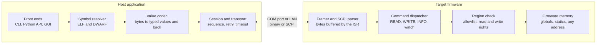

# RDT Design Document

Started 2026-10-05 by rani. This file is the full design document, kept in step with the [living copy](https://claude.ai/code/artifact/01fb6748-f6db-46d8-a10b-bd96ece091f2); [DESIGN.md](DESIGN.md) is the short summary.

## Overview

RDT reads and writes a running device's firmware variables and raw memory over the link the product already has, so an engineer can inspect and tune a live system without attaching a JTAG or SWD probe.

The host application loads the firmware's ELF file, parses its symbol and type information, and resolves a name the user types (`motor.speed`, `cfg.gains[2]`) into an address, a size and a type. It then asks the device to read or write those bytes over a COM port or LAN, as binary frames or SCPI text, and renders the result as a typed value. The ELF is the only symbol input; map files are not supported.

**Goals**

- Read and write any address on the target, with or without a symbol name
- Resolve global and static variables, struct members, array elements and enums from the ELF
- Work over a COM port and LAN from v1, with further channels added later as plug-in transports that need no change to the agent's logic
- Keep the firmware side small, portable and safe enough to leave in a production build
- Be scriptable, so production test and tuning can automate it

**Non-goals for v1**

- Breakpoints, single-stepping and local (stack) variable inspection, which need real debug hardware
- Flashing or firmware update, which belongs to a bootloader
- Source-level stepping or a disassembler

### Why ELF rather than a map file

RDT reads the ELF only (decided 2026-10-05). The comparison below is why: a map file has addresses but no types.

|  | ELF with DWARF | Map file |
| --- | --- | --- |
| Variable address | Yes | Yes |
| Variable size | Yes | Usually |
| Type (int, float, struct, enum) | Yes | No |
| Struct members and offsets | Yes | No |
| Array element type and count | Yes | No |
| Signedness and bit width | Yes | No |
| Build identity check | Yes, via build ID | No |
| Format stability across toolchains | Standardised (DWARF) | Vendor-specific text |

Without types, the host cannot tell `0x41200000` is the float `10.0`, cannot offset into a struct, and must ask the user for every detail. The ELF is standard across GCC, IAR and Keil, so one parser covers every toolchain.

## Requirements

### Functional

| ID | Requirement |
| --- | --- |
| F1 | Read N bytes from an arbitrary target address and return them to the user |
| F2 | Write arbitrary bytes to an arbitrary target address |
| F3 | Load an ELF file and list every global and static variable with address, size and type |
| F4 | Dropped: map file input (decided 2026-10-05, ELF only) |
| F5 | Resolve an expression (`cfg.pid.kp`, `buf[4]`, `*ptr`) to an address and a type |
| F6 | Decode read bytes into a typed value, and encode a typed value into bytes to write |
| F7 | Connect over a COM port or LAN (TCP) in v1, with a plug-in interface for further channels |
| F8 | Verify that the loaded ELF matches the firmware running on the target, and refuse on mismatch unless overridden |
| F9 | Watch a set of variables at a periodic rate and log the samples to CSV |
| F10 | Expose the same operations through a CLI, a Python API and a GUI |
| F11 | Report a clear, specific error for every failure (bad address, no such symbol, timeout, write refused) |

### Non-functional

| ID | Requirement | Target |
| --- | --- | --- |
| N1 | Firmware agent flash footprint | under 4 KB |
| N2 | Firmware agent RAM footprint | under 1 KB plus the I/O buffer |
| N3 | Agent CPU time per poll call, idle | under 10 µs on a 100 MHz Cortex-M |
| N4 | No work in the ISR beyond buffering one byte or one packet | hard requirement |
| N5 | Single read round-trip latency | under 5 ms on a COM port at 115200 baud or faster |
| N6 | Read throughput for a block transfer | at least 100 KB/s on LAN; on a COM port, limited by the baud rate |
| N7 | Portability | plain C99, no dynamic allocation, no compiler extensions |
| N8 | Host platforms | Windows only; the code stays portable so Linux can be added later |
| N9 | Agent memory access must never fault the target on a bad request | hard requirement |

## System architecture



Everything that knows about names, types and the ELF lives on the host; the firmware agent only ever receives an address and a byte count. That split is the central decision of the design: it keeps the firmware side small enough to ship, portable across MCUs, and unaffected when the symbol handling grows.

A request travels down the host stack and back up the target stack. `rdt get cfg.pid.kp` becomes: resolve the name to address `0x20000418` and type `float32`; ask the session for four bytes at that address; encode a READ frame; send it over whichever transport the connection string named; the agent's framer hands the parsed command to the dispatcher, the region check approves the address, four bytes come back; the codec turns them into `0.75`.

The transport is pluggable and the protocol encoding is pluggable, independently. The same command set runs as compact binary frames or as SCPI text, so an instrument-style integration and a high-rate logging session use one firmware implementation.

## Symbol handling

All symbol work happens on the host. The firmware agent never sees a name or a type, only an address and a byte count, which is what keeps it small and portable.

### Loading

The host loads an ELF with `pyelftools` and walks the DWARF `.debug_info` section. For every `DW_TAG_variable` at file scope it records the name, the address from its `DW_AT_location` (a `DW_OP_addr` expression), and a reference to its type DIE. Type DIEs are resolved recursively into a type model: base types with byte size and encoding, pointers, arrays with element type and count, structs and unions with member names and byte offsets, enums with their value-name pairs, and typedefs collapsed to their target.

Map files are not read. A raw address with an explicit type (`@0x20000418:u32`) still works with no symbols loaded.

Parsing a large ELF takes seconds, so the result is cached on disk keyed by the ELF's content hash.

### Symbol model

A resolved symbol is the tuple the rest of the system works with:

| field | meaning | example |
|---|---|---|
| name | fully qualified expression as typed | cfg.pid.kp |
| address | absolute target address | 0x20000418 |
| size | bytes to transfer | 4 |
| type | decoded type descriptor | float32 |
| access | read-only or read-write | rw |
| section | ELF section the address falls in | .data |

### Expression syntax

The user types an expression, not just a name. v1 supports:

- `name` — a global or file-static variable
- `name.member.member` — nested struct and union members
- `name[3]` and `name[2][5]` — array elements, bounds-checked against the declared count
- `*name` and `name->member` — one level of pointer dereference, which costs an extra round trip: read the pointer, then read the target
- `file.c:name` — disambiguating a static when the same name exists in several translation units
- `@0x20000418:u32` — a raw address with an explicit type, needing no symbols at all

Not in v1: arithmetic in expressions, function calls, casts other than the `@addr:type` form.

### Rules settled in M3

These came out of the M3 symbol work (2026-10-11).

- **Typed raw addresses:** a raw address can take any ELF type, then members or cells, for example `@main:0x48000000:GPIO_TypeDef.ODR`. The type can be a typedef or a struct, union or enum tag.
- **Pointers:** an expression that goes through a pointer is re-resolved before every read, so a watch follows the pointer when it moves.
- **Not supported:** local variables, function-static variables, and variables the compiler kept only as constants.
- **Strings:** only `char` arrays show as strings; `uint8_t` and `int8_t` arrays stay numbers.
- **Bit-field writes:** RDT reads the holding word, changes the field, writes the word back and confirms it by read-back. If the firmware changes a neighbouring field in that moment, that change is lost.
- **ELF reload:** RDT waits until the file has been unchanged for 0.5 s. If the rebuilt file can't be read, it keeps the old symbols.
- **Symbol cache:** `%LOCALAPPDATA%\rdt\cache`, or the folder in `RDT_CACHE_DIR`.

### Build identity

The ELF's GNU build ID (`.note.gnu.build-id`) is placed in a known firmware structure at compile time and reported by the agent's `INFO` response. The host compares it on connect. A mismatch means the symbol addresses are untrustworthy, so the host refuses the session unless the user passes `--force`, which downgrades every typed operation to a warning. Without a build ID, the host falls back to comparing a CRC32 over a configured address range.

## Communication

One command set, two encodings, two transports in v1. The agent's command handler is written once; a thin codec turns it into binary frames or SCPI text, and a thin transport layer moves bytes.

### Transports

| Transport | Release | Carries | Notes |
| --- | --- | --- | --- |
| COM port | v1 | SCPI or binary | Any serial port: a UART through a USB-serial adapter, or the MCU's own USB-CDC device. Port and baud rate chosen by the user. |
| LAN TCP | v1 | SCPI or binary | IP address and port entered by the user; one connection per session |
| LAN UDP | v1 | SCPI or binary | IP address and port entered by the user; one command per datagram, one reply per datagram |
| Further channels | Later | Either | CAN, USB bulk, BLE or anything else, added as a plug-in transport |

UDP can lose a datagram silently, so RDT handles it differently: a read that times out is simply re-sent, but a write that times out is not repeated blindly. RDT reads the address back to confirm it, and only then retries. Decided 2026-10-05: LAN uses a plain socket, TCP or UDP, with no VISA layer.

In the GUI the user picks COM, TCP or UDP and fills in the port name and baud rate, or the IP address and port. The same choice can be given as a connection string on the CLI: `com:COM7?baud=115200`, `tcp:192.168.1.50:5025`, `udp:192.168.1.50:5025`, with the protocol taken from the selected profile.

Adding a channel later means implementing one host class (`open`, `close`, `write(bytes)`, `read(timeout)`) and one firmware port function pair. Nothing above the transport layer changes on either side, because the protocol only needs an ordered byte stream or a datagram.

### Binary protocol

The default and the one used for throughput and watch streaming. Little-endian, one request per frame, one response per request, plus unsolicited stream frames.

| field | bytes | meaning |
|---|---|---|
| SOF | 1 | 0xA5 start of frame |
| seq | 1 | sequence number echoed in the response |
| cmd | 1 | command code |
| len | 2 | payload length |
| payload | len | command arguments or returned data |
| crc16 | 2 | CRC-16/CCITT over seq through payload |

On a byte-stream transport (USB-CDC, TCP) the frame is COBS-encoded so a zero byte delimits frames and a desynchronised receiver resynchronises at the next delimiter. Responses carry the request's `seq` and a status byte; the host times out after a configurable 200 ms and retries twice.

| Code | Command | Request payload | Response payload |
| --- | --- | --- | --- |
| 0x01 | PING | none | none |
| 0x02 | INFO | none | protocol version, build ID, max payload, endianness, pointer size, capability flags |
| 0x03 | READ | address (u32/u64), length (u16) | the bytes |
| 0x04 | WRITE | address, bytes | bytes written |
| 0x05 | READ\_MULTI | count, then (address, length) pairs | concatenated bytes |
| 0x06 | WRITE\_ATOMIC | address, bytes | as WRITE, done inside a critical section |
| 0x07 | WATCH\_SET | period in ms, count, then (address, length) pairs | accepted slot count |
| 0x08 | WATCH\_START / WATCH\_STOP | none | none |
| 0x80 | SAMPLE (unsolicited) | timestamp, then the watched values | n/a |

### SCPI

The existing firmware already speaks SCPI, with its own command names. RDT therefore hard-codes no SCPI command: the user defines them in an **SCPI profile**, a small file saved per firmware product and edited in the GUI (decided 2026-10-05).

A profile holds a template for each operation, with placeholders RDT fills in, and a description of the reply:

| Setting | Example | Meaning |
| --- | --- | --- |
| Read command | `MEM:RD? {addr},{len}` | Sent to read `len` bytes at `addr` |
| Write command | `MEM:WR {addr},{value},{size}` | Sent to write one value of 1, 2 or 4 bytes |
| Address format | `0x{addr:08X}` | Hex with prefix, decimal, or `#H` SCPI style |
| Data format | hex string, comma-separated bytes, decimal value, or IEEE 488.2 block | How `{data}` is written and how the read reply is parsed |
| Value byte order | little or big endian | When the device replies with a whole number instead of bytes |
| Maximum response size (bytes of data per reply) | `1024` | Set to match the firmware's reply buffer, from 1 to 65535. RDT packs as much data into each reply as this allows, and splits anything larger |
| Error query | `SYST:ERR?` | Optional; sent once after a command times out, to learn the cause. A failed command sends no reply, so this is the only place its error shows |
| Line terminator | `\n` | Appended to every command; expected at the end of each reply |
| Timeout | `500 ms` | Per command |
| Retries (retries) | 2 | Host only; how many times a timed-out read is re-sent |
| Probe (probe) | \*IDN? | Host only; sent on connect and on every reconnect to check the device answers |
| Reply regex (reply\_regex) | none | Optional; a regular expression whose group named data holds the read data, for replies the fixed formats cannot describe |

### Filling a large response

The firmware implements one read command, `read startAddress,size` (decided 2026-10-05). The maximum response size lets that one command return many values at once, which is what makes polling fast over SCPI.

When watched items lie close together in memory, RDT reads one block covering them all, up to the maximum response size, and decodes every item from it. Gaps between items are read too, as long as the block stays within the limit. Items far apart are read as separate blocks. A multi-address read command is not planned; it would only be considered if measurements show scattered variables poll too slowly.

On every poll cycle RDT plans the reads: it sorts the due items by address, merges neighbours into blocks no larger than the maximum response size, and sends one read per block. Items inside peripheral ranges are never merged; each is read on its own at its exact size. The SCPI console shows the commands actually sent, so the packing can be checked against the firmware.

If the profile defines a size query (suggested firmware command `MEM:MAX?`, returning the largest size the read accepts), RDT asks it on connect and sets the maximum response size automatically; otherwise the value from the profile is used.

### Writing

Writes go one value per command, `write address,value` (decided 2026-10-05), because a SCPI parser handles a short numeric argument far more easily than a long buffer. RDT adapts to that:

- The value is sent as the raw integer of the variable's bytes, in hex. A float is sent as its bit pattern (1.5 becomes `0x3FC00000`), so the firmware never parses a float.
- The size (1, 2 or 4 bytes) is sent with it (confirmed 2026-10-05: \`write address,value,size\`), so the firmware does a single store of the right width. A write sends no reply whether it succeeds or fails, so RDT reads the value back after every write to confirm it.
- Editing a whole struct or array in the GUI becomes one write per field or cell. That is not atomic: the firmware can run between two writes and see a half-updated struct. The GUI says so when more than one write is needed.
- A variable larger than `max_write` (a `double` or `int64` when the limit is 4) is written as several pieces, low address first, with the same warning.
- A later firmware version may add a buffer write; the profile then gains a second write template and RDT uses it for multi-byte edits. Until then it is not used.

Placeholders: `{addr}`, `{len}`, `{size}` (access width 1, 2 or 4), `{data}`, and `{value}` (the typed value as text, for firmware whose write command takes a number rather than bytes).

If the reply format cannot be described by the fixed options, a profile can give a regular expression with a named group, for example `^VAL (?P<value>-?\d+)$`.

The GUI also has an **SCPI console**: a text box that sends any command typed by hand and shows the raw reply, with history. It is the fastest way to try a template before saving it to the profile.

An example profile, as saved:

```
[scpi]
name           = "Motor controller v3"
read           = "MEM:RD? {addr},{len}"
write          = "MEM:WR {addr},{value},{size}"   # one value per command
value_format   = "0x{value:X}"  # raw integer in hex; floats sent as their bit pattern
max_write      = 4              # largest value size the write accepts, in bytes
size_query     = "MEM:MAX?"     # optional; sets max_response on connect
addr_format    = "0x{addr:08X}"
data_format    = "hex"          # reply format of the read
byte_order     = "little"
max_response   = 1024           # bytes of data the firmware can put in one reply
error_query    = "SYST:ERR?"
terminator     = "\n"
timeout_ms     = 500
```

### Recommended firmware commands

The existing firmware has no memory commands yet (decided 2026-10-05: rani adds them later). Any names work, since the profile maps them, but this shape is the easiest to implement and is what the simulator and the default profile use:

```
MEMory:READ? <addr>,<len>     -> hex bytes, lowest address first: 0000A041
MEMory:WRITE <addr>,<value>,<size>   ; one value of 1, 2 or 4 bytes
SYSTem:ERRor?                 -> 0,"No error" or a code and text
```

Addresses are accepted as `0x` hex. The read reply is plain hex text rather than an IEEE 488.2 binary block, because it is trivial to produce in firmware and readable in the SCPI console. A read of more than the firmware's buffer sends no reply and puts an error in the queue, so RDT never asks for more: it splits the request using the profile's maximum length.

SCPI is the slower path, because text parsing and hex formatting cost bandwidth and target CPU. Watch rates over SCPI are therefore limited by the command round trip, and the GUI shows the achieved rate.

### Error codes

One list, shared by both encodings; SCPI maps them onto its error queue.

| Code | Meaning |
| --- | --- |
| 0 | OK |
| 1 | Bad CRC or malformed frame |
| 2 | Unknown command |
| 3 | Address not in an allowed region |
| 4 | Length exceeds the maximum payload |
| 5 | Unaligned access the target cannot perform |
| 6 | Write refused: region is read-only or the write lock is engaged |
| 7 | Too many watch slots requested |
| 8 | Busy |

### Sharing the link with other tools

Other tools may talk to the firmware's SCPI port over LAN while RDT is connected (rani, 2026-10-05). A COM port can be opened by only one program, so sharing applies to LAN only.

- Each tool uses its own TCP connection, and the firmware must send each reply on the connection that asked. Over UDP it replies to the sender's address and port.
- RDT checks every read reply: its length must match the requested size. A reply that doesn't fit is discarded, the input is flushed, and the read is sent again.
- A command that times out is retried with a growing delay instead of failing at once.
- The SCPI error queue is shared by all clients, so another tool's errors can show up in RDT's error query. Another tool can also read RDT's error first. RDT therefore never depends on the error query: writes are confirmed by reading the value back, and an error found after a timeout is only a hint.
- M2 adds a simulator test in which a second client sends commands while RDT polls.

## Multiple MCUs

The device has several MCUs, each with its own ELF, and RDT debugs all of them through the main MCU (rani, 2026-10-11). The main MCU owns the USB/LAN link and forwards requests to the others over an internal channel.

| Topic | Decision |
| --- | --- |
| MCU IDs | The main MCU is MCU 0; the others are 1, 2, 3. Each has a display name and its own ELF in the workspace. |
| SCPI commands | The MCU is an extra parameter: `read mcu,startAddress,size` and `write mcu,address,value,size`. Templates use an `{mcu}` placeholder. |
| Internal channel | MCUs 1 and up use fixed 64-byte command and response frames. The main MCU's firmware splits a large read into 64-byte pieces, so `max_response` stays one profile setting. |
| Timeouts | One profile timeout, which each MCU can override, because split reads take longer. |
| Silent MCU | The main MCU sends no reply and puts a defined error in the queue, such as `-240,"MCU not responding"`. RDT greys out only that MCU's values, keeps polling the others, and retries it in the background. Because another LAN client may read that error first, RDT also greys out an MCU after three timeouts in a row while MCU 0 still answers. |
| Watch tabs and chart | Each watch tab is one mixed tree with an MCU column and filter. The chart and the CSV log can combine values from any MCUs; timestamps come from the PC. |

- Every expression starts with the MCU's name, always, with no default (rani, 2026-10-11): `main:motor.speed`, `motorctl:cfg.gains[2]`, `@motorctl:0x20000418:u32`. The name is the display name from the workspace, and the watch tabs, chart legend and CSV columns show it too.
- Symbols, memory ranges, the ELF watcher and the build-ID check all work per MCU, since each MCU has its own ELF.
- On MCUs 1 and up, a struct or array larger than 64 bytes is read in pieces, so its fields may not come from the same moment. The variable view marks such items.
- The simulator models several MCUs, each with its own ELF and memory, including the 64-byte split and a silent MCU (no reply, error in the queue).

### Target file

M2 keeps the connection, the SCPI profile and the MCUs in one TOML target file, which becomes the start of the M3 `.rdtw` workspace.

```toml
[connection]
transport = "tcp"
host      = "192.168.1.50"
port      = 5025

[profile]
read  = "read {mcu},{addr},{len}"
write = "write {mcu},{addr},{value},{size}"
retries = 2
probe   = "*IDN?"

[[profile.ranges]]
mcu   = "main"
name  = "GPIOA"
start = 0x48000000
size  = 0x400

[[mcu]]
id   = 0
name = "main"
elf  = "build/main.elf"

[[mcu]]
id         = 1
name       = "motorctl"
elf        = "build/motorctl.elf"
timeout_ms = 1500

[[mcu.ranges]]
name  = "TIM1"
start = 0x40012C00
size  = 0x400
```

A range can sit in the profile with `mcu = "name"`, or under its MCU entry; both mean the same.

### Workspace file

The `.rdtw` workspace is the target file plus the watch tabs and the chart layout (2026-10-11). See Watch tabs below.

```toml
poll_ms = 500                    # global interval; 0 = off

[[tab]]
name = "Motor"                   # unique, case-insensitive

[[tab.watch]]
expr      = "main:motor.speed"
poll      = "global"             # global | manual | a number of ms
format    = "dec"                # dec | hex | bin | char
q         = 15                   # optional fixed-point bits
scale     = 1.0
offset    = 0.0
unit      = "rpm"
read_only = false
min       = 0
max       = 3000
confirm   = true

[[tab]]
name = "Overview"

[[tab.watch]]
expr = "main:motor.speed"        # same item as in "Motor": settings shared

[chart]
window_s = 30                    # visible history, 1 s to 600 s

[[chart.series]]
expr   = "main:motor.speed"
axis   = 1                       # 1-4: 1 on the left, the rest on the right
color  = "#1f77b4"
unit   = "rpm"                   # optional
hidden = false                   # optional
```

- The `[connection]`, `[profile]` and `[[mcu]]` tables are the same as in the target file.
- Shown value = raw / 2^q × scale + offset, on single values only. `min` and `max` are in shown units.
- Read-only on a struct or array covers all its fields.

### Watch tabs

Added by rani on 2026-10-11, together with removing the command buttons.

- **Tabs:** a workspace holds several watch tabs. Each `[[tab]]` has a name (unique, ignoring case) and its own ordered list of items in `[[tab.watch]]`.
- **Shared items:** one expression can be in several tabs but is one item, with one set of settings (format, scaling, polling, write safety) shared by every tab. The settings are written at the item's first place only; a later place may repeat them but must not differ, or the file fails to load. Write safety is checked across all tabs.
- **Polling:** every tab keeps polling, not only the visible one. Each poll collects what every tab has due, reads each expression once, and gives the result to every tab that shows it. The chart and the CSV log see items from all tabs.
- **GUI:** the centre of the window is a tab bar of watch trees. Tabs are added with +, renamed by double-click, removed (with a question if the tab is not empty; the last tab can't be removed) and reordered by dragging. The Watch menu has New tab (Ctrl+Shift+T), Rename and Remove, and Ctrl+PgUp/PgDown switch tabs. An item's menu has "Also show in tab" and "Remove from this tab". Items added from the symbol browser go to the tab in front.
- **CLI:** `read` and `watch` take `--tab NAME`, and default to every tab. `add --tab NAME` creates the tab if it is new; `remove --tab NAME` removes from one tab, and from every tab without it. `rdt tab add|rename|remove` manages tabs, and `list` prints the items per tab.
- **Older files:** a top-level `[[watch]]` list loads as one tab named "Watch" and is saved as tabs. A `[[button]]` table loads with a warning and is dropped on save.

## Firmware side (specification, built later)

Not in the current scope (decided 2026-10-05): the PC application is built first, and the firmware part comes later, inside the existing firmware. This section is the contract that firmware will implement; until then the simulated device implements it, so the application can be built and tested end to end.

Integration into the existing firmware is three lines of application code plus a porting file. Everything above that is library code the application never touches.

### Public API

```c
/* Called once at start-up with the I/O buffers and the allowed-region table. */
void rdt_init(const rdt_config_t *cfg);

/* Called from the UART/USB RX ISR or an RTOS receive task. Buffers one byte. */
void rdt_rx_byte(uint8_t b);

/* Called from the main loop or a low-priority task. Parses whatever has
   arrived, executes at most one command, sends the response, services
   watch sampling. Bounded work; never blocks. */
void rdt_poll(void);
```

### Porting layer

One file per platform implements four functions, and nothing else is platform-specific:

```c
void     rdt_port_tx(const uint8_t *data, uint16_t len); /* non-blocking send */
uint32_t rdt_port_time_ms(void);                         /* monotonic ms */
void     rdt_port_critical_enter(void);                  /* for atomic access */
void     rdt_port_critical_exit(void);
```

### Memory access rules

The agent protects the target from a bad request before it touches anything.

1. Every address and length is checked against the allowed-region table, which the integrator fills from the linker script symbols (`_sdata`/`_edata`, `_sbss`/`_ebss`, flash start and size). Peripheral ranges are excluded by default and added only deliberately, because reading a peripheral register can clear a flag or pop a FIFO.
2. Each region carries read and write permission separately, so flash and `.rodata` are readable but not writable.
3. Accesses of 1, 2 or 4 bytes on a naturally aligned address are performed as a single load or store, so a concurrently running ISR sees a whole value and the host never gets a torn one. Larger or unaligned transfers are done bytewise and reported as non-atomic; `WRITE_ATOMIC` wraps them in a critical section when the caller needs consistency.
4. The agent never writes to its own state, the stack, or the region holding the response buffer.

### Footprint and timing

| Item | Budget |
| --- | --- |
| Flash | under 4 KB with binary protocol only; SCPI adds roughly 2 KB of parser |
| RAM | under 1 KB of state plus RX and TX buffers, 256 B each by default |
| ISR cost | one byte stored into a ring buffer |
| Poll cost, idle | a buffer check, under 10 µs |
| Poll cost, one 64-byte read | dominated by the memcpy and the CRC |

No dynamic allocation anywhere. All buffers are supplied by the integrator in `rdt_config_t`, so the agent's memory is visible in the map file.

## Host application

The host is a Python package whose core is a library; the CLI and the GUI are two front ends over the same API, so anything the GUI does can be scripted.

### Block diagram


Every panel and the CLI call the Target API, never the layers below it. The core resolves names through the symbol database, plans reads in the poll scheduler and checks writes in the write guard; only the protocol and transport layers know how bytes reach the device, so swapping the simulator for the real firmware, or SCPI for the binary protocol, touches nothing above them.

```
rdt/
  transport/    base.py, serial.py, tcp.py               - plug-in byte movers
  protocol/     binary.py, scpi.py, frames.py            - encode commands
  session.py                                             - sequence, retry, timeout
  symbols/      elf.py, mapfile.py, types.py, expr.py    - ELF/DWARF, map, expressions
  codec.py                                               - bytes <-> typed values
  target.py                                              - the public API
  gui/                                                   - the desktop app (primary UI)
  cli.py                                                 - the command line
```

### Scripting API

```python
from rdt import Target

with Target("tcp:192.168.1.50:5000", elf="build/fw.elf") as t:
    print(t.get("cfg.pid.kp"))        # 0.75
    t.set("cfg.pid.kp", 0.9)
    raw = t.read(0x20000418, 16)      # bytes, no symbols needed
    with t.watch(["motor.speed", "motor.current"], rate_hz=100) as w:
        for sample in w:
            print(sample.t, sample["motor.speed"])
```

### CLI

```
rdt info          --port tcp:192.168.1.50:5000
rdt list          --elf build/fw.elf --filter 'cfg.*'
rdt get  cfg.pid.kp
rdt set  cfg.pid.kp 0.9
rdt read  0x20000418 16 --format hex
rdt write 0x20000418 DEADBEEF
rdt watch motor.speed motor.current --rate 100 --csv run.csv
```

Connection and ELF paths come from `--port`/`--elf`, the `RDT_PORT`/`RDT_ELF` environment variables, or an `rdt.toml` in the working directory, in that order of precedence.

With the workspace file (M3), `-w` opens a workspace (`-t` is the same option) and `write -y` skips the confirm. `read` and `watch` default to every watch tab or take `--tab NAME`, `init` starts a workspace, and `list`, `add`, `remove` and `tab` edit the watch tabs. Command buttons and `rdt press` were removed (rani, 2026-10-11); such commands go through `rdt send`.

### GUI

The GUI is the primary interface and ships from M3, after the host core and CLI in M2, and grows with each milestone. It is a Qt desktop app (PySide6), chosen because it packages into a single installer on Windows and has a fast live-plot widget. The GUI only calls `Target`, so the CLI and scripting API come almost for free.

| Panel | What it does | First milestone |
| --- | --- | --- |
| Connection bar | Pick COM port and baud, or TCP/UDP with IP and port; choose the profile; connect, disconnect, show build-ID match | M3 |
| Memory view | Hex and ASCII dump of any address range, editable in place | M3 |
| Variable tree | Every global from the ELF, searchable, expandable into struct members and array elements | M3 |
| Value editor | Read and write the selected variable as its own type (float, enum by name, bitfield) | M3 |
| Watch table | Pinned variables refreshed live, values editable in the cell | M4 |
| Live plot | Selected watch variables plotted over time, with CSV export | M4 |

Two SCPI panels arrive with M3: the **SCPI profile editor**, where the user defines the read and write command templates and the reply format and can test each one against the connected device, and the **SCPI console** for sending any command by hand.

### How the M3 GUI works

Settled while building the first GUI (2026-10-11). The live chart stays in M4.

- **Start:** `rdt-gui [workspace.rdtw]` or `python -m rdt.gui`. The GUI works on one workspace, and every edit saves back to it. Opening a plain `.toml` target file starts an unsaved workspace, and Save asks for a `.rdtw` path.
- **Threading:** all device I/O runs on one worker thread, in the order it was asked for. Keyed jobs (each watch item, the memory view, the ELF check) are dropped while the previous job with the same key is still pending, so a slow poll falls behind instead of queueing. A 50 ms tick looks for due items, and each row shows its achieved rate.
- **Watch tree:** structs and arrays get header rows with depth, type and address. Collapsed structs and arrays are not read, and arrays page by 100 cells. Every item is read once on connect; manual items are read only by hand or with F6.
- **Writes:** edited in place, checked by the workspace's write safety, confirmed in a dialog when the item asks for it, and verified by read-back.
- **ELF check:** every 1 s while connected, with re-mapping by name. Items that moved or changed type turn orange with a note; items that no longer exist turn grey and show "gone".
- **Profile editor:** edits every SCPI field with a live preview of the commands and a test read using the edited profile before applying. Applying stores the profile inside the workspace and reconnects. MCUs and their ELFs have their own dialog.
- **Link state:** the console and memory view are disabled unless the link is up, and the connection fields can be edited only while disconnected.

### Watch, chart, statistics and CSV (M4)

Settled while building the live watch in M4 (2026-10-11).

- **Poll scheduler:** items on one MCU that are at most 32 bytes apart merge into one read of up to `max_response` bytes. Peripheral ranges are never merged. A merged read that fails is re-read item by item. Only one poll runs at a time, so a slow link falls behind instead of queueing. Each sample carries the PC time its reply arrived.
- **Chart:** drawn with pyqtgraph. The workspace's `[chart]` table has `window_s` for the visible history (1 s to 600 s) and one `[[chart.series]]` per signal with `expr`, `axis` (1 to 4: axis 1 on the left, the rest on the right), `color`, and optionally `unit` and `hidden`. Signals with the same unit share an axis by default. A charted field of a collapsed struct is still read.
- **Statistics:** Min, Max, Mean and Samples columns in the watch tree, hidden by default and shown with View > Statistics columns (Ctrl+T). Changing an item's scaling resets its statistics.
- **CSV log:** `rdt watch --csv FILE` on the CLI, or from the GUI. Columns are `time` (ISO 8601 with UTC offset), seconds since start, one column per value named with `  [unit] `, and `event` (link down, link up, ELF rebuilt for an MCU). There is one row per poll, and a cell is empty when that value was not read in that poll. Values are shown values in decimal, enums as numbers and bools as 0 or 1. The file is UTF-8 with a BOM, so Excel opens it correctly.

### Variable view

The main window works like a debugger's watch window (decided 2026-10-05). The user browses or searches every global and static variable from the ELF, adds the ones they care about, and sees their live values. A struct shows all of its fields and an array shows all of its cells, nested to any depth:

```
Name                    Type          Address      Value
▾ motor                struct motor  0x20000400
    state               enum state    0x20000400   RUNNING (2)
    speed               float         0x20000404   1500.0
  ▾ pid                struct pid    0x20000408
      kp                float         0x20000408   0.75
      ki                float         0x2000040C   0.02
      kd                float         0x20000410   0.0
  ▾ phase_current[3]   int16_t[3]    0x20000414
      [0]               int16_t       0x20000414   -312
      [1]               int16_t       0x20000416   148
      [2]               int16_t       0x20000418   164
    flags.fault         bitfield 1    0x2000041A   0
▸ cfg                  struct cfg    0x20000500
  rx_buf[256]           uint8_t[256]  0x20000600   (collapsed)
```

How each kind of variable is shown:

| Kind | Display | Edit |
| --- | --- | --- |
| Integer | decimal, with a per-row toggle to hex or binary | type a number; range-checked against the type |
| Float, double | decimal | type a number |
| Enum | the name and the number, e.g. `RUNNING (2)` | pick from a drop-down of the enum's names |
| Bool | `true` / `false` | checkbox |
| Bitfield | its own value, extracted from the containing word | type a number; written as read-modify-write of the containing word |
| Struct, union | expandable node; every field is a child row | edit the fields |
| Array | expandable node; every cell is a child row, numbered `[0]`, `[1]` ... | edit the cells |
| char array | also shown as a string, e.g. `"v3.2.1"` | type a string; padded with zeros |
| Pointer | the address it holds, plus an expandable child for what it points to | type an address |

How it reads the device:

- Expanding a struct or array reads the whole object in as few commands as possible: one read of its total size, split only at the profile's maximum length. Every child value is decoded from that one block, so all fields of a struct come from the same moment.
- Large arrays expand in pages of 100 cells, with a "show more" row, so a 4 KB buffer doesn't flood the view or the link.
- Collapsed nodes are not read at all. Only what is visible is refreshed.
- Values refresh by polling, at the interval described below, or on demand with a button or F5. A value that changed since the last refresh is highlighted.
- The list of watched variables, their expanded state and their display formats are saved with the session and reopen next time.

### Polling interval

Every watched item, whether a variable from the ELF or a raw address, is polled at an interval. A global setting gives the default, and each item can override it (decided 2026-10-05).

| Setting | Where | Values | Default |
| --- | --- | --- | --- |
| Global polling interval | Settings, and a box in the toolbar | a time in ms, or Off | 500 ms |
| Item override | An Interval column in the watch tree, and the item's right-click menu | Global (inherit), a time in ms, or Manual | Global |

Rules:

- An item set to Global follows the global value, including later changes to it. An item with its own interval keeps it when the global value changes.
- Manual means the item is read only when the user presses refresh, which suits large buffers or values that rarely change.
- The override applies to a top-level watched item. Fields of a struct and cells of an array are read with their parent in the same block, so they share its interval and stay consistent with each other. To poll one field at a different rate, add that field as its own watched item (for example `motor.pid.kp`).
- Setting the global interval to Off pauses all polling; a Pause button in the toolbar does the same without losing the configured values.
- The intervals are saved with the session.

How the scheduler works: on each tick it collects every item that is due and sends their reads back to back, merging neighbouring addresses into one read where the profile's maximum length allows. If the link cannot keep up (likely over SCPI on a slow COM port), items fall behind rather than queueing up without limit, and each row shows its actual achieved rate next to the requested one, so the user can see the limit instead of guessing.

### v1 features adopted from FreeMASTER and STM32CubeMonitor

rani picked these nine on 2026-10-05 from the feature comparison. All of them are PC-side and need no firmware changes. Everything else on that list (multi-variable read, on-target recorder, alarms, stimulus, computed values, scripting API, log replay) is out of v1.

| # | Feature | Design | Milestone |
| --- | --- | --- | --- |
| 1 | Live chart | An oscilloscope panel plotting any watched numeric items against time, fed by the polling engine. Pause, zoom, pan, two cursors showing values and time difference, auto or fixed Y range, one or more Y axes. A configurable history depth (default 10 minutes) is kept in memory. | M4 |
| 2 | Display formats and scaling | Per item: decimal, hex, binary or char; fixed-point Q15, Q31 or Qm.n; and a linear scale `value = raw * k + offset` with a unit label (e.g. `0.0122 * raw - 50`, `°C`). Writes apply the inverse scale and round to the raw type. The chart and CSV use the scaled value. Settled in M3: shown = raw / 2^q × scale + offset, on single values only; a write converts from shown units to the nearest raw value and is refused if it doesn't fit the type. | M3 |
| 3 | Enum and bit-field names | Enum values shown as `NAME (n)` and edited from a drop-down; bit fields shown as their own named rows, both taken from DWARF. Already part of the Variable view; listed here so it is tracked as a v1 feature. | M3 |
| 4 | Workspace file | One `.rdtw` file (TOML) saving the ELF path, connection settings, SCPI profile, watch tabs with expanded state, per-item interval, format, scaling and limits, and chart layout. Open, Save and Save As; the last workspace reopens on start. A plain target file opens as a workspace with no watches. Saving rewrites the file, so comments in it are lost, and paths are stored relative to the file. | M3 |
| 5 | ELF rebuild detection | The app watches the ELF file. When it changes, it reloads it and re-maps every watched item by its expression (e.g. `motor.pid.kp`), not by its old address. Items whose address or type changed are flagged in the tree; items that no longer exist are kept, greyed out, so nothing is silently lost. Polling pauses during the reload. | M3 |
| 6 | CSV logging | Start and Stop buttons; one row per poll cycle with a timestamp (ISO 8601, ms) and one column per logged item, scaled values. The user picks which items are logged and the file name. | M4 |
| 7 | Write safety | Per item: a read-only flag, min and max limits (in scaled units) checked before every write, and an optional confirm dialog showing old and new value. A global setting makes all items read-only by default. Read-only on a struct or array covers all its fields, and a write that needs a confirm with no one to answer it (the CLI without -y) is refused. | M3 |
| 8 | Command buttons (removed) | Removed by rani on 2026-10-11. Send such commands from the SCPI console or with `rdt send`. A workspace with `[[button]]` still loads, with a warning, and the buttons are dropped on save. | — |
| 9 | Statistics | Per watched numeric item: min, max and mean since the last reset, plus the sample count, shown as optional columns in the watch tree. A reset button per item and one for all. | M4 |

## Safety and error handling

A tool that writes arbitrary memory in a running system can brick a test rig or, worse, move a motor. The defences are layered, with the most important ones on the target, since the target cannot trust the host.

| Risk | Defence |
| --- | --- |
| Read or write of an unmapped address faults the CPU | The host refuses any address outside the ELF's RAM and flash sections and the extra ranges listed in the SCPI profile; an access that touches a listed range must stay inside it, and writes to read-only ELF sections (.text, .rodata) are refused. The allowed-region table on the target is a second check |
| Reading a peripheral register changes hardware state | Peripheral ranges are reachable only once listed in the SCPI profile, and reads there are never merged: each item is read on its own at its exact size |
| Writing a live control variable causes dangerous motion | Write lock: writes refused until the host sends an explicit unlock; regions can be marked read-only |
| A torn multi-byte read returns a nonsense value | Single-instruction aligned access; `WRITE_ATOMIC` and critical-section reads where needed |
| Symbols from the wrong build point at the wrong data | Build ID compared on connect, session refused on mismatch |
| A corrupted frame is executed as a command | CRC16 on every frame; a failed CRC is dropped, never partially applied |
| An attacker on the LAN reads or writes device memory | None, by decision: no authentication; use on trusted networks |

### Network exposure

RDT has no authentication, by decision: it is a development and bench tool used on trusted networks. Anyone who can reach the device's RDT port can read and write its memory.

Two cheap controls stay in the design for that reason: the agent compiles in only when `RDT_ENABLE` is defined, so a release build can leave it out entirely, and the LAN listener is switched on in the integrator's configuration rather than by default.

### Failure behaviour

The host retries a timed-out request twice, then reports the failure with the command and address that failed. A failed SCPI command sends no reply at all, and its error goes only to the error queue (rani, 2026-10-11), so after a timeout RDT sends the error query once and shows the cause if it finds one. If the error query gets no reply either, the device counts as not answering: the link is marked down and RDT reconnects. When the link drops, RDT reconnects on its own (rani, 2026-10-05): values grey out, writes are refused while the link is down, and RDT retries in the background with a growing delay. Once the link is back, it re-reads every watched value, marks the gap in the chart and the CSV log, and resumes polling. The agent, for its part, resynchronises on the next frame delimiter and answers the next valid request, regardless of what came before.

## Testing

Most of the system can be tested without hardware, which is what keeps CI useful.

- **Simulated device.** Written in Python alongside the application. It implements the protocol exactly as the specification states, holds a memory image loaded from an ELF, and enforces the same region rules the firmware will. The application talks to it exactly as it will talk to a board, so protocol, session, retry, symbols and watch are all covered in CI.
- **ELF corpus.** A set of small firmware images built with GCC, Clang and, if available, IAR and Keil, each with known variables of every supported type. Golden tests assert that the resolver returns the expected address, size and type for each one.
- **Protocol unit tests.** Frame encode/decode, COBS round trip, CRC vectors, truncated and corrupted frames, sequence mismatch, resynchronisation after garbage.
- **GUI tests.** pytest-qt drives the main flows: connect, browse the variable tree, edit a value, start a watch.
- **Later, with the firmware.** Agent unit tests for region boundaries, fuzzing `rdt_rx_byte`, and hardware-in-the-loop runs measuring latency and throughput against N5 and N6.

## Milestones

SCPI comes first, because the existing firmware already speaks it. The firmware does not yet have memory read and write commands (rani adds them later), so the application is built and tested against the simulated device; the moment those two commands exist, it works on real hardware with nothing else changed.

1. **M0: Spec and skeleton.** This document and the protocol specification agreed; `rani-feldman/RDT` laid out; CI running.
2. **M1: Simulated device.** A Python program that answers SCPI commands defined by a profile, and the binary protocol, over TCP and over a virtual COM port pair. Its memory is loaded from the ELF's initialised data, so reads return the firmware's real start-up values.
3. **M2: Host core and CLI, over SCPI.** COM, TCP and UDP transports, session, SCPI profiles, the target file with several MCUs, reconnect, and the CLI, all tested against the simulated device. No GUI yet (rani, 2026-10-11). It becomes usable on real hardware as soon as the firmware has its memory read and write SCPI commands, which rani adds later.
4. **M3: First GUI and symbols.** The GUI's connection bar, SCPI profile editor, SCPI console and memory view; ELF/DWARF loader, type model, expression resolver, value codec, build-ID check; the variable tree and typed value editor, display formats and scaling, write safety, the workspace file and ELF rebuild detection.
5. **M4: Watch.** Host-side polling at a set rate, so it needs nothing new in firmware; the GUI's watch table, live chart, statistics and CSV logging.
6. **M5: Binary protocol.** The faster path, ready in the application for when the firmware part is written.
7. **M6: Application release.** Installer, user documentation, and the protocol specification packaged for the firmware work.
8. **Later: Firmware integration.** The binary agent added to the existing firmware, then tested on hardware against N5 and N6. Target-side sampling and the write lock come with it.

## Open questions

Decided with rani on 2026-10-05:

| Topic | Decision |
| --- | --- |
| Target MCU | Not fixed. The design is MCU-independent: endianness and pointer size come from the ELF header and the agent's INFO reply, and only the porting file is MCU-specific |
| Communication | COM port and LAN in v1; further channels later as plug-in transports |
| User interface | GUI from the start, with the CLI and Python API on the same core |
| Authentication | None; RDT is used on trusted benches and networks |
| Symbol input | ELF only; map files are not supported |
| Scope | PC application first, tested against a simulated device; the firmware part goes into the existing firmware later |
| PC operating system | Windows only; the code stays portable |
| Firmware language | C only; no C++ support in the symbol reader |
| Memory ranges | Accesses outside the ELF's RAM and flash and the profile's extra ranges are refused |
| Peripheral reads | Never merged into blocks; each item read alone at its exact size |
| Link loss | Reconnect automatically; writes refused while the link is down |
| Shared SCPI port | Other tools may use it over LAN at the same time; RDT tolerates unexpected replies and busy firmware |
| Multiple MCUs | One ELF per MCU; main MCU is 0 and forwards to the others; MCU is an extra SCPI parameter (2026-10-11, see Multiple MCUs) |

Still open:

- [ ] **Answered: the existing firmware speaks SCPI, so commands are user-defined in an SCPI profile.** See the SCPI section.
- [ ] **Host language.** Answered: Python with a Qt GUI (PySide6).
- [ ] **Which board will be the first hardware test? Only open item, and not needed until rani adds the memory commands.**

Deferred to the firmware phase: bare metal or RTOS, and whether SCPI is parsed on the device.
