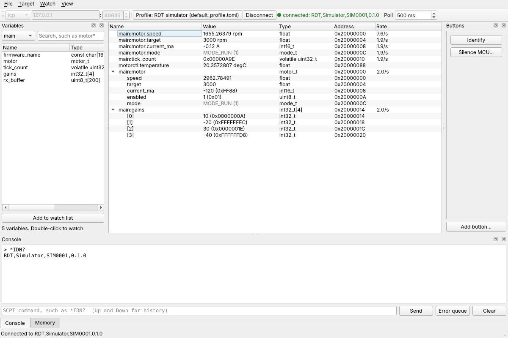
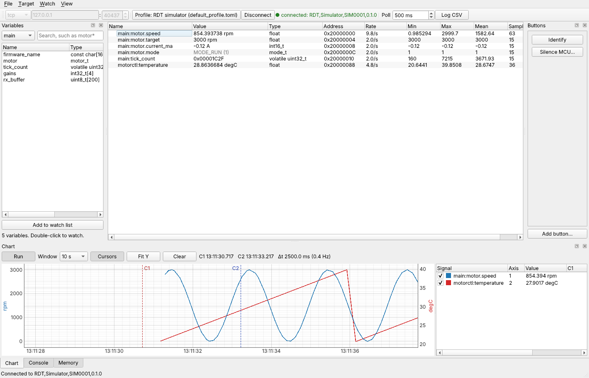

# RDT GUI

The GUI works on one workspace (`.rdtw`, see [CLI.md](CLI.md#workspace)): the connection, the SCPI profile, the MCUs and their ELF files, the memory map, the watch tabs, the chart layout and the known commands. Everything you change in the window is saved back to it: the profile, the memory map, the watch tabs and chart, and the commands each go to a file of their own beside the `.rdtw` (see [Files](#files)). For a step-by-step guide, see the [user manual](USER_MANUAL.md).

```
python -m pip install -e .[dev]
python -m sim &                          # the simulated device
rdt-gui examples/sim_bench.rdtw          # or: python -m rdt.gui examples/sim_bench.rdtw
```

Started with no file, `rdt-gui` reopens the workspace you last opened or saved. If there is none (or that file is gone), it opens `rdt.toml` from the current folder, or else from `%LOCALAPPDATA%\rdt`, the same default target file as the CLI (see [Default files](CLI.md#default-files)); otherwise it starts with a new workspace. File > Open and Save as start in `%LOCALAPPDATA%\rdt` (beside `ui.toml`), and a workspace's `.profile.toml`, `.memory.toml`, `.watch.toml` and `.commands.toml` are always saved beside its `.rdtw`.



## Connection bar

- **Transport**: `tcp` or `udp` with the device's IP address and port, or `serial` with a COM port and baud rate. The COM port list shows each port with its description, such as `COM3 - GAC serial port (COM3)`; you can also type a port name.
- **Profile** (gear icon): opens the SCPI profile editor (below). Its tooltip shows the profile's name and, when it comes from a file of its own, the file.
- **Connect button** (F5). One button shows the link state and the link, the COM port or IP:port, and clicking it connects or disconnects: green `Connected · COM3` while the link is up, amber `Connecting · COM3` (click to cancel), red `Link down · COM3` when the port broke (RDT reconnects by itself) or when the device answered none of the last three reads while the port stays open, and blue `Disconnected · COM3` when not connected. Hover over the button for which one it is. Connected means the COM port or socket opened; RDT sends nothing to the device to check it (no `*IDN?`). A port that disappears, such as an unplugged USB COM port, shows as link down within a second even with polling off; a board that hangs with its port still open is only noticed by the next reads, so with polling off press Poll now (F6). While the link is down the MCU cards say `link down` and writes are refused; when it comes back the ELFs are checked against the firmware again. The memory view and sending from the console are disabled unless the link is up (the transcript, search, log and command list still work), and the connection fields can only be changed while disconnected.
- **RUN / STOP** (F7, also **Watch > Poll automatically**): a key as on an oscilloscope. Green `▶ RUN` while polling; click it to stop all polling, including items with their own interval, and it turns red `■ STOP`. The interval is kept and polling picks up where it was when you click it again. Polling is on when RDT starts; the setting is not saved in the workspace.
- The interval next to it is the global polling interval. `Off` (0) stops the global polling only; items set to their own interval still poll.
- **Poll now** (circular arrow icon, F6, also **Watch > Poll now**): read every watched item once, in every tab, including manual items, whether polling is on or off.
- **Log CSV** (page icon, red while logging, Ctrl+L): log every watched value to a CSV file. See [CSV log](#csv-log).

**Target > MCUs and ELF files** sets each MCU's id, name, short name, colour, ELF file and timeout (how long to wait for that MCU's reply; empty uses the SCPI profile's timeout). MCU 0 is the main MCU and is required. The **short name** (1 to 6 letters, digits or underscores, such as `CM7`) and the **colour** make the MCU's tag in the watch tree; double-click the colour cell to choose one. Left empty, the short name is the part of the name after its last underscore, cut to four characters (`Control_CM7` is `CM7`, `main` is `MAIN`), and the colour is picked by the MCU's id. Short names must be unique. A long ELF path is cut in the middle so the file name stays visible; hover the cell to see the whole path, or widen the window.

**Errors.** Every error shows in one slim red bar under the toolbar: a failed connect, read, write or poll, and an ELF that does not match the firmware. A failed action stays until you close it (✕), another error replaces it, or a later action goes through; the ELF line stays until the ELF matches. The status bar at the bottom only shows ordinary messages.

**ELF identity.** On connect, RDT checks that each MCU runs the firmware its ELF came from: it compares the GNU build ID when the linker put it in memory, or else sampled blocks of the read-only sections (code, constants, vector table) on the device with the ELF file. Each MCU's card in the **Target** panel shows the result on its ELF line: `✓ main.elf` (green), `✗ main.elf does not match` (red), `? main.elf: not checked yet` or `? main.elf: not read` (grey); the console says the same. On a mismatch every read and write to that MCU is refused, so a stale ELF can't read or write the wrong address. The red error bar under the toolbar names the MCU and stays until the ELF matches again, with **Load ELF...** (opens Target > MCUs and ELF files) and **Check again**; its tooltip has the detail. There is no way around it in the GUI: load the ELF that matches the firmware, or flash the firmware that matches the ELF. **Target > Check ELF identity** checks again, such as after flashing while the link stays open; it also runs after an ELF is rebuilt and when the link or an MCU comes back after a drop. See [Use your own ELF](use-your-own-elf.md#check-that-the-device-runs-this-elf).

## Panels

The four buttons at the left of the toolbar each show or hide one panel (also **View > Show or hide Watch** and so on, Ctrl+1 to Ctrl+4):

- **Watch** (Ctrl+1): the watch tabs.
- **Scope** (Ctrl+2): the chart.
- **Memory** (Ctrl+3): the memory view.
- **Console** (Ctrl+4): the SCPI console.

A button is pressed while its panel is shown. A panel that sits behind another tab comes to the front when you press its button, and is hidden by the next press. Every panel can be moved (drag its title bar to dock it elsewhere, stack it as a tab or float it) and resized (drag the edge between panels). The **Target** panel with the MCU cards is shown or hidden from **View > Target**.

Polling, the chart and the CSV log keep running while a panel is hidden. The layout (which panels are shown, where they are and how big) is saved when you close RDT and each time you press a button; **View > Save layout** (Ctrl+Shift+S) saves it at once, and it is kept per user in `ui.toml`. **View > Reset layout** shows every panel again where it starts.

## Target panel

The **Target** panel on the left shows the workspace and its link, then one **card** per MCU:

- The MCU's **tag** (short name and colour, see Target > MCUs and ELF files), its name and id, and a dot with its overall state: green when it answers and its ELF matches, amber when it is slow or a read timed out in the last minute, red when its ELF does not match the firmware or the link is down, grey when not connected, silent or not checked.
- **Link**: how long the MCU takes to answer a read (`✓ 38 ms`), with the number of reads that timed out in the last minute (`412 ms · 3 timeouts`), `silent: not answering`, `link down` or `not connected`.
- **ELF**: the ELF file and whether it matches the firmware (see [ELF identity](#connection-bar)).
- **Variables ▸** (or a click on the card's title) opens the card on the MCU's variables; one card is open at a time. **Memory ranges ▸** lists the memory RDT may read on that MCU: the ELF's sections and the workspace's ranges, with their start, size and kind.
- Right-click a card for **Check ELF again**, **MCUs and ELF files...** and **Open in the memory view**.

## Variable view

The open card lists its MCU's globals from its ELF. Type in the search box to filter (`motor*`, `*count`), then double-click a variable or select several and press **Add to watch list**; they go to the watch tab in front. You can also **drag** them: drop on a watch tab to add them there (hold the drag over a tab's title to switch to that tab first), or on the chart to watch and chart them in one go. Rows of a watch tree drag the same way: onto another tab (the item is shared, as with **Also show in tab**) or onto the chart. A dropped value is charted after its first read; one that is not a number is not charted and the status bar says so. **Watch > Add expression** (Ctrl+E) takes any expression the CLI takes, such as `main:motor.speed`, `main:gains[2]`, `main:*ptr` or `@main:0x20000000:u32`.

### Watch tabs

The centre of the window holds the watch tabs. Each tab is its own watch list with its own tree, such as one for the motor and one for the system state, and the workspace saves them all. A new workspace starts with one tab, `Watch`.

- **New tab**: the **+** at the right of the tabs, a double-click on the empty part of the tab bar, or **Watch > New tab...** (Ctrl+Shift+T).
- **Rename**: double-click a tab, or right-click it > **Rename...**. Tab names are unique, whatever the case.
- **Remove**: right-click a tab > **Remove**, or **Watch > Remove tab**. It asks first when the tab has items. The last tab can't be removed.
- **Reorder**: drag a tab along the tab bar. Ctrl+PgDown and Ctrl+PgUp go to the next and previous tab.
- **The same item in several tabs**: right-click an item > **Also show in tab**. It is still one item: its format, scaling, polling and write safety are the same in every tab, and changing them in one tab changes them in all. **Remove from this tab** takes it out of the tab in front only.

**Every tab keeps polling**, not only the one in front, so the chart and the CSV log keep getting values from items in the other tabs. One poll reads what every tab has due, and an item in several tabs is read once.

### Watch tree

The watch tree of each tab shows each watched item with its value, type, address and the rate it is actually read at:

- Each row starts with its MCU's **tag**, a coloured pill with the MCU's short name, followed by the name without the MCU, so `Control_CM7:motor.speed` shows as **CM7** `motor.speed`. Hover over the name for the full expression.
- A value that **changed** since the last read is highlighted in yellow for a second.

- Structs and arrays open to every field and cell. A struct is read in one block. **A collapsed struct or array is not read**, so close what you aren't looking at to keep the link free. Arrays show 100 cells at a time; right-click and choose **Show 100 more cells** for the next page.
- Enums show as `NAME (n)`, bit fields are extracted, `char` arrays show as strings, and pointers show their target's name. Right-click a pointer and choose **Watch what it points to** to follow it.
- Right-click a field or cell and choose **Watch this on its own** to give it its own row, with its own format and polling.
- Grey values are read-only (in the workspace, or not a single value). A red value is an error; hover over it for the reason. When the link goes down or an MCU stops answering, the item shows `link down` or `MCU silent` in grey and its last values stay.

Polling: each item is read at the global interval, at its own interval, or only by hand. Everything that is due is read in one poll, and items close to each other on the same MCU share one read (see [CLI.md](CLI.md#commands)), so they come from the same moment. While a poll is still running no new one starts: an item that can't keep up falls behind rather than queueing reads, and the **Rate** column shows what it actually gets. **Poll now** (F6) reads everything once, and every item is read once on connect.

### Statistics

**View > Statistics columns** (Ctrl+T) shows **Min**, **Max**, **Mean** and **Samples** for every numeric value in the tree, fields and cells included, in shown units. They count every value read since connecting or the last reset. **Watch > Reset statistics** starts them all again, in every tab; right-click an item and choose **Reset statistics** for that item alone. Changing an item's scaling resets its statistics.

### Writing

Double-click a value (or right-click > **Write...**), type the new value, and press Enter. Type it in the item's units: with `scale = 0.001` and unit `A`, typing `1.25` writes 1250. Enums take their names (`MODE_RUN`), and `char` arrays take a string. Every write is confirmed by reading the value back.

The workspace's write safety applies: read-only items can't be edited, values outside `min`..`max` are refused with a message in the error bar, and items with `confirm` ask first. A struct marked read-only or confirm makes its fields read-only or confirm-first too. **Watch > All items read-only** makes every item read-only unless its settings say Writable, and also refuses edits in the memory view.

### Item settings

Right-click a top-level item for **Format** (dec, hex, bin, char) and **Settings...**, which sets the fixed-point format (`Q15`, `Q31`, `Q3.12`), scale, offset and unit (shown = raw / 2^q × scale + offset), polling (global, manual or a time in ms), and the write safety (read-only: Workspace default, Read-only or Writable; minimum, maximum, ask before writing).

### ELF rebuilds

RDT checks the ELF files every second while connected. When one is rebuilt, its MCU's watched items are found again by name: an item that moved or changed type is shown in orange with a note in its tooltip and the status bar, and an item that no longer exists shows `gone` in grey. The variables list reloads too.

## Live chart



The **Chart** panel plots watched values over time. Right-click a number, bool or enum in the watch tree (a variable, a field or a cell) and choose **Add to chart**, or select several and press Ctrl+G. Values from any MCUs can share the chart; the time is the PC's clock when each reply arrived.

- **Following.** The chart shows the newest data over the **Window** (1 s to 10 min). Each signal keeps the last 10 minutes.
- **Pause** (or Space) freezes the view while data keeps coming in. Dragging or zooming with the mouse pauses too. **Run** goes back to following.
- **Zoom and pan.** The mouse wheel zooms, dragging pans, and right-dragging zooms each axis on its own. The wheel over a Y axis zooms only that axis. **Fit Y** scales every Y axis to the data in view again.
- **Y axes.** There are up to four: axis 1 on the left, the others on the right. Signals with the same unit share an axis by default, and each axis is labelled with its units. Right-click a signal in the list to move it to another axis, change its colour or remove it; untick it to hide it.
- **Cursors** shows two vertical cursors. Drag them; the list shows each signal's value at C1 and C2 and the difference, and the bar above shows both times, the time between them and its frequency.
- **Gaps.** When the link goes down or a value can't be read, its line breaks rather than joining across the gap.
- **Clear** drops the recorded data and keeps the signals.

A charted field of a struct or array is read even while its row is collapsed. The chart's window and signals, with their axes and colours, are saved in the workspace's `[chart]` table:

```toml
[chart]
window_s = 10

[[chart.series]]
expr  = "main:motor.speed"
axis  = 1
color = "#1f77b4"
unit  = "rpm"
```

## CSV log

**Log CSV** in the toolbar, or **Watch > Log to CSV...** (Ctrl+L), asks for a file (by default `rdt-<date>-<time>.csv` next to the workspace) and writes one row per poll until you press it again. The columns are every value the watch tabs show at that moment, in all tabs, struct fields and array cells included; while logging, collapsed structs and arrays are read too. Items added later are not logged until the log is started again. Starting the log reads everything once, so the first full row has every column. The status bar shows the file and the number of rows.

The format is the same as `rdt watch --csv`; see [CSV log](CLI.md#csv-log). A lost link and its return are marked in the `event` column, and so is an ELF rebuild.

## Memory view

Choose the MCU, type an address (`0x20000000`) or a variable name (`motor`), a length, and press **Read**. The dump shows 16 bytes per row with their ASCII. Right-click the dump to choose how the cells show memory: **Unsigned** or **Signed** with a C type (**Char** 8 bits, **Short** 16, **Int** and **Long** 32, as on ARM), in hex, or in decimal when **Decimal** is ticked; **Ascii** (one character per byte); **Float** (32-bit); or **Double** (64-bit). The ASCII column is shown only beside the plain hex bytes; with any other choice it is hidden (pick **Ascii** to see memory as text). The current choice has a check mark, values use the MCU's byte order, and the choice is remembered for the next start. The default is unsigned Char in hex, the plain hex bytes. Double-click a cell, type a new value in the shown format (a hex `0x` prefix is accepted in decimal too), and press Enter to write it; a value too big for the type is refused. **Refresh** reads again at the global polling interval. Access outside the ELF's memory and the target's ranges is refused, as in the CLI.

## SCPI console

The console is a dark terminal. Each line shows its time, a tag (`TX` sent, `RX` reply, `ERR` error, `SYS` RDT's own notes) and the text. The last line is the prompt: the link's address (such as `COM3`), green while connected, then `>`. Type any SCPI command there, on the console's next free line, and press Enter; the command becomes a `TX` line and the prompt moves down. There is no separate input line or Send button. Replies that arrive while you type appear above the prompt without disturbing it. Because the firmware sends nothing back when a command fails, a query with no reply shows `(no reply)`. To see why, type `SYST:ERR?`.

- **History.** Every command you send is saved, per user, in `%LOCALAPPDATA%\rdt\console_history.txt` (the last 500, a repeated command moved to the end). The GUI and `rdt console` share it, and it is kept across launches. Up and Down walk through it; going past the newest gives back what you were typing. **History** shows it newest first beside the transcript, like **Commands**; with both open they sit side by side. Double-click or **Send** sends an entry again, **Delete** removes one, **Clear all** empties it.
- **Known commands.** **Commands** shows the workspace's list of the device's commands beside the transcript, by group, with a filter box; a command's description is its tooltip. Double-click one to put it in the input line, fill in any values, and press Enter. **Import...** reads a commands file (`.toml`), a CSV file (columns `command`, `name`, `group`, `description`, separated by commas, semicolons or tabs) or a text file with one command per line, and asks whether to add to the list (skipping commands already in it) or replace it. **Export...** writes the list as a commands file (`.toml`) or as CSV, and **Clear** empties it. The list is saved in the workspace's commands file (`bench.commands.toml`) and works while disconnected. **File > Import > Commands** and **File > Export > Commands** do the same as these buttons.
- **Suggestions while typing.** As you type, a list of the matching commands opens under the cursor at once: your history (newest first), then the imported known commands, those that start with what you typed before those that only contain it. The best match also shows in grey after the cursor; → takes it. In the list, ↑ and ↓ move the highlight, Tab or Enter takes the highlighted command, and Tab with nothing highlighted takes the first. Enter with nothing highlighted sends what you typed, and Esc closes the list.
- **Tab completion.** With the list closed, Tab (or Ctrl+Space) completes what you typed: a single match is filled in at once; with several, the part they share is filled in and the list opens.
- **Transcript.** Each line starts with its time to the millisecond (**Timestamps** hides it). Commands sent are green, replies light, errors (no reply, link down) red, and RDT's notes (connected, link down, reconnecting, sent with no reply expected) grey italic. A reply of several lines lines up under its first line.
- **Search.** Ctrl+F opens a find bar under the transcript. Every match is highlighted, the counter shows which one you are on (`3 of 12`), Enter and Shift+Enter go to the next and previous match, and Esc closes it. Ctrl+K clears the transcript, like **Clear**.
- **Text size and wrap.** Ctrl+= and Ctrl+- (or Ctrl+mouse wheel over the transcript) make the console text larger or smaller, and Ctrl+0 resets it. **Wrap** wraps long lines; off (the default), they scroll sideways. Both are remembered for next time.
- **Send break.** On a COM port link, the transcript's right-click menu has **Send break (250 ms)**, for firmware that resets its parser on a break.
- **Hex and text.** Select part of the transcript and right-click: **Selection as hex** shows its bytes (`Hi` is `48 69`), and **Hex selection as text** turns hex such as `48656C6C6F`, `48 65 6C` or `0x48,0x65` back into text (`Hello`), with any non-printable byte as `\xNN`. The result opens in a small window with **Copy**.
- **Log to file.** Asks for a text file and appends every console line to it, with its date and time and a mark: `>` sent, `<` reply, `!` error, `#` note. Click again to stop. The file is appended to, never overwritten. This is separate from the CSV value log.

## Theme

**View > Theme** chooses how the window looks:

- **System** (the default) follows Windows; **Light** and **Dark** are plain light and dark colours.
- **Studio dark**, like VS Code and Segger Ozone: flat grey, square buttons, and the Watch, Scope, Memory and Console buttons become an icon strip down the window's left edge (hover for their names).
- **Islands**, like the JetBrains IDEs and Windows 11: rounded panels with gaps between them and one blue accent.
- **Instrument**, like an oscilloscope: black plot, bold square buttons, green for what is on.
- **Light pro**, like STM32CubeMonitor: a white work area, a navy title bar and a light blue accent.

**View > Density** chooses **Compact rows** (the default) or **Comfortable rows** with more space in the watch tabs and lists. The chart follows the theme; the SCPI console is always the dark terminal. Both choices are kept per user in `ui.toml` (`ui/theme`, `ui/density`) and come back on the next start.

**Status bar.** The right end of the status bar shows the link and each MCU's latest reply time (`● main 1 ms`), and the whole bar takes the link's colour: green while connected, amber while connecting, red when the link is down (Studio dark also shows blue while disconnected).

**Chart colours.** A value added to the chart is drawn in its MCU's colour, the colour of its tag and card; the MCU's next values get lighter and darker turns of it. Right-click a signal to pick another colour.

**Watch rows.** Values, addresses and statistics are in a fixed-width font so their digits stay in place while they change. With the mouse over a row, two small buttons appear at the right of its name: a wave to add the value to the chart (when it is a number and not charted yet) and ✕ to remove the item from the tab.

## Keyboard shortcuts

**Help > Keyboard shortcuts** (F1) lists every shortcut in the menus and the console in one table.

## SCPI profile editor

The profile says how the firmware spells a memory read and write and how it encodes the reply. The editor has every field of the `[scpi]` table (see [CLI.md](CLI.md#scpi-profile)), shows the read and write commands as they will be sent, and refuses a template that would not work (for example a read without `{len}`). While connected, **Test read** sends one read with the edited profile and shows the reply and the decoded bytes, before you apply it.

**Load from file...** at the top of the editor fills the fields from a profile file; the line beside it names the workspace's profile file, or the file just loaded. Pressing OK applies the profile and reconnects. Saving the workspace writes the profile to its own file beside the `.rdtw` (`bench.profile.toml`), and the `.rdtw` points to it.

## Files

**File > New, Open, Save, Save as**. A workspace is saved as up to five files next to each other: `bench.rdtw` (connection, MCUs, polling), `bench.profile.toml` (the SCPI profile), `bench.memory.toml` (the memory map), `bench.watch.toml` (the watch tabs and chart) and `bench.commands.toml` (the known commands); opening the `.rdtw` loads all of them. A workspace from before the split, with everything in the `.rdtw`, still opens and is split on the next save; one with its commands in `bench.commands.csv` gets `bench.commands.toml` on the next save. See [CLI.md](CLI.md#files-of-a-workspace).

**File > Import** and **File > Export** move each part on its own:

- **Watch list...** Export writes the watch tabs and chart to a watch list file. Import reads one (or the tabs of another `.rdtw`) and asks whether to add its tabs to yours (a tab with the same name gets the items it lacks; an item you already watch keeps its settings) or replace your tabs and chart.
- **Memory map...** Export writes all the memory ranges to a memory file (`bench.memory.toml`). Import ("Load memory map") reads one (or the ranges of a profile, target file or another `.rdtw`) and asks whether to add its ranges to yours or replace them; ranges you already have are skipped, a map whose ranges overlap is refused, and RDT reconnects to use the new map.
- **Commands...** The known commands as a commands file (`.toml`) or CSV, the same as the console's **Commands** panel buttons.
- **Interface settings...** The theme and row density, the console's text size and wrapping and the memory view's display format. These are per user, not per workspace, and kept in `ui.toml` next to the console history (`%LOCALAPPDATA%\rdt\ui.toml`). The panel layout and the last workspace are kept there too, but are never exported. Import shows the new settings at once; a setting the file leaves out goes back to its default. The first start of this version moves the settings from the older `gui.ini` and `console.ini` into `ui.toml`.

Opening a plain target file (`.toml`) starts a new workspace from it, so Save asks where to put the `.rdtw` rather than overwriting the target file. A workspace from before watch tabs opens with its watch list in one tab, `Watch`. Command buttons are no longer part of RDT: a workspace that has them still opens, the status bar says they were dropped, and they are left out when it is saved. Type such commands in the SCPI console instead. The title shows `*` while there are unsaved changes, and closing the window asks whether to save them.
