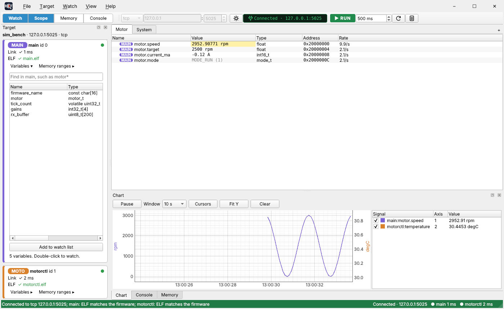
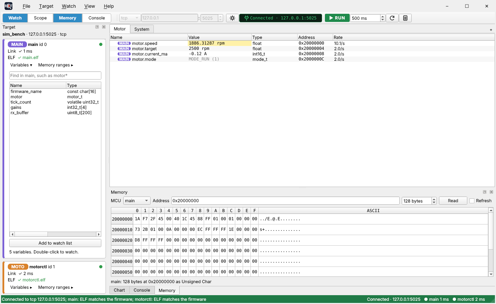
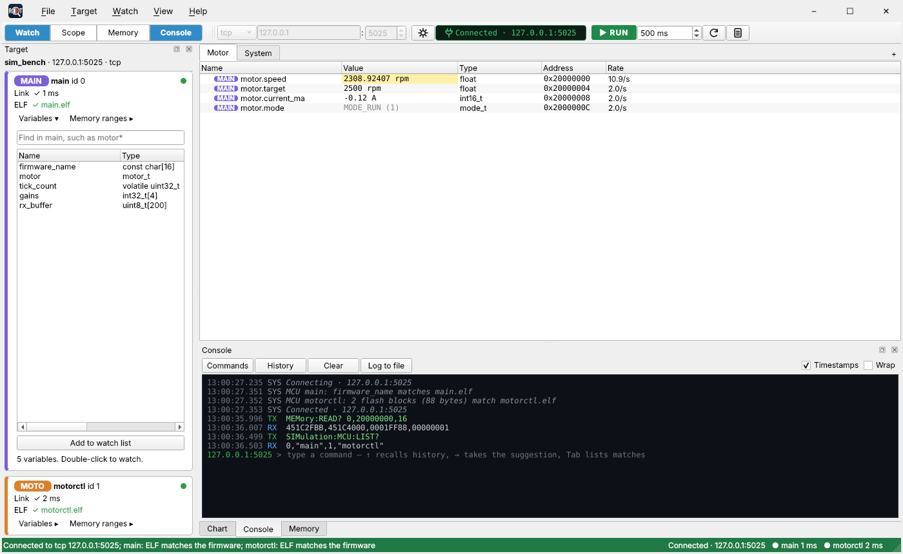
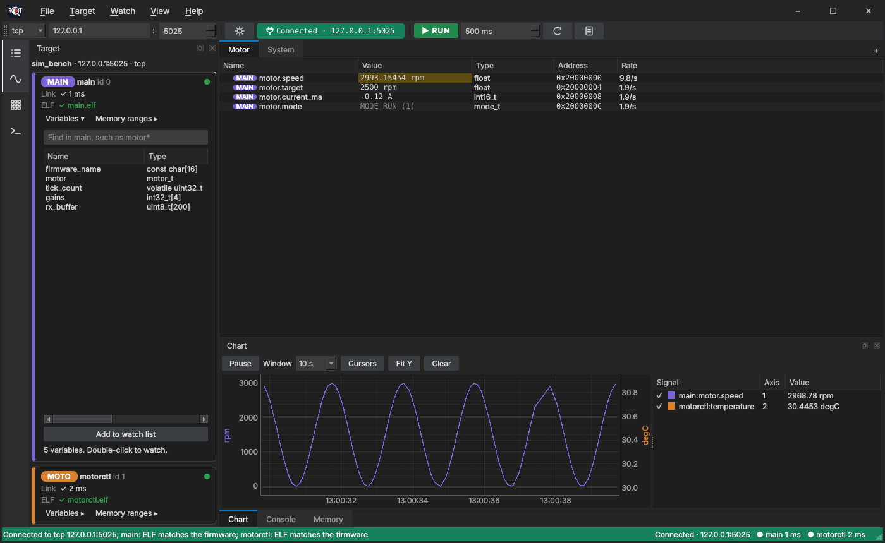

# RDT User Manual

RDT (Remote Debugging Tool) reads and writes the variables and memory of firmware that is running on a device, over the link the product already has: a COM port, or LAN with TCP or UDP. It needs no JTAG or SWD probe. It uses each MCU's ELF file to turn a variable's name into an address and a type, and talks to the firmware with the SCPI commands you define.

You can operate RDT in two ways, on the same files:

- **The GUI** (`rdt-gui`): watch tabs, a live chart, a memory view and an SCPI console. See [Part 2](#part-2-operating-from-the-gui).
- **The command line** (`rdt`): every device operation as a one-shot command, for scripts and quick checks. See [Part 3](#part-3-operating-from-the-command-line).

This manual walks through setting up a bench and operating RDT. The reference pages give every detail: [GUI.md](GUI.md), [CLI.md](CLI.md), [SIMULATOR.md](SIMULATOR.md) and [Use your own ELF](use-your-own-elf.md). The design and every requirement are in [DESIGN_DOCUMENT.md](DESIGN_DOCUMENT.md).

**Contents**

- [Part 1: Before you start](#part-1-before-you-start)
  - [Install](#install)
  - [Try it on the simulator](#try-it-on-the-simulator)
  - [What you need to know](#what-you-need-to-know)
- [Part 2: Operating from the GUI](#part-2-operating-from-the-gui)
  - [The main window](#the-main-window)
  - [Set up a bench](#set-up-a-bench)
  - [Connect](#connect)
  - [Watch variables](#watch-variables)
  - [Change a value](#change-a-value)
  - [Polling](#polling)
  - [Chart, statistics and CSV log](#chart-statistics-and-csv-log)
  - [Memory view](#memory-view)
  - [SCPI console](#scpi-console)
  - [Layout, themes and settings](#layout-themes-and-settings)
  - [Save, import and export](#save-import-and-export)
  - [Keyboard shortcuts](#keyboard-shortcuts)
- [Part 3: Operating from the command line](#part-3-operating-from-the-command-line)
  - [Choose the target](#choose-the-target)
  - [Look at the device](#look-at-the-device)
  - [Read and write](#read-and-write)
  - [Watch and log](#watch-and-log)
  - [Send SCPI commands](#send-scpi-commands)
  - [Edit a workspace](#edit-a-workspace)
  - [Exit codes and scripts](#exit-codes-and-scripts)
  - [Command summary](#command-summary)
- [Part 4: Troubleshooting](#part-4-troubleshooting)
- [Part 5: Files and where they are](#part-5-files-and-where-they-are)

---

## Part 1: Before you start

### Install

Download `RDT-Setup-<version>.exe` from the [releases page](https://github.com/rani-feldman/rdt/releases) and run it. It installs RDT for your Windows user only, in `%LOCALAPPDATA%\Programs\RDT`, with no admin rights, and everything it needs (Python and every package) comes with it.

- Windows may show "Windows protected your PC" the first time, because RDT is not signed yet: click **More info**, then **Run anyway**.
- Setup offers **Add rdt to PATH** (ticked), so the `rdt` command line works in any new terminal, and a desktop shortcut (not ticked).
- `.rdtw` workspaces open in RDT on a double-click.
- The release also has `RDT-<version>-portable.zip`: unzip it anywhere and run `rdt-gui.exe`, with nothing installed. It keeps its settings in the same place as the installed RDT.

The installation has three programs:

| Program | What it is |
| --- | --- |
| `rdt-gui` | The window (Start menu: **RDT**) |
| `rdt` | The command line |
| `rdt-sim` | The simulated device (Start menu: **RDT simulator**) |

**Upgrade:** run the newer setup. It closes RDT, removes the old version and installs the new one; your settings and workspaces are kept. RDT checks GitHub once a day and says in the status bar when a newer version is out; the first time it finds one, a window lists what changed since your version, with a **Download** button (clicking the status bar link shows it again). The check reads GitHub's public releases page, not its API, so many PCs behind one office network don't run into GitHub's request limit. Turn the check off in **Help > Check for updates at start**; **Help > Check for updates** checks now. Installing an older version over a newer one asks first. What changed in each version is in **Help > Release notes**.

**Uninstall:** Windows **Settings > Apps > Installed apps > RDT > Uninstall**. It asks whether to delete your settings and workspaces too (`%LOCALAPPDATA%\rdt`); the answer is No unless you choose Yes.

**From the source code** (to develop RDT, or on Linux), with Python 3.11 or later, from the repository folder:

```
python -m pip install -e .[dev]
```

This installs the same three commands (also `python -m rdt.gui`, `python -m rdt` and `python -m sim`).

### Try it on the simulator

Until the firmware has its memory commands, a simulated device on the same PC stands in for it. It has two MCUs, `main` and `motorctl`, each with an example ELF, and listens on TCP and UDP port 5025.

1. In one terminal, start the simulator:

   ```
   python -m sim
   ```

2. In another, open the example workspace in the GUI:

   ```
   rdt-gui examples/sim_bench.rdtw
   ```

3. Press **Disconnected · 127.0.0.1:5025** in the toolbar (or F5). It turns green, `Connected`, and the values in the **Motor** tab start to move. The **Structures** tab has structures, arrays and arrays of structures; click the arrow beside a row to open it.

The same from the command line:

```
rdt -w examples/sim_bench.rdtw info
rdt -w examples/sim_bench.rdtw read main:motor
rdt -w examples/sim_bench.rdtw watch
```

To try RDT with your own firmware's ELF in the simulator, see [Use your own ELF](use-your-own-elf.md).

### What you need to know

**Workspace.** Everything about one bench is kept in a workspace: the connection, the SCPI profile, the MCUs and their ELF files, the memory map, the watch tabs with each item's settings, the chart layout and the device's known commands. A workspace is a `.rdtw` file plus up to four files beside it, named after it:

| File | Holds |
| --- | --- |
| `bench.rdtw` | The connection, the MCUs and their ELF files, the global polling interval, the read-only default, and the names of the other files |
| `bench.profile.toml` | The SCPI profile |
| `bench.memory.toml` | The memory map: the memory ranges RDT may access besides the ELF's sections |
| `bench.watch.toml` | The watch tabs and the chart |
| `bench.commands.toml` | The device's known SCPI commands, for the console |

The GUI and the CLI read and write the same files. A plain **target file** (`.toml`) is a workspace with only the connection, profile and MCUs; you can open one and save it as a workspace.

**MCUs.** A device has one or more MCUs. MCU 0 is the main MCU: it owns the link and passes requests on to the others. Each MCU has an id, a name (letters, digits and underscores, such as `Control_CM7`) and its own ELF file.

**Expressions.** You name what to read or write with an expression that always starts with the MCU's name:

| Expression | Meaning |
| --- | --- |
| `main:tick_count` | A global variable |
| `main:motor.speed` | A struct member, to any depth |
| `main:gains[2]` | An array cell |
| `main:head->next->value`, `main:*ptr` | Following a pointer |
| `main:motor.c:state` | A file-static variable, with its source file |
| `@main:0x20000010:u32` | A raw address as a basic type (`u8 i8 u16 i16 u32 i32 u64 i64 f32 f64`) |
| `@main:0x48000000:GPIO_TypeDef.ODR` | A raw address as any type from the ELF |

The ELF must have debug info (built with `-g` or the Keil equivalent) for names and types. Without it only raw addresses work.

**SCPI profile.** RDT has no built-in firmware commands. The profile says how your firmware spells a memory read and a memory write. For example:

```toml
[scpi]
name         = "My firmware"
read         = "SERV:MEM:READ? {mcu},{addr},{len}"
write        = "SERV:MEM:WRIT {mcu},{addr},{value}"
max_write    = 4        # largest value one write takes: 1, 2 or 4 bytes
align        = 4        # every read and write covers whole aligned words of 1, 2 or 4 bytes
max_response = 1024     # bytes of data one read reply can carry
terminator   = "\n"
timeout_ms   = 500
retries      = 2
```

- `{addr}` and `{value}` are sent as bare upper-case hex with no prefix, each always 8 digits with leading zeros: address `08000000`, value `000002FF`. `{mcu}` and `{len}` are decimal.
- A write has no size. Every write RDT sends is one aligned word of `max_write` bytes (4 by default): a smaller value is written by read-modify-write of its word, and an 8-byte value (a `double` or `int64`) as two word writes, confirmed together by one read-back. `max_write` and `align` can be 1, 2 or 4. A profile saved by an older RDT still opens: RDT takes `{size}` out of its write template (and turns a `max_write` or `align` of 8 into 4), says so in the status bar, and saves the profile that way the next time you save the workspace.
- A read reply is the data as comma-separated 32-bit words in hex, lowest address first, such as `3FC00000,43B40000`.
- A failed command gets no reply at all, so RDT sees it as a timeout. RDT confirms every write by reading it back.
- RDT sends nothing to the device except your read and write commands and what you type in the console. It sends no `*IDN?` and never reads the error queue (`SYST:ERR?`) on its own.

**Memory map.** RDT refuses any access outside each MCU's ELF sections and the memory ranges you list, before sending anything. Add a range for each RAM or flash bank the firmware lets you read (`kind = "memory"`), and for each register block (`kind = "peripheral"`, read alone at its exact size and never merged with other reads). Writes to read-only sections, such as code and constants, are refused.

**ELF check.** On connect, RDT checks that each MCU runs the firmware its ELF came from, by comparing a sample of the flash (code, constants and the vector table) on the device with the ELF, or the GNU build ID when there is one. If they don't match, every read and write to that MCU is refused, so a stale ELF can never read or write the wrong address.

---

## Part 2: Operating from the GUI

Start the GUI with a workspace, or with nothing:

```
rdt-gui bench.rdtw
rdt-gui
```

With no file, it reopens the workspace you last opened or saved. If there is none, it opens `rdt.toml` from the current folder or from `%LOCALAPPDATA%\rdt`, or starts a new workspace.

### The main window



From top to bottom:

1. **Title bar row:** the RDT icon and the menus **File**, **Target**, **Watch**, **View** and **Help**, with the window buttons on the right.
2. **Toolbar:**
   - The panel buttons **Watch**, **Scope**, **Memory** and **Console** show or hide their panels.
   - The connection fields: transport (`tcp`, `udp` or `serial`) and the IP address and port, or the COM port and baud rate.
   - The **profile** button (gear icon) opens the SCPI profile.
   - The **connect button** shows the link and its state, and connects or disconnects.
   - **RUN / STOP** turns polling on and off, followed by the global polling interval.
   - **Poll now** (circular arrow) and **Log CSV** (page icon).
3. **Error bar:** a slim red bar that appears under the toolbar only when there is an error.
4. **Target panel** (left): the workspace name and its link, then one card per MCU.
5. **Watch tabs** (centre): the watched items, one tree per tab.
6. **Chart, Console and Memory** (bottom): stacked as tabs at first; drag them anywhere.
7. **Status bar:** messages on the left; on the right, the link and each MCU's latest reply time, on a strip in the link's colour.

### Set up a bench

Do this once per bench, then save the workspace.

1. **Start a workspace.** **File > New workspace**, or **File > Open...** a target file or workspace to start from (such as `examples/stm32h7_interface.rdtw`).
2. **Choose the link.** In the toolbar, pick the transport:
   - `serial`: pick the COM port (the list shows each port's description, such as `COM3 - GAC serial port (COM3)`, and is rescanned each time you open it) and the baud rate.
   - `tcp` or `udp`: type the device's IP address and port.
   The fields can only be changed while disconnected.
3. **Set the SCPI profile.** Click the gear icon (or **Target > SCPI profile...**). Fill in the read and write templates and the other fields, or press **Load from file...** to fill them from a profile file. The editor shows the commands as they will be sent and refuses a template that can't work. While connected, **Test read** sends one read with the edited profile and shows the reply and the bytes it decodes to, before you apply it; like any read, it is refused outside known memory and on an ELF mismatch. Press **OK** to apply.
4. **Add the MCUs and their ELF files.** **Target > MCUs and ELF files...** has one row per MCU:
   - **Id** and **Name**. MCU 0 is the main MCU and is required.
   - **Short name** (1 to 6 letters, digits or underscores, such as `CM7`) and **Colour**: the MCU's tag in the watch tree and its colour on the chart. Double-click the colour to choose one. Left empty, they are picked for you.
   - **ELF file**: the `.elf` or `.axf` the linker wrote for that MCU.
   - **Timeout ms**: overrides the profile's timeout for this MCU.
5. **Load the memory map.** **File > Import > Memory map...** reads the memory ranges from a memory file, or from a profile, target file or another workspace. Choose whether to add them to yours or replace them. A peripheral range that overlaps the ELF is refused and nothing changes. The GUI has no editor for single ranges; write them in a memory file (see [Memory ranges](CLI.md#scpi-profile)) and import it. Each MCU card's **Memory ranges ▸** lists what RDT may access on that MCU.
6. **Import the known commands** (optional). **File > Import > Commands...** reads a commands file (`.toml`), a CSV file or a text file with one command per line. They appear in the console's **Commands** list.
7. **Save.** **File > Save as...** writes the `.rdtw` and its files, by default in `%LOCALAPPDATA%\rdt`.

### Connect

Click the connect button, or press F5. It shows the state and the link:

| Button | Meaning | A click |
| --- | --- | --- |
| Blue `Disconnected · COM3` | Not connected | Connects |
| Amber `Connecting · COM3` | Opening the port or socket | Cancels |
| Green `Connected · COM3` | The port or socket is open | Disconnects |
| Red `Link down · COM3` | The port broke (RDT reconnects by itself), or the device answered none of the last three reads | Disconnects |

Connected means the COM port or socket opened; RDT sends nothing to check the device. An unplugged USB COM port shows as link down within a second. A board that hangs with its port still open is noticed by the next reads; with polling stopped, press **Poll now** (F6). While the link is down, writes are refused and the last values stay on screen in grey.

**The MCU cards.** Once connected, each card in the **Target** panel shows:

- A dot: green when the MCU answers and its ELF matches; amber when it is slow or a read timed out in the last minute; red when its ELF does not match or the link is down; grey when not connected, silent or not checked.
- **Link:** the MCU's reply time (`✓ 38 ms`), timeouts in the last minute, `silent: not answering`, `link down` or `not connected`.
- **ELF:** `✓ main.elf` when the ELF matches the firmware, `✗ main.elf does not match`, `? main.elf: not read` or `main.elf: not checked`.

Right-click a card for **Check ELF again**, **MCUs and ELF files...** and **Open in the memory view**.

**When the ELF does not match,** the red error bar names the MCU and every read and write to it is refused. Load the ELF that matches the firmware (**Load ELF...** on the bar), or flash the firmware that matches the ELF, then press **Check again** (or **Target > Check ELF identity**). There is no way around this in the GUI. If you flash the device while the COM port stays open, use **Target > Check ELF identity** afterwards, since RDT can't tell the firmware changed.

**A secondary MCU that stops answering** is marked silent on its own card; its items show `MCU silent` in grey, and the other MCUs keep working. RDT tries it again every 2 seconds.

### Watch variables

**Add variables.**

- Click an MCU's card (or **Variables ▸** on it) to open its list of globals. Type in the search box to filter (`motor*`, `*count`).
- Double-click a variable, or select several and press **Add to watch list**. They go to the watch tab in front.
- Or drag them onto a watch tab, onto a tab's title (hold it there to switch to that tab), or onto the chart to watch and chart them at once.
- **Watch > Add expression...** (Ctrl+E) takes any expression, such as `main:gains[2]`, `main:head->value` or `@main:0x20000000:u32`.

**Read the watch tree.** Each row shows the item's name, value, type, address and the rate it is actually read at.

- The row starts with its MCU's tag, a coloured pill with the short name, so `Control_CM7:motor.speed` shows as **CM7** `motor.speed`. Hover over the name for the full expression.
- A value that changed since the last read is highlighted in yellow for a second.
- Structs and arrays open to every field and cell. A collapsed struct or array is not read, so close what you aren't looking at to keep the link free. Arrays show 100 cells at a time; right-click > **Show 100 more cells** for the next page.
- Enums show as `NAME (n)`, `char` arrays as strings, pointers with their target's name. Right-click a pointer > **Watch what it points to** to follow it, or a field > **Watch this on its own** to give it its own row.
- Grey values are read-only. A red value is an error; hover over it for the reason. Orange means the ELF was rebuilt and the item moved or changed type; `gone` means it no longer exists.
- Hover over a row for two small buttons: a wave to add it to the chart, and ✕ to remove it from the tab.

**Item settings.** Right-click a top-level item:

- **Format**: dec, hex, bin or char, for integers.
- **Settings...**: fixed-point format (`Q15`, `Q31`, `Q3.12`), scale, offset and unit (shown = raw / 2^q × scale + offset), polling (global, manual or a time in ms), and write safety: read-only (workspace default, read-only or writable), minimum, maximum, and ask before writing.
- **Read now**, **Reset statistics**, **Add to chart**, **Also show in tab** and **Remove from this tab**.

**Watch tabs.** Each tab is its own watch list, such as one for the motor and one for the system state.

- **New tab:** the **+** at the right of the tabs, a double-click on the empty tab bar, or **Watch > New tab...** (Ctrl+Shift+T).
- **Rename:** double-click the tab, or right-click > **Rename...**. **Remove:** right-click > **Remove**. **Reorder:** drag the tab.
- **The same item in several tabs:** right-click > **Also show in tab**. It stays one item with one set of settings, read once per poll.
- Every tab keeps polling, not only the one in front.

### Change a value

1. Double-click the value (or right-click > **Write...**).
2. Type the new value in the item's units: with scale 0.001 and unit `A`, typing `1.25` writes 1250. Enums take their names (`MODE_RUN`); `char` arrays take a string; integers take `42`, `-7`, `0x1F` or `0b101`.
3. Press Enter (or click elsewhere). RDT writes the value and reads it back to confirm it. Esc cancels, and an unchanged value is not written.

The write is refused, with the reason in the error bar, when the item is read-only, the value is outside its minimum and maximum, or the MCU's ELF does not match. Items set to ask first show a confirmation. **Watch > All items read-only** makes every item read-only unless its settings say Writable, and also blocks writes from the memory view. The memory view also refuses a write over a watched read-only item and asks first over one that asks before writing.

Writes are always whole 4-byte words (the profile's `align`). A smaller value is written by reading its word, changing the bytes and writing the word back; if the firmware changes a neighbouring value in that moment, its change is lost.

### Polling

- **RUN / STOP** (F7, also **Watch > Poll automatically**): green `▶ RUN` while polling; click it to stop all polling, including items with their own interval, and it turns red `■ STOP`. Polling is on when RDT starts.
- The interval next to it is the global polling interval (500 ms by default). `Off` stops the global polling only.
- **Poll now** (F6): reads every watched item once, in every tab, whether polling runs or not.
- Each item can follow the global interval, have its own, or be manual (read only by **Poll now** or **Read now**).

Items close together on the same MCU are read in one command, so they come from the same moment. A slow link makes items fall behind instead of queueing; the **Rate** column shows what each item actually gets.

### Chart, statistics and CSV log

**Chart.** Press **Scope** (Ctrl+2) to show the chart. Add values by right-click > **Add to chart**, by selecting rows and pressing Ctrl+G, with the hover wave button, or by dragging them onto the chart. Values from any MCU can share it, each drawn in its MCU's colour.

- **Window** sets how much time is shown (1 s to 10 min); each signal keeps the last 10 minutes.
- **Pause** (Space) freezes the view while data keeps coming in; dragging or zooming pauses too. **Run** goes back to following.
- The mouse wheel zooms, dragging pans; over a Y axis the wheel zooms only that axis. **Fit Y** rescales.
- Up to four Y axes; signals with the same unit share one. Right-click a signal to move it to another axis, change its colour or remove it.
- **Cursors** shows two cursors with each signal's value at both, and the time and frequency between them.
- **Clear** drops the recorded data and keeps the signals.

**Statistics.** **View > Statistics columns** (Ctrl+T) adds **Min**, **Max**, **Mean** and **Samples** for every numeric value. **Watch > Reset statistics** starts them again; right-click an item for that item alone.

**CSV log.** Press **Log CSV** (Ctrl+L) and choose a file. RDT writes one row per poll, with every value the watch tabs show, until you press it again. The file opens in Excel; lost links and ELF rebuilds are marked in its `event` column. See [CSV log](CLI.md#csv-log) for the format.

### Memory view



Press **Memory** (Ctrl+3). Choose the MCU, type an address (`0x20000000`) or a variable name (`motor`), set the length, and press **Read**. Tick **Refresh** to read again at the global polling interval.

- Right-click the dump to change how cells show: **Unsigned** or **Signed** **Char** (8 bits), **Short** (16), **Int** or **Long** (32), in hex or with **Decimal** ticked; **Ascii**; **Float**; **Double**. The default is the plain hex bytes with an ASCII column. The choice is remembered.
- Double-click a cell, type a new value in the shown format, and press Enter to write it.
- Reads and writes outside the MCU's known memory are refused, as everywhere else.

### SCPI console



Press **Console** (Ctrl+4). The console is a terminal, dark or light with the theme: each line has its time, a tag (`TX` sent, `RX` reply, `ERR` error, `SYS` RDT's own notes) and the text. Type a command on the last line, after the prompt (`COM3 >`), and press Enter.

- A command whose header ends in `?` waits for a reply. A failed command gets no reply, so it shows `(no reply)`; type `SYST:ERR?` to read why from the firmware's error queue.
- As you type, a list of matching commands from your history and the known commands opens, with the best match in grey after the cursor. → takes the grey text; ↑ and ↓ move in the list; Tab or Enter takes the highlighted command; Esc closes the list.
- Up and Down walk through the history, which is kept per user and shared with `rdt console`.
- **Commands** shows the known commands by group, with a filter. Double-click one to put it on the prompt line, fill in its values and press Enter. **Import...**, **Export...** and **Clear** manage the list.
- **History** shows past commands; double-click or **Send** to send one again.
- Ctrl+F searches the transcript, Ctrl+K clears it, Ctrl+= and Ctrl+- change the text size, **Wrap** wraps long lines, **Timestamps** shows or hides the times.
- **Log to file** appends every line to a text file until you click it again.
- Right-click the transcript for **Send break (250 ms)** on a COM port, and to turn a selection into hex or hex back into text.

The console can be used while polling runs. Sending is disabled unless the link is up.

### Layout, themes and settings

- **Panels:** the **Watch**, **Scope**, **Memory** and **Console** buttons (Ctrl+1 to Ctrl+4) show or hide their panels. Drag a panel's title bar to dock it elsewhere, stack it as a tab or float it. **View > Target** shows or hides the MCU cards. The layout is saved when you close RDT; **View > Save layout** (Ctrl+Shift+S) saves it at once and **View > Reset layout** puts every panel back.
- **View > Theme:** System, Light, Dark, Studio dark, Islands, Instrument or Light pro. In Studio dark the panel buttons become an icon strip down the left edge.
- **View > Density:** Compact rows or Comfortable rows.



The theme, density, console text size, memory view format and layout are kept per user in `%LOCALAPPDATA%\rdt\ui.toml`, not in the workspace.

### Save, import and export

- **File > Save** (Ctrl+S) writes the `.rdtw` and its files side by side. The title shows `*` while there are unsaved changes, and closing asks whether to save.
- **File > Import** and **File > Export** move one part at a time between workspaces:
  - **Watch list:** the watch tabs and the chart. Import adds the tabs to yours or replaces them.
  - **Commands:** the known commands, as `.toml` or CSV.
  - **Memory map:** all the memory ranges. Import adds or replaces them, and RDT reconnects to use the new map.
  - **Interface settings:** your theme, density, console and memory view settings.

### Keyboard shortcuts

**Help > Keyboard shortcuts** (F1) lists all of them. **Help > Video walkthrough** plays a narrated video of RDT in use, and **Help > Presentation** opens this manual as slides. The main ones:

| Keys | Action |
| --- | --- |
| F5 | Connect or disconnect |
| F6 | Poll now |
| F7 | RUN / STOP polling |
| Ctrl+E | Add expression |
| Ctrl+G | Add selected to chart |
| Ctrl+L | Log to CSV |
| Ctrl+T | Statistics columns |
| Ctrl+1 to Ctrl+4 | Show or hide Watch, Scope, Memory, Console |
| Ctrl+Shift+T | New watch tab |
| Ctrl+PgDown / Ctrl+PgUp | Next / previous watch tab |
| Delete | Remove the selected items |
| Ctrl+Shift+S | Save layout |
| Ctrl+N, Ctrl+O, Ctrl+S | New, open, save workspace |
| Space (in the chart) | Pause or run the chart |
| Ctrl+F, Ctrl+K (console) | Find in the transcript, clear it |
| F1 | Keyboard shortcuts |

---

## Part 3: Operating from the command line

`rdt` does what the GUI does, one command at a time. Every command has `--help`, such as `rdt read --help`.

### Choose the target

Every command that talks to the device needs a workspace or target file:

```
rdt -w bench.rdtw info              # a workspace (-t is the same option)
rdt info                            # rdt.toml from this folder, else from %LOCALAPPDATA%\rdt
```

Options override what the file says:

| Option | Meaning |
| --- | --- |
| `--serial COM5 --baud 115200` | Use a COM port |
| `--tcp HOST:PORT`, `--udp HOST:PORT` | Use LAN |
| `--profile FILE` | Use another SCPI profile |
| `--timeout MS` | Reply timeout for every MCU |
| `--mcu NAME=ID[:ELF]` | Define the MCUs (repeat for each); replaces the file's |
| `--allow-mismatch` | Let this command read and write an MCU whose ELF does not match its firmware |
| `-v`, `-vv` | Log link events; log every command and reply |

With no file at all, give the link, profile and MCUs on the command line:

```
rdt --serial COM5 --profile fw_profile.toml --mcu main=0:build/main.elf read main:motor
```

### Look at the device

```
rdt -w bench.rdtw info                    # the link, the profile, each MCU's ELF check and memory map
rdt -w bench.rdtw symbols main 'motor*'   # find variables (no device needed)
rdt -w bench.rdtw ptype main:motor        # a variable's address and its type's layout (no device needed)
```

`info` on the simulator:

```
Link:          tcp 127.0.0.1:5025
Profile:       RDT simulator
Max response:  1024 bytes
MCU 0 main (main.elf, little endian)
    identity: match, 3 flash blocks (112 bytes) match main.elf
    0x08000000        80  ro  section     .text
    0x20000000        36  rw  section     .data
    0x48000000      1024  rw  peripheral  GPIOA
MCU 1 motorctl (motorctl.elf, little endian)
    identity: match, 2 flash blocks (88 bytes) match motorctl.elf
```

### Read and write

```
rdt -w bench.rdtw read main:motor motorctl:temperature
rdt -w bench.rdtw read                       # every item in the workspace's watch tabs, scaled
rdt -w bench.rdtw read --tab Motor           # one tab's items
rdt -w bench.rdtw write main:motor.target 2500
rdt -w bench.rdtw dump main 0x20000000 64    # hex and ASCII dump
rdt -w bench.rdtw dump main:rx_buffer        # a variable's bytes
rdt -w bench.rdtw poke main 0x20000010 01020304   # raw bytes, lowest address first
```

`read` opens a struct or array to every field and cell, one line each, so any line can be copied into `write`:

```
main:motor  motor_t, 16 bytes at 0x20000000
main:motor.speed      = 1.5            float
main:motor.target     = 3000           float
main:motor.current_ma = -120 (0xFF88)  int16_t
main:motor.enabled    = 1 (0x01)       uint8_t
main:motor.mode       = MODE_RUN (1)   mode_t
```

`write` takes one value: `42`, `-7`, `0x1F`, `0b101`, `1.5`, `true`, an enum name such as `MODE_FAULT`, or `'A'`. Every write is read back to confirm it:

```
$ rdt -w bench.rdtw write main:motor.target 2500 -y
main:motor.target = 2500 rpm (confirmed by read-back)
```

A watched item's scaling and write safety apply: the value is in its units, a read-only item refuses the write, a value outside its limits is refused, and an item set to confirm asks first (`-y` answers yes).

### Watch and log

```
rdt -w bench.rdtw watch                                  # every watched item, each at its own interval
rdt -w bench.rdtw watch main:motor.speed -i 100 -n 50    # one item every 100 ms, 50 samples
rdt -w bench.rdtw watch --tab Motor --csv run1.csv       # also log to a CSV file
```

`watch` prints one line per sample until Ctrl+C. It keeps running through a lost link, shows `link-down` and reconnects on its own; it also reloads a rebuilt ELF and prints a `#` line for each item that moved or no longer exists.

```
time          main:motor.speed  motorctl:temperature
12:59:28.464    502.501373 rpm       24.9287701 degC
12:59:28.568    195.573624 rpm       24.9287701 degC
```

### Send SCPI commands

```
rdt -w bench.rdtw send "SYST:ERR?"                      # a query waits for its reply
rdt -w bench.rdtw send "MOT:STOP"                       # a command doesn't
rdt -w bench.rdtw send "*IDN?" --expect "^ACME,"        # exit code 11 if the reply doesn't match
rdt -w bench.rdtw console                               # interactive console
```

In `rdt console`, type SCPI commands as in the GUI console. Lines starting with `.` are RDT's own: `.read EXPR`, `.write EXPR VALUE`, `.history`, `!N` (send history entry N again), `.commands`, `.info`, `.reconnect`, `.break` and `.quit`; `.help` lists them. Tab completes from the history and known commands. `--timestamps` shows each line's time and `--log FILE` appends the session to a text file.

### Edit a workspace

These need no device:

```
rdt --serial COM3 --profile fw_profile.toml --mcu main=0:build/main.elf init bench.rdtw
rdt -w bench.rdtw add main:motor.speed --tab Motor --unit rpm --poll 100
rdt -w bench.rdtw add main:motor.target --min 0 --max 3000 --confirm
rdt -w bench.rdtw add main:motor.mode --read-only
rdt -w bench.rdtw list
rdt -w bench.rdtw remove main:motor.speed --tab Motor
rdt -w bench.rdtw tab add Tuning
rdt -w bench.rdtw tab rename Tuning Gains
rdt -w bench.rdtw read-only on                  # every item read-only unless added with --no-read-only
```

`add` options: `--tab`, `--format dec|hex|bin|char`, `--q Q15`, `--scale`, `--offset`, `--unit`, `--poll MS|global|manual`, `--read-only`/`--no-read-only`, `--min`, `--max`, `--confirm`/`--no-confirm`.

Import and export, the same as the GUI's **File > Import** and **Export**:

```
rdt -w bench.rdtw memory import h7.memory.toml          # add ranges; --replace replaces them
rdt -w bench.rdtw memory export h7.memory.toml
rdt -w bench.rdtw watchlist export motor.watch.toml
rdt -w other.rdtw watchlist import motor.watch.toml     # --replace replaces the tabs and chart
rdt -w bench.rdtw commands import gac.csv               # .toml, .csv or a text list
rdt -w bench.rdtw commands list SPEED
rdt ui show                                             # the GUI's per-user settings and where they are
rdt history -n 50                                       # the saved console history
```

### Exit codes and scripts

| Exit code | Meaning |
| --- | --- |
| 0 | Success |
| 1 | Anything failed: the message on stderr says what |
| 11 | `send --expect` got no reply, or a reply that doesn't match |

For longer scripts, use the Python API that the CLI and GUI are built on; see [Python API](CLI.md#python-api):

```python
from rdt import Target

with Target.from_file("bench.rdtw") as t:
    print(t.read_value("main:motor.speed"))
    t.write_value("main:motor.mode", "MODE_RUN")     # confirmed by read-back
```

### Command summary

| Command | What it does | Device |
| --- | --- | --- |
| `info` | The link, profile, each MCU's ELF check and memory map | Yes |
| `symbols MCU [PATTERN]` | List or search an MCU's variables | No |
| `ptype EXPR` | A variable's address and its type's layout | No |
| `read [EXPR...] [--tab NAME]` | Read values; with no names, the watched items | Yes |
| `write EXPR VALUE [-y]` | Write one value and confirm it | Yes |
| `dump EXPR [LEN]`, `dump MCU ADDR LEN` | Hex and ASCII dump | Yes |
| `poke MCU ADDR HEX` | Write raw bytes and confirm them | Yes |
| `watch [EXPR...] [--tab] [-i MS] [-n N] [--csv FILE]` | Poll and print, optionally log to CSV | Yes |
| `send COMMAND [--expect REGEX]` | Send one SCPI command | Yes |
| `console [--timestamps] [--log FILE]` | Interactive SCPI console | Yes |
| `init FILE` | Save the target as a new workspace | No |
| `list`, `add`, `remove`, `tab`, `read-only` | Edit the watch tabs and write safety | No |
| `memory`, `watchlist`, `commands` | Import and export parts of the workspace | No |
| `ui`, `history` | Per-user GUI settings and console history | No |

---

## Part 4: Troubleshooting

Turn on `-vv` on the command line to see every command RDT sends and every reply; in the GUI, the console shows RDT's notes.

| What you see | Why | What to do |
| --- | --- | --- |
| Every read times out | The firmware does not answer the read command as written, or the link settings are wrong | Check the profile's read template and terminator; try the command by hand in the console; use **Test read** in the profile editor; type `SYST:ERR?` to read the firmware's error |
| `Link down`, and the port is still open | The device answered none of the last three reads | Check the board is running; reset it if it hung. The link comes back with the first reply |
| `Link down` after unplugging | The COM port disappeared | Plug it back; RDT reconnects by itself |
| `ELF does not match the firmware` | The device runs another build than the ELF | Load the matching ELF or flash the matching firmware, then **Check again** |
| `outside the MCU's known memory` | The address is in no ELF section or listed range | Add the bank or register block to the memory map, if the firmware allows reading it |
| `read-only` | The item, the workspace default or the section (code, constants) is read-only | Change the item's settings, or turn off **All items read-only** |
| `not confirmed: wrote ..., read back ...` | The value read back differs from the one written | The firmware may have changed it, or refused the write; check with `SYST:ERR?` |
| `MCU silent` | A secondary MCU stopped answering (three timeouts in a row, or a `-240` error) | Check that MCU; RDT tries it again every 2 seconds |
| A reply is refused (`BadReply`) | The reply is not comma-separated hex words, or has the wrong number of words | Check the firmware's reply format and the profile's `align` |

Some memory, such as registers, or a core's tightly coupled memory reached through another MCU, can upset the firmware when read. Add only regions the firmware can read safely to the memory map, and keep register blocks as `kind = "peripheral"` so they are read alone at their exact size.

---

## Part 5: Files and where they are

| File | Where | What |
| --- | --- | --- |
| `bench.rdtw` and its `.profile.toml`, `.memory.toml`, `.watch.toml`, `.commands.toml` | Side by side, by default in `%LOCALAPPDATA%\rdt` | The workspace |
| `rdt.toml` | The current folder, else `%LOCALAPPDATA%\rdt` | The default target or workspace when none is given |
| `ui.toml` | `%LOCALAPPDATA%\rdt` (`RDT_UI_FILE` overrides) | The GUI's per-user settings and layout |
| `console_history.txt` | `%LOCALAPPDATA%\rdt` (`RDT_HISTORY_FILE` overrides) | The console history, shared by the GUI and CLI |
| Symbol cache | `%LOCALAPPDATA%\rdt\cache` (`RDT_CACHE_DIR` overrides) | Parsed ELF files, so a large ELF loads fast; safe to delete |
| `sim.toml` | The current folder | The simulator's default config |
| `logs\rdt.log` | `%LOCALAPPDATA%\rdt\logs` | The GUI's warnings and unexpected errors; safe to delete |
| The installed RDT | `%LOCALAPPDATA%\Programs\RDT` | The programs, the example workspace (`examples`) and the simulator's files; removed by uninstall |

The file formats are in [CLI.md](CLI.md#workspace), and the simulator's in [SIMULATOR.md](SIMULATOR.md#config).
